# SophoNote 技术架构设计

> 文档状态：当前唯一技术架构真相源
>
> 基线日期：2026-09-15
> 设计增补：2026-10-13 自动路由与受控协作，见 §23.13（单执行器自动路由已编码、宿主验收待完成；协作待实现）
>
> 适用项目：本仓库根目录
>
> 开源读者：产品需求以 [PRD](./PRD.md) 为准；进展、问题与后续事项以[项目台账](./project-ledger.md)为准。正文为中文。历史草稿不在本仓库，不能覆盖本文。本文同时标注“当前实现”和“目标整改”，不得把目标写成已完成。社区入口成对维护：[README.md](../README.md)（English）与 [README.zh-CN.md](../README.zh-CN.md)（简体中文）。

## 1. 背景、目标与设计范围

SophoNote 是 Tauri v2 驱动、面向知识工作者的 macOS 本地优先 AI 工作环境。系统从资讯聚合器演进为包含发现、项目任务、Markdown 笔记、隐藏知识层、Agent 记忆、工具、Browser、代码工作区、Agent Runtime、Skill 和 MCP 的单体桌面应用；**Hermes、Pi、Claude Code、OpenCode 是由 Host 自动路由、按会话绑定的执行引擎，SophoNote 保持产品控制面、数据真相源、权限与审批所有权**。当前架构既要完成现有性能/发布收口，也要支撑新版“项目一级入口 + 任务执行 + 本地目录上下文与交付”的产品结构。核心挑战是：

1. 在不牺牲本地数据可靠性的前提下，让输入、预览、文档和页签切换达到写作工具应有的响应速度。
2. 让 Inline Completion 与完整 Agent Run 复用模型配置、各自使用合适的执行协议，但保持不同的延迟、状态和生命周期。
3. 让 Agent、Skill 和 MCP 可以读取项目材料、提出修改，但永远不能绕过用户审批和 DocumentService 直接覆盖 Markdown。
4. 在 `.md` 文件、SQLite、前端编辑器状态和异步运行事件之间建立清晰的真相源与恢复边界。
5. 收敛此前分散在多份设计、状态和审计文档中的架构口径。
6. 让一级会话页、工作室/笔记本嵌入面板和工作室项目会话共享同一 Thread/Run/所选引擎 Session，并让发现/收件箱/工具通过受控 ContextHandoff 交接上下文，同时保持页面、项目与资料作用域透明且隔离。
7. 允许会话先以无项目的快捷工作开始、后续归属项目，但不复制历史、不静默扩大长期记忆或工具权限。
8. 在不引入第二文档真相源或第二长期记忆库的前提下，为笔记、项目、Claim、Decision 和 Artifact 建立可定位到 Git Commit/Blob/语义锚点的版本证据，并在证据变化时触发增量索引和受控复核。
9. 把 Hermes 已有 Browser 管理能力提升为会话、工作室、笔记本共用的可见 Browser，同时处理用户接管、页面状态、登录/下载/表单等副作用和审计。
10. 让会话临时绑定目录、工作室持久绑定仓库，并提供代码编辑、Git Diff、Terminal 与 Preview；外部工作树不得与受控 Markdown 的 DocumentService 写入语义混用。

设计范围覆盖当前仓库的 React 前端、Tauri IPC、Rust 后端、SQLite/sqlite-vec、Markdown 文件与资产、模型调用、Agent/Skill/MCP、调度抓取、测试和发布流程。自建云端控制面、多端同步和多人协同不在当前架构范围；外部模型服务与可选火山托管 OpenViking 的接入边界属于本架构。

单执行器自动路由已按 §23.13 编码并接入 Composer，真实宿主验收待完成；跨引擎子任务和有界执行图仍为目标架构，尚未实现。既有的固定会话执行链继续承担选定引擎后的原生执行。设计不要求统一原生历史或新建模型代理。

### 1.1 Rust 宿主与客户端分工（当前代码）

| 层 | 当前职责 | 代码入口 |
|---|---|---|
| 系统 WebView + React | 中文界面、编辑器、模型/引擎选择、统一消息/审批/错误渲染；不直接管理本地文件或模型密钥 | `src/App.tsx`、`ProjectChatPanel.tsx` |
| Rust 产品服务 | SQLite、Markdown、Keychain、抓取/embedding、文档 CAS/版本锚点/原子写与审计 | `commands.rs`、`documents/service.rs`、`model/*` |
| Rust Agent Host | 解析固定引擎、校验模型/目录/附件、Run claim、进程/取消、适配事件、持久化再推 UI | `agent/commands.rs`、`agent/pi/mod.rs`、`agent/store.rs` |
| 原生引擎 | Hermes/Pi/Claude Code 各自维护模型回合、工具调度和原生历史；模型 HTTP 由对应进程执行 | `agent/hermes/*`、`agent/pi/transport.rs`、`agent/claude/transport.rs` |
| 工具副作用 | Pi/Claude 回 Rust 审批/路径/沙箱后执行；Hermes 原生工具由受监督 Runtime 执行，产品文档最终由 Host 回收审阅 | `agent/pi/tools.rs`、Hermes Surface/工作副本适配 |

Rust 是有业务职责的本机控制层，不只是转发器；也没有另造一套模型推理/Agent 规划循环。统一业务 DTO/事件不要求三个运行时实现相同协议或同一 Rust trait。

### 1.2 轻量客户端：已实现措施与待测预算

Tauri 2 使用系统 WebView（macOS WKWebView），前端打包静态 React/TypeScript 资源；应用界面不捆绑 Chromium，也不常驻一个 Node Web 服务。随包 Hermes/CPython 与 Pi 独立运行时、外部 Claude CLI 属于额外执行成本，不能计成“零成本 sidecar”。

- `App.tsx` 使用 `lazy/Suspense`，`pagePreload.ts` 按 hover/focus/空闲加载页面。
- `pageKeepAlive.ts` 只保活 Notes/Studio，最多两个；轻量页卸载，隐藏页停昂贵订阅/快捷键，原生子 WebView 停泊。
- `ProjectChatPanel` 历史窗口化，流式稳定块与活跃尾部分开；编辑器按变更驱动保存，不空闲序列化。
- Pi/Claude 每轮启动进程，终态/取消回收；Hermes 由启动与健康监督链管理。应用还有发现状态 15 秒轮询和后台任务，不能称全部按需或全局零轮询。
- `.md`/SQLite 磁盘优先已成立；Hot/Warm/Cold、跨进程 ResourceBudgetManager/lease/FTS-only 压力治理仍是 NEXT-055 方案，未编码为完整预算执行器。

整 App 性能口径要统计 Rust、WebView、全部活跃引擎、Browser/电脑驱动、子工具与可选本地模型的进程树峰值、空闲 CPU 与启动时延。知识/记忆 `<1 GiB` 是独立增量预算目标，不含基础引擎，不代表整 App 内存上限；火山托管 OpenViking 的服务端 RSS 与本机分账。当前只有已登记的编辑/切换夹具结果，不能声称三引擎并发资源基线已通过。

### 1.3 实现与目标的关键区别

当前已有文档/选区、目录与权限的 Run 内校验；Pi/Claude 持有不可变 `tools::Scope`，前端有 `WorkspaceScopeSnapshot`。这不等于已实现跨域 `AgentScopeProvider`、`scope_type/scope_id` 或 `scope_snapshot_json` 持久化（NEXT-031/035）。笔记本已可交付工作副本 Diff，但独立 document Thread/Memory scope 仍未完成。

当前 Pi/Claude 普通文件由 Rust `tools::execute` 在复核/批准后原子写入；`edit` 要求唯一 oldText，`write` 并不提供完整版本化 CAS。通用 CodeChangeSession/CodeChangeService、逐文件/逐 hunk 代码审查与 PreviewSupervisor 仍是后续方案。笔记 `notes/` 不使用这条直接文件路径，继续走 DocumentService。

`agent_thread_create` 仍有 Hermes Gateway 环境检查，而 `agent_run_start` 已按 engine 分派；这是新建入口的遗留耦合，NEXT-075 继续跟进。本节只核查并记录，不把独立 Run 协议接入等同于彻底移除 Hermes 启动依赖。

### 1.4 项目与任务入口（2026-09-18）

产品导航使用“项目”，兼容内部 `conversation` 路由；`ai-studio` 旧入口重定向项目页，不再挂载隐藏工作室。界面任务沿用 Thread/Run/原生 Session，不新建第二套任务存储。项目首页展示卡片与创建入口；空列表不渲染引导卡，项目会话面可关闭空态展示但保留输入与加载/错误反馈。进入后显示按 `agent_threads.project_id` 隔离的会话目录；顶部项目名只读展示，回首页选择项目后切换 scope，保留本页各项目最近打开的任务。任务操作菜单仅保留置顶/取消置顶与归档；移除所属项目选择器及页面专用移动处理，保留 Host 关系移动契约，运行中禁用归档。返回首页卸载会话面板但不取消 Run。旧 collection 和归档元数据保留，移除未归属任务入口；项目页只加载并展示有效项目内任务。无项目或项目被删除时返回首页，不挂载可发送面板。创建弹窗分“新建文件夹/使用已有文件夹”；前者使用原生目录选择器的创建目录能力，Rust 只接收最终已存在的目录，继续同事务保存项目/绑定。

`project_create` 接收可选 `workspaceRoot` 兼容参数：新项目界面强制选择目录，Rust canonicalize 后在同一 SQLite 事务中创建 projects 和 `ui:project-workspace:<id>` 绑定。旧入口兼容无目录项目，补选后才能得到文件范围。项目任务只使用项目绑定；底层可空 Thread 归属仅保留给历史数据和笔记内嵌会话兼容，不提供独立项目任务入口。目录加载期间停止挂载可发送面板，避免旧目录在切项目后短暂泄漏。

项目文件浏览复用 Rust `local_workspace_scan/list_directory/read`，按用户展开目录和打开文件有界读取；加入任务只传显式文件附件，仍由 Host 校验。交付文件写入沿用各引擎已有 Workspace/审批工具，受管笔记仍唯一经 DocumentService。任务移动事务拒绝空目标并检查目标存在与无非终态 Run，保留旧 Run 的项目审计与原生 Session，清理旧任务目录绑定；不会自动沉淀 Memory。

### 1.5 笔记目录与项目扩展（2026-09-22）

笔记目录采用 SQLite `notebook_folders(id,name,parent_id)` 与 `notebook_entries(article_id,folder_id)` 保存组织关系，与 `project_documents` 隔离。Rust 校验父级存在、同级唯一、循环移动与笔记类型；删除仅允许空文件夹，删除文章同步清理目录关系。新增笔记沿用 `notes::insert_article` 的 Markdown 唯一新建路径，扩展为可选文件夹参数，在同一数据库事务中保存索引和归属；文件/数据库仍不宣称跨介质原子性。正文路径继续为 `notes/<id>.md`，移动文件夹/笔记不重命名文件、不变更正文版本或双链。`db_get_articles(includeNotebook=true)` 在最近报告之外完整返回 manual/journal 笔记，避免目录关系完整而笔记被 200 篇列表上限截断；正文仍沿用文件回填。`DocWorkspace` 只持有目录快照与视图状态，编辑草稿、Change Session、日期聚合和保存队列沿用既有实现。

项目 `ProjectExtensions` 负责 AI 对话上方工具行、扩展菜单与可缩放右栏，`ProjectChatPanel(showBrowserTab=false)` 保留单一会话内核。右栏按需装载 `ProjectFilesPanel`、人工模式 `AgentBrowserPanel` 或 `LocalTerminal`，项目切换按项目 ID 隔离；宽度经 settings 持久化，splitter 复用 `VerticalResizeHandle`。Browser 人工模式不调用 Hermes 能力连接，仍使用原生子 WebView，关闭即释放；终端仅在非计划模式显式打开时启动 Rust PTY，卸载回收。扩展只传显式附件给现有 Composer，不持有 Run 或引擎权限状态。手动终端沿用本机用户权限，项目目录是 cwd 而非文件系统沙箱；不将终端入口自动暴露为 Agent 工具。

## 2. 功能与非功能需求

### 2.1 功能需求摘要

- 当前一级页面：Discover、项目（内部 Conversation）、Notes、Scheduled Tasks、Tasks，Studio 隐藏并重定向项目，Settings 为辅助入口；Inbox 保留为 Settings 子页面，旧 Library 页面停止挂载。收件箱接管旧 Library 的信息条目检索与索引能力，并作为首次拉取起严格保留 168 小时的短期池。知识层隐藏在项目/笔记/资料/会话之下提供检索、版本、证据和关系；Agent 长期记忆由火山 OpenViking 保存目标、约束、偏好、决策和未完成状态（§23.12）；未来 Artifacts 只做来源对象投影。
- 多源抓取、正文与证据获取、证据化 AI 解读、日报候选和语义搜索。
- Markdown 文档创建/编辑/预览/分屏、双链、任务、模板、资源、导出。
- 独立 Inline Completion，支持取消、缓存、过滤和聚合指标。
- 本地文件工作室、多轮三引擎 Chat、事件恢复与审批；Hermes 原生 Skill/MCP。旧项目 Article 树仅兼容，不是当前主界面。
- 新版目标：一级会话中心、工作室/笔记本嵌入 Agent、发现/收件箱/工具 ContextHandoff、会话内运行状态、显式 ScopeSnapshot、会话后归属项目和跨产品域的受控工具调用。
- 会话、工作室、笔记本共用可见 Browser；会话和工作室支持 WorkspaceBinding、代码文件树/编辑、Git Diff、Terminal、应用 Preview 和 Agent 验证。
- 选区快照、TextAnchor、Range Patch、逐 hunk 审阅、冲突保护、操作审计和撤销。
- 目标隐藏知识能力：笔记/项目 Git 语义版本、EvidenceAnchor、Claim/Decision/Artifact、版本感知检索、变更影响和 Hermes Memory 证据绑定；只由项目、笔记、资料、会话与未来 Artifacts 投影消费，不提供独立 Library UI。

### 2.2 非功能需求摘要

- 输入和导航响应指标、空闲零序列化、分屏预览追平指标以 PRD §3/§12 为准。
- Markdown 不丢字；保存失败不可假成功；同文档写入串行、Patch 幂等。
- Rust 拥有所有文件、数据库、网络、模型和子进程副作用。
- 文档修改采用最小权限、默认拒绝、用户审批和可审计事件。
- 本地数据可导出、可恢复；隐藏页面和后台任务不得拖慢写作主线程。
- Git 建版、索引和影响分析必须异步、幂等、可取消/重试；不得跟踪 DB/密钥/临时文件或扫描未授权路径。
- 真实宿主验证是发布门禁，自动测试不能替代 WKWebView 生命周期验证。
- Browser 页面、代码编辑器、Terminal 与 Preview 必须懒加载、有界缓存、可暂停/回收；不得以能力对齐为由引入无界 WebView 或子进程常驻。

## 3. 设计原则与技术约束

1. **单仓单体、受控执行进程**：Hermes Gateway 使用 loopback WebSocket + 随机端口/Token；Pi 使用 stdin/stdout JSONL RPC；Claude Code 使用 stream-json，并通过逐 Run 鉴权的 loopback MCP 调用 Rust 工具。Hermes/Pi 随包或使用已验证私有槽，Claude Code 明确依赖本机官方 CLI。Rust 监督生命周期，产品控制面与 Markdown 真相源不下沉到引擎。

2. **副作用后置于 Rust**：前端不得直连第三方 HTTP、模型或任何 Agent 引擎；WKWebView 只 invoke SophoNote。避免 CORS、密钥泄露和多套网络策略。
3. **真相源唯一、职责分离**：`notes/<articleId>.md` 是当前正文；SQLite 保存元数据、索引、任务、Run 和审计。每个引擎在私有目录维护原生会话，Thread 保存引擎与外部会话映射；RunStore 是统一 UI/重放/恢复真相源。Agent 长期记忆正文由可选的火山托管 OpenViking 持有（§23.12），Hermes 原生 MEMORY/USER 关闭；不把各引擎 transcript 冒充共享记忆，也不在本地再建第二套记忆库。目标 Git 语义版本与 SQLite 投影仍与当前正文分层。

4. **框架类型不外泄**：Rig、Hermes JSON-RPC/WS、Pi JSONL RPC、Claude stream-json、rmcp、Milkdown 内部类型只出现在 Adapter/Transport/ToolGateway/编辑器封装处；业务 DTO、SQLite 和前端 store 不绑定框架。
5. **按真相源设置安全写入口**：笔记工作副本只产生 DocumentService dry-run 提案，接受后 CAS/锚点复核落盘。Pi/Claude 当前普通文件通过 Rust 工具的路径/权限/批准与原子写入；CodeChangeService/逐 hunk 代码审查为后续目标。Hermes 原生工具仍受 Host 显式范围约束。两种正文域不得旁路混写。
6. **交互优先调度**：输入/点击为高优先级，序列化、预览、关系分析、embedding 和抓取为低优先级异步工作。
7. **恢复机制与知识版本分层**：内部 version、operation 和短期 checkpoint 只用于并发安全/事故恢复；Git 语义版本只在有知识意义的 checkpoint 形成，用于长期溯源、比较和受控恢复。两者不互相替代，普通自动保存不产生 Commit。
8. **渐进迁移**：SQLite 建表/补列、文件迁移和 operation 恢复必须幂等；升级失败不得破坏已有正文。新增引擎必须先完成协议、权限与事件契约验证，再开放入口；现有 Thread 不换绑原生历史。历史 Rig 不注册产品路径。
9. **会话视图单一内核**：完整会话页、工作室/笔记本嵌入面板与项目会话视图只共享/组合同一个无页面依赖的会话内核；发现/收件箱/工具只产生上下文交接，不渲染第二套 Chat。任何视图不得自行维护第二份 selectedThread、恢复轮询或 Channel 订阅。
10. **作用域在发送时固定**：Rust 对当前文档/选区、目录、附件和权限重新校验，Pi/Claude Scope 随 Run 保持不变；通用 AgentScopeDescriptor/持久 ScopeSnapshot 是目标契约，尚未完整落地。导航不是授权，切页不能扩大旧 Run 的资料范围。
11. **归属不等于复制或记忆授权**：会话归属项目只更新关系和后续默认作用域；所选引擎原生 Session ID 不变，历史摘要/成果/外部资料是否进入项目长期记忆分别由用户决定。
12. **知识、记忆、Artifacts 分离**：隐藏知识层只提供检索/版本/证据/关系；火山 OpenViking 是可选 Agent 记忆正文真相源（§23.12）；Artifacts 只保存来源引用与展示投影，不复制正文或创建第三套知识对象。
13. **代码与笔记双写路径分离**：notes 唯一经 DocumentService；当前授权代码文件由 Rust 文件工具处理。后续 CodeChangeService 可以复用 Diff 视图，不能混用文章版本/锚点和工作树 hash。
14. **Browser 与 Preview 分离**：Browser 是通用网页协作、页面控制权归 Browser Runtime；Preview 是当前工作产物及本地服务验证、进程控制权归 Host。二者可共享渲染容器和 Agent 检查能力，但 Session、权限、生命周期和审计各自独立。

技术约束：桌面宿主为 Tauri v2（macOS 完整体验；Windows 构建/验收单独记录），React 19、TypeScript、Tailwind 4、Zustand、Milkdown/Crepe、SQLite/sqlite-vec。Hermes 0.20.0 + CPython 3.11、Pi 0.85.1 官方独立程序已钉扎随包；Claude Code 使用本机官方 CLI（最低 2.1.233）。已验证私有更新槽可替代随包 Hermes/Pi；启动校验、签名、公证和干净机门禁见 §17。`rig-core`/`rig-agent = 0.41.0` 及旧循环仅保留为工程测试/清债资产，不提供产品回退。

## 4. 总体架构图

当前交互图：[前端、引擎与长期记忆 HTML](./sophonote-current-architecture.html) · [Archify 源](./sophonote-current-architecture.archify.json)。依据已实现的前端分层、入口、Transport、RunStore、火山 OpenViking 与工具边界绘制；图中来源可定位代码。graphify 是工程维护图谱，不是产品运行时。以下 Mermaid 提供同一结构的文档内概览，不表示所有引擎采用同一个原生协议或 Rust trait。

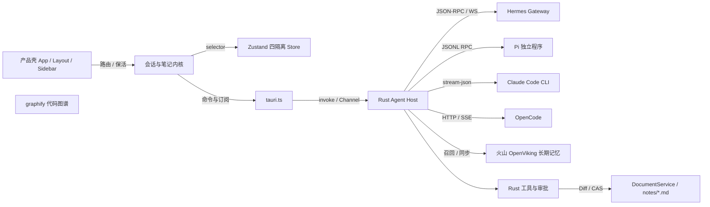

Completion、embedding 等非 Agent 请求由 Rust ModelGateway/模型服务处理，继续复用配置，不经过 Agent Run；当前发现 AI 解读由 Hermes Skill/Cron 执行。Hermes 原生 Skill/MCP、Browser、电脑控制与 Cron 属于其专属能力；Agent 长期记忆走火山 OpenViking（§23.12），不是 Hermes 本地 MEMORY，也不等于知识检索 Adapter。

## 5. 核心组件与职责边界

### 5.1 前端组件

| 组件 | 职责 | 禁止事项 |
|---|---|---|
| `App.tsx` / `AppShell` / Sidebar | 初始化、一级导航与页面级 Agent 入口策略 | 不重复显示全局执行徽标；不常驻渲染完整 Chat；不订阅正文/任务等无关大状态；不承载会话恢复或业务写入 |
| 目标 `ConversationCore` | Thread/Run 选择、消息/过程/工具/Composer 的无页面内核 | 不读取 activePage 推断权限；不自行创建第二套 store/Channel |
| 目标 `ConversationPage` | 一级会话页：历史列表、完整工作区、搜索/分组/归属项目 | 不复制 `ConversationCore`；不把待办 Task 当 Thread |
| 目标 `EmbeddedAgentPanel` | 工作室/笔记本中的紧凑 AI 区域、展开/折叠/宽度/打开完整会话，并承载 Chat/Browser 切换 | 不挂载到发现/收件箱/工具；不因折叠或切页取消 Run；不静默复用不匹配作用域的会话 |
| 目标 `BrowserSurface` | 会话、工作室、笔记本复用的可见页面、导航、控制权、Agent 动作、截图/DOM/控制台与引用 UI | 不保存 Cookie/密码/表单 Secret；不把“已连接”冒充页面可控；不自行绕开 Hermes Browser API |
| 目标 `CodeWorkspace` | 会话/工作室的文件树、代码 Editor、Git Diff、Terminal、Preview 与布局协调 | 不挂载到笔记本；不直接读写文件/启动进程；不把代码文件伪装为 SophoNote Article |
| 目标 `CodeDiffReview` | CodeChangeSession 的逐文件/逐 hunk 审查，可复用文档 Diff 视觉 | 不复用 DocumentService 的 operation/baseVersion/落盘路径；不自动 commit/push |
| 目标 `PreviewSurface` | 静态/localhost/Markdown/PDF/图片产物展示和 Agent 验证状态 | 不等同 BrowserSession；不自行启动命令或拥有子进程生命周期 |
| 目标 `ContextHandoffAction` | 把发现条目、知识资产、任务或选区作为显式候选上下文交给新建/已有会话 | 不复制正文、不直接启动带副作用 Run、不把筛选结果偷换为全库授权 |
| 目标 `AgentScopeProvider` | 页面提供可显示的作用域描述、focus entity、selection、filters | 只提供候选上下文；不作为 Rust 授权依据，不直接读文件 |
| `NoteWorkbench` | 单文档编辑/预览/分屏、保存状态、大纲、反链 | 不把跨文档保存状态放共享 ref；目标改为每文档 DraftRecord |
| `DocWorkspace` | 文档列表、选择、批量操作、工作台组织 | 文档点击不得等待旧文档 I/O 后才响应 |
| `MarkdownEditor` | Crepe 生命周期、selection、completion、diff、view checkpoint | 正常 AI 写回不得用清空 history 的全量替换 |
| `ProjectMode` / 当前 `ProjectChatPanel` | 当前项目文档与 Chat 协作；目标迁移为工作室 + 共享 `ConversationCore` | 不维护第二套审批/会话状态；迁移后不得继续成为唯一 Agent 入口 |
| `MarkdownView` | GFM/KaTeX/highlight/Mermaid/双链/嵌入预览 | 预览刷新不得阻塞输入；相同内容不重复重解析 |

### 5.2 前端状态

| Store | 所有权 | 生命周期 |
|---|---|---|
| `appStore` | 来源、items、articles、tasks、settings、全局 UI、语义索引 | 应用级；当前体量大，组件必须 selector 订阅 |
| `projectStore` | 项目、历史成员关系兼容与项目 UI 状态 | 项目域；不得合入 appStore |
| `agentStore` | Thread/Run/Event/Message/ToolCard、恢复与降级 | 运行域；不得接收 completion 或编辑 dirty 状态 |
| 目标 `agentUiStore`（可独立小切片） | 工作室/笔记本面板展开与宽度、各作用域最近 Thread、完整视图定位、待消费 ContextHandoff | 只保存 UI 引用；不得复制消息、事件或权限；是否新增须以现有 store 边界评审为准 |
| 目标 `browserUiStore` | 当前 BrowserSurface、页面展示快照、控制权和面板状态 | 只保存 UI 投影；真实页面/导航/DOM/控制状态归 Hermes；Cookie/Profile 不进 Zustand/localStorage |
| 目标 `workspaceUiStore` | 当前 WorkspaceBinding 引用、打开文件、布局、选中 Diff/Terminal/Preview | 不保存源码全文、授权 token 或进程所有权；磁盘状态由 Rust 重读 |
| 目标 `codeChangeStore` | CodeChangeSession、文件/hunk 决策、base hash、冲突和验证状态 | 与 `changeSessionStore` 分开；只允许共享无状态 Diff 展示组件 |
| `changeSessionStore` | operationId、hunk 决策、active document operation、视图 checkpoint | 文档变更会话；Chat/编辑器/状态条唯一审批真相源 |
| 目标 `DraftRecord` 服务/切片 | 每文档 draft、sequence、dirty、lastSaved、error、inFlight queue | P0 待实现；替代组件级共享保存 ref |

### 5.3 Rust 组件

| 模块 | 职责 |
|---|---|
| `commands.rs` | 通用数据库、抓取、设置、AI、文章等 Tauri 命令门面 |
| `notes.rs` | Markdown/frontmatter/资产文件 I/O 与历史数据迁移 |
| `documents/repository.rs` | 文档读取、CAS version、原子写入、单文档锁的底层仓储 |
| `documents/service.rs` | Patch dry-run/apply/reject/undo、operation 状态机、revision checkpoint、启动恢复 |
| `agent/*` | 四引擎调度、原生会话映射、事件适配、RunStore 与恢复；不可用时独立失败，无跨引擎/Rig 回退 |
| `agent/hermes/*` | Gateway Client Surface、随包/私有更新槽、原生能力与工作副本适配 |
| `agent/pi/*` | Pi RPC；也承载 Pi/Claude/OpenCode 共用的 Run 准备、配置快照、claim、审批与文件工具 |
| `agent/claude/*` | 官方 CLI 检测、Anthropic/DeepSeek 快照适配、stream-json 与逐 Run loopback MCP |
| `agent/opencode/*` | OpenCode 认证 HTTP/SSE、私有 HOME、Host MCP 桥 |
| `agent/openviking.rs` | 火山云端记忆配置、目录编辑、Pi/Claude/OpenCode 轮前召回与成功同步；详见 §23.12 |
| `agent/runtime_updates.rs` | Pi/Claude/OpenCode 更新入口；Hermes 更新仍由 Hermes 模块维护 |

| `model/*` | Provider 配置、OpenAI-compatible 请求、ModelGateway、重试和 prompt 版本 |
| `tools/*` | 内置项目/文档工具、ToolGateway、结构化 ToolOutput、MCP 封装 |
| `skills/*` | bundled/user/workspace Skill 加载、校验、启用、预算与工具交集 |
| `content.rs` / `scheduler.rs` | 来源抓取、正文预热、质量/证据、定时调度 |
| `vector.rs` / `global_search.rs` | 条目/正文/笔记 chunk 索引和融合检索 |
| 目标 `knowledge/*` | Resource/Artifact/Claim/Decision/KnowledgeReference 生命周期、发布/复核和证据完整性；不保存 Hermes Memory 正文 |
| 目标 `versioning/*` | Managed Notes Repository、项目仓库关联、语义 checkpoint、Commit/Diff/Blob/Anchor 投影和受控恢复 |
| 目标 `retrieval/*` | 结构化过滤、FTS5/BM25、sqlite-vec、版本过滤、融合排序、ContextAssembler 和引用组装 |
| 目标 `resource_budget/*` | 检测物理内存/memory pressure/磁盘，分配 Hot/Warm 字节配额，暂停作业并驱动 FTS-only 降级 |
| 目标 `browser/*` | Hermes Browser capability discovery、BrowserSession 映射、控制权、动作审批、事件适配、引用/截图审计；页面真相不复制到 SQLite |
| 目标 `workspace/*` | WorkspaceBinding 授权/canonical path/symlink/ignore/大文件校验、目录树、文本读写、文件 watcher 与 Git 工作树状态 |
| 目标 `code_changes/*` | CodeChangeSession、base hash/tree、逐 hunk 决定、原子写入/冲突/补偿和 Run/Decision 关联；不处理 notes 文档 |
| 目标 `preview/*` | Preview launch spec、端口分配、子进程所有权、健康检查、stdout/stderr 有界缓冲、停止/重启和 stale 验证状态 |
| `projects.rs` / `project_tree.rs` | 项目、文档成员关系与项目内树结构 |
| `export.rs` / `storage_gc.rs` | Markdown 导出、存储统计和孤儿资产清理 |
| `storage_layout.rs` | 当前统一解析/创建 DB、notes、workspace、Hermes、runtime、logs 分区；目标增加 `version/` 与 `knowledge/blobs|cache` 分区。设置「存储」页需分开展示真相源和可清理派生数据，入口当前隐藏 |

## 6. 模块间调用关系

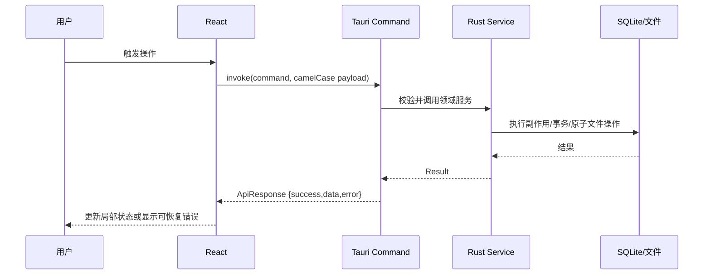

调用规则：

- React 页面只通过 `src/services/tauri.ts` 包装调用命令，不在组件散落裸 `invoke`。
- 通用 CRUD 命令可直接调用 repository；涉及 Patch、审批、恢复、幂等的写入必须经过 service。
- Agent 工具只调用 ToolGateway 注册的能力；Document tool 内部仍走 DocumentService，不直接操作 notes/DB。
- Completion 与 Agent 共享 `ai_config`/Keychain，不共享执行循环：Completion 经 Rust ModelGateway 请求；Agent 由 Host 传入所选模型快照，再由对应引擎调用供应商。Completion 不创建 Thread/Run。

## 7. 核心数据流与控制流

### 7.1 文档编辑与保存

当前实现已经改为事件驱动：ProseMirror `doc` transaction 只标记 dirty；800ms trailing 或 5s max-wait 到期时才序列化，分屏仅在变更后约 400ms 生成预览快照。切文档会先同步捕获旧文档草稿到全局 `DocumentDraftQueue`，随后立即显示目标文档，SQLite/Markdown 写入在后台按 `documentId` 完成。

当前保存链路：

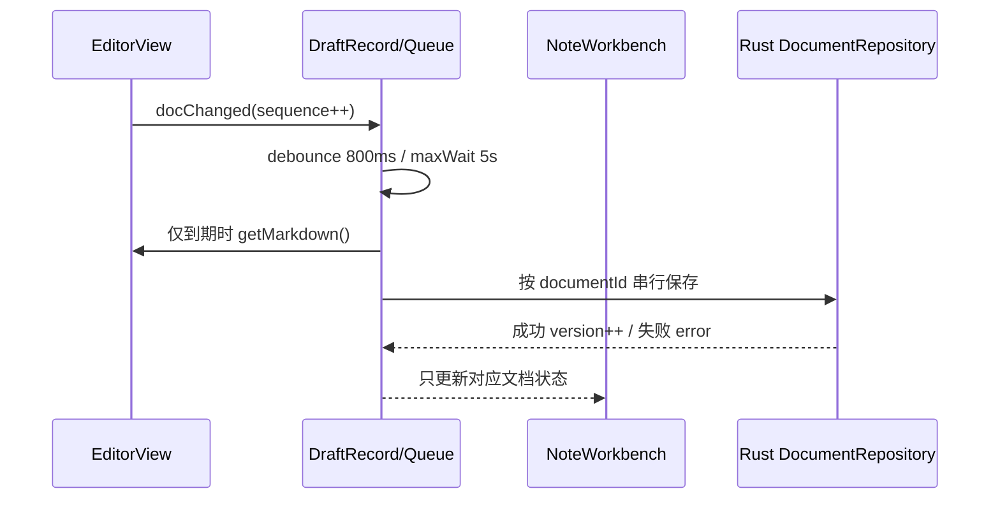

`DocumentDraftQueue` 位于 React 生命周期之外；同文档只运行一个保存循环，在途输入通过 generation 合并，不同文档的基线、错误和 Promise 完全隔离。编辑器销毁前还会同步交付最终 Markdown，旧保存结果只允许按原 `documentId` 回填。

### 7.2 抓取与证据化 AI

```text
手动刷新 / Scheduler 60s tick
  → fetch_source_data 按 source_type 分派
  → 标准化、去重、只更新源字段
  → items 元数据
  → Bridge 按近 7 日、近期入选、来源与紧凑元数据预筛
  → 每个来源最多 4 条候选进入 Hermes Skill 评分
  → 冻结本轮全部达标且不重复的最终名单（无每日数量配额）
  → 仅最终名单按条延迟准备 item_contents / evidence[]
  → quality_level 2+ 才允许生成速览/深度解读并发布
```

成本门禁位于内容生成之前：未通过元数据预筛或评分的条目不得读取完整正文、不得生成速览/深度解读。候选工具只返回压缩后的评分规则与元数据；来源级生成 Prompt 仅随最终入选条目的完整证据返回。

### 7.3 Inline Completion

```text
Editor docChanged/光标稳定
  → 前端构造短上下文与 requestId
  → completion_suggest
  → Rust CompletionService → ModelGateway
  → 过滤、超时、缓存、requestId 复检
  → Decoration ghost text
  → Tab 以普通 transaction 接受 / Esc 或变化取消
```

### 7.4 Agent Run 与恢复

执行进度的等待提示基于当前 Run 已接收事件的最后时间戳，前端计时器仅负责显示经过时间；没有新事件不等于引擎失败。工具计数使用真实调用数，归并行数只表示动作分类。此展示层不改写 Run 状态，不绕过既有 reconcile、审批或 DocumentService。

产品发送使用 `agent_submission_auto_start`，不传引擎选择；Host 按 §23.13 自动准备并派发一次。旧兼容入口 `agent_run_start` 先解析 Thread 的 `engine`，默认 Hermes。首次 Run 固定引擎；Pi/Claude 共用 `agent/pi/mod.rs` 中的准备与 claim，随后分派各自 Transport。Hermes 使用既有 `AgentEngine`/Surface Adapter；当前不是三个引擎都实现该 trait。运行记录保留实际引擎与版本。

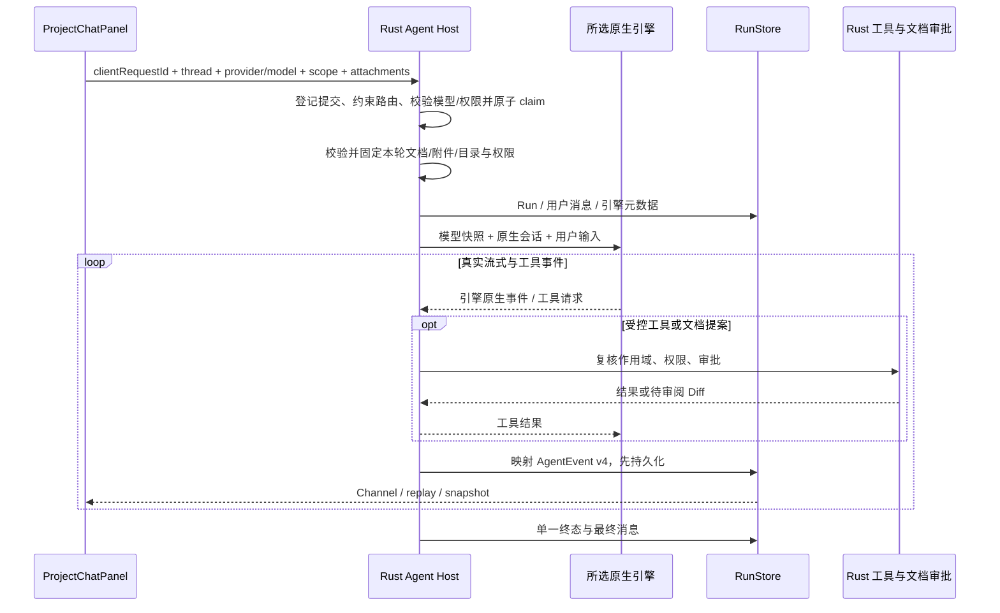

三引擎共享正式事件契约和页面渲染，不共享原生 transcript。无原生思考或工具事件时，不生成虚构过程；阶段说明与最终答案分别落库，避免重复回复。文档工作副本的最终回收也进入同一 dry-run Diff 与 DocumentService 审阅流程。

窗口重挂载或 seq 缺口：Thread history → replay(afterSeq) → Snapshot；仍缺失则记录 degraded。Thread history 从请求发起即进入恢复门禁；若历史中最后一个 Run 无终态，`agentStore` 恢复 `runningRunByThreadId`、标记 resuming，并按 750ms 从 RunStore 持续 replay/Snapshot。Composer 与 `startRun` 共用同一门禁，只有终态事件，或 `agent_runs` 权威 Snapshot 已是 completed/failed/cancelled/interrupted，才允许同一 Thread 开始下一轮；旧 Run 迟到终态不得清理新 Run 标记。

**Hermes 恢复：** 宿主进程重启后 CancellationToken 不存在，只能证明 SophoNote 本地 observer 丢失，不能证明 Hermes 回合已结束。`agent_run_reconcile` 必须先对 Thread 绑定的 Hermes Session 调用 `session.resume`：若 `running/streaming/auto_continue` 为真，则保留该 WebSocket、从 RunStore `latest_seq + 1` 重新发射并消费到 `message.complete`；若 Hermes 已空闲但 transcript 在对应用户消息之后存在 assistant 回答，则补齐 `message_completed/run_completed`；仅当 Hermes 明确空闲且没有对应回答时写 `interrupted`。Hermes 暂不可达或恢复连接中断时不生成假终态，输入继续锁定，由下一轮恢复探针重试。任意 Run 终态都是过程轨的硬边界：即便断连窗口漏收 `tool.complete`，历史工具活动也必须停止转圈并以终态时间收口。

**Pi / Claude 恢复：** 宿主丢失的在途原生进程不宣称可续接同一活跃轮次；对账将孤儿 Run 标记为 `interrupted`。下一轮重新启动进程并打开稳定的私有原生历史。UI 重挂载仍复用上述 RunStore replay/snapshot，不读取原生文件拼装另一套页面历史。

**会话生命周期（AG-01）**：当前 Thread 可无项目或属于一个项目；一级会话从列表切换，工作室从项目会话列表打开。用户关闭（×）：**无任何用户对话则硬删，不进历史**；有对话则写入 `closed_at` 进入历史（须已有明确标题，可由首条 Query 与回复摘要生成；占位「新会话」等不得出现在历史）。历史中「归档」写入 `archived_at` 后对 UI 不可见。设置键 `agent.thread_history_ttl_days`（默认 **0=永久**）：仅当配置为正整数时，对**已归档**且超过该天数的 Thread 硬删除。列表按 `scope=active|history` 过滤。

**会话归属目标（DEC-016/027）**：Thread 已可在 `project_id IS NULL` 时创建为快捷会话；后续归属/移动项目仍待 NEXT-033，项目视图只是 `projectId` 过滤入口。完整会话页、工作室/笔记本嵌入面板与工作室共享同一生命周期控制器；发现/收件箱/工具的 ContextHandoff 只向该生命周期提交候选上下文。归属项目不创建新 Thread/Session；若当前 Thread 已有非终态 Run，必须等待终态后再改变归属，避免一个 Run 中途切换工具/记忆边界。

### 7.5 通用作用域与项目归属目标（NEXT-031/033/035 未完成）

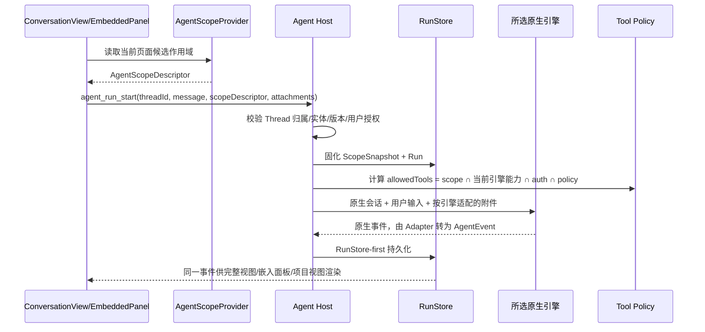

作用域 DTO 目标：

```text
AgentScopeDescriptor（前端候选）:
  surfaceType: discover | conversation | studio | notes | library | tools
  scopeId?: string
  focusEntity?: { type, id, title, version? }
  visibleEntityIds?: string[]       // 有界，仅作候选
  filters?: object                  // 有界、可审计
  selection?: SelectionSnapshot

ScopeSnapshot（Rust 校验后、随 Run 固化）:
  surfaceType, scopeId, projectId?, focusEntity?, selection?, filters?
  contextRefs[]                     // 实际注入的资料引用、版本与来源
  capabilityProfile
  createdAt
```

关键不变量：

1. `AgentScopeDescriptor` 不能授予权限；Rust 必须按 SQLite/文件/项目成员关系和用户授权重新解析 `ScopeSnapshot`。
2. `ScopeSnapshot` 属于 Run，不属于可变页面；用户发送后切页不修改它。
3. 默认快捷会话只得到显式附件、用户通用只读能力和基础网页能力；不得默认读取整个知识库或所有笔记。
4. 工作室会话默认使用项目作用域；知识库、笔记本、发现和工具作用域分别通过能力配置映射到最小工具集合。
5. 写工具必须经过统一 ToolContext/Policy/Approval；文档写仍唯一经 DocumentService。

项目归属事务目标：

```text
precondition: thread exists && no non-terminal run && target project exists
transaction:
  agent_threads.project_id = targetProjectId
  agent_threads.scope_type = 'project'
  agent_threads.scope_id = targetProjectId
post-commit:
  所选引擎原生 Session ID 不变
  依据用户选择创建 memory summary / document links / knowledge refs
  任一步失败不得复制或丢失 Thread 历史
```

### 7.6 Agent 文档修改

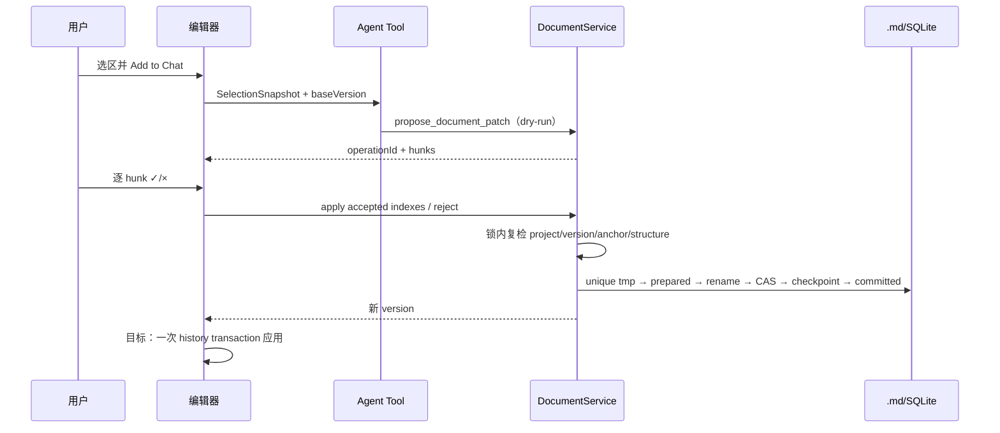

## 8. API、协议与数据模型

### 8.1 Tauri 命令协议

- 命令输入/输出使用 serde `camelCase` 对齐 TypeScript。
- 统一响应：`ApiResponse<T> = { success: boolean, data?: T, error?: string }`。
- 命令按域分为：数据库/设置、抓取/内容、文章/资产/导出、向量搜索、项目、Agent、Completion、Document、Skill、MCP。
- 修改命令签名时必须同时更新 Rust handler 注册、`src/services/tauri.ts`、TS 类型和契约测试，并重启 Tauri 宿主。

### 8.2 Agent 事件协议

- 每个事件包含稳定 `schemaVersion`、`eventId`、`runId`、单 Run 单调 `seq`、时间戳和类型化 payload。
- RunStore 是事件真相源；Channel 只是低延迟传输。
- 当前 schema v4 payload 包含 `run_started`、`model_started`、`reasoning_delta`、`reasoning_completed`、`message_delta`、`message_interim`、`message_completed`、`tool_started`、`tool_completed`、审批/澄清、终态与 `engine_degraded`；旧事件通过 serde 默认和 mapper 兼容。`message_interim` 会把当前助手说明封存为独立消息，后续最终答案不能覆盖。
- Snapshot 是独立查询/恢复路径，`interrupted` 是 Run 持久状态；二者不得伪装成已经落库的实时事件。附着 Hermes 已提供真实 reasoning/message delta；非 Agent 模型路径不保证同等级 token 流。
- 工具完成结果分为 `model_text`、`structured`、`ui_artifact`、`provenance`、`truncated`；`model_text` 不作为 UI 解析协议。
- 项目会话通过共享 CSS 阅读列对齐时间线与 composer，笔记 `NoteWorkbench` 在各编辑/预览 pane 内居中正文（最大 800px）；滚动仍归原有 viewport 所有，不重挂载编辑器或改动滚动跟随算法。Crepe 的默认正文内边距在笔记工作区内覆盖，避免编辑/预览内容宽度不同；横向溢出仅由代码/表格容器承接。
- Chat UI 映射：助手消息阶段 `thinking → answering → done|error`；`reasoning_delta`+同 run 工具 → **Area A**；`message_delta` → **Area B**；`message_interim` 封存当前说明并开启下一段。Hermes 常发送 1～3 字符 delta，Adapter 在不改变顺序与正文的前提下合并相邻同类增量，Surface 再按语义边界与约 48～96ms 视觉帧提交；换行、句末标点、代码围栏和累计字符阈值可提前落屏，稀疏流也不得等待 260ms 后才逐字出现，非流式/终态事件立即落屏。Gateway 的模型正文、路径、URL 与 Markdown 原样透传，不再经过 SophoNote 正则“脱敏/改写”；仅结构化工具参数可在字段级移除凭据。流式答案拆为已闭合稳定 Markdown 块与活跃纯文本尾部：稳定块由 memoized renderer 渲染且后续 token 不重解析，活跃尾部只做换行保真的轻量展示，终态执行一次完整 Markdown 渲染。
- `approval_required` / `clarify_required` 是阻塞当前引擎会话的统一事件，不转换成新用户消息。共享输入卡片使用当前 Thread 已绑定的引擎名称；审批/澄清仍按 `runId` 发送到对应运行的控制通道，不能根据界面文案选择执行引擎。Conversation Surface 将 `choices[]` 按事件顺序渲染为整行纵向决策列表；卡片保持可换行文案、序号、推荐/风险语义与底部自定义回答。一次/会话/拒绝可直接回传，`always` 等持久授权必须经过本地二次确认后才调用 `approval.respond`；提交中禁用重复操作，失败保留原卡片供重试。
- Hermes 过程事件兼容层以 Gateway 的 `reasoning.delta`、`message.interim`、`tool.start|complete`、`message.delta|complete` 为现行标准；前端按 RunStore `seq` 聚合 Thought/Explored/Used。`reasoning.available` 若只是已输出 reasoning 的回标必须去重，`thinking.delta` 属于 spinner 状态而非推理正文，与 Hermes Desktop 一致地忽略。
- 未知 schema/payload 不归约，进入显式降级；旧事件通过 serde default 保持兼容。

### 8.3 文档 Patch 协议

核心字段：

```text
SelectionSnapshot:
  articleId, baseVersion, scope, selectedText, selectedTextHash,
  contextBefore, contextAfter, startLine/endLine(best-effort)

PatchPreview:
  operationId, approvalId?, documentId, baseVersion, targetVersion,
  oldText, newText, hunks[], status, scope?, rebased

PatchHunk:
  startLine, contextBefore[], removed[], added[], contextAfter[]
```

TextAnchor 必须唯一匹配。安全 rebase 仅在版本变化但锚点仍唯一、hash 不变时重新基于当前正文出 diff；否则返回冲突。

### 8.4 数据表与文件模型

| 领域 | 表/文件 | 真相与用途 |
|---|---|---|
| 文档 | `notes/<id>.md`、`assets/` | 正文与附件真相源 |
| 文档元数据 | `articles` | 标题、类型、时间、内部 `version`；content 不作为正文真相 |
| 文档安全 | `document_operations`、`document_revisions` | operation 审计/恢复与短期旧正文 checkpoint |
| 项目 | `projects`、`project_documents` | 项目及文档单一归属/树关系 |
| Agent | `agent_threads`、`agent_runs`、`agent_messages`、`agent_tool_calls`、`agent_approvals`、`agent_run_events` | Thread 固定 engine 与外部会话引用；Run 记录实际引擎/版本；统一消息、工具、审批、事件恢复 |
| 原生会话 | StorageLayout 私有 Hermes Home、`pi/agent/` 与 `pi/sessions/`、`claude_code/sessions/` | 各引擎独立历史，不作为 UI 恢复源或共享记忆 |
| 历史 Skill/MCP | `skill_state`、`mcp_servers`、`mcp_tool_auth` | 兼容旧库与测试资产；产品能力目录、连接和授权不再从这些表读取 |
| 资讯 | `sources`、`items`、`item_contents`、`stories`、`daily_picks` | 来源、元数据、正文证据、聚类/推荐 |
| 组织 | `collections`、`collection_items`、`daily_logs`、`tasks`、`settings` | 收藏、日志、独立任务、配置 |
| 语义索引 | `item_chunks`、`note_chunks`、`vec_items`、`vec_chunks`、`vec_note_chunks` | chunk 元数据和 sqlite-vec 向量 |
| 目标冷资料/派生缓存 | `knowledge/blobs/<sha256>`、`knowledge/cache/` | blobs 是内容寻址原始资料；cache 只含可重建提取文本/OCR/thumbnail/rerank 等，两者清理语义不同 |
| 目标版本证据 | `repositories`、`repository_projects`、`document_versions`、`evidence_anchors`、`version_jobs` | Git 仓库授权、确定文档版本、语义锚点和异步作业投影；Git 对象仍是版本事实 |
| 目标知识治理 | `knowledge_claims`、`knowledge_evidence`、`knowledge_relations`、`change_impacts`、`memory_evidence_links` | Claim/Decision/Artifact 证据、替代/冲突关系、待复核与 Hermes Memory 外部引用；不复制 Memory 正文 |
| 目标工作区 | `workspace_bindings` | 会话临时/项目持久的授权目录引用、访问模式、Git 类型和授权状态；不复制源码或 bookmark 明文给前端 |
| 目标代码改动 | `code_change_sessions`、`code_file_changes` + `runtime/code-changes/` | base tree/hash、逐文件/hunk 决定、Run/原因和受控临时 patch；不复用 document operation |
| 目标 Browser | `browser_session_refs`、Browser action/provenance audit | 只保存 Hermes 外部 Session 引用、控制权/状态投影和最小引用审计；页面/Profile/Cookie 不入库 |
| 目标 Preview | `preview_sessions` + `runtime/previews/` | launch spec hash、端口、进程所有权、generation/验证状态与有界日志；实际进程由 Host 所有 |

关键不变量：

- 正文成功写入才使 `articles.version + 1`；version 只增不减。
- operation 的 `idempotency_key` 唯一，重入不得产生第二次副作用。
- project tool 在读取/写提议前校验 `project_documents` 成员关系。
- `projects` 组织本地目录与会话；旧 `project_documents` 只保留兼容关系。`project_delete` 解除 Thread/Run 的 project_id、删除项目成员关系与元数据，保留 Article/Markdown、索引与本地文件；DEC-036 已替代旧级联删除。
- 删除文章应同时清理文件、索引、项目关系和 revision/operation 孤儿；文章删除路径已在 `delete_article_rows` 同步清理 revision/operation。

新版会话迁移目标（新增列必须经 `ensure_columns` 幂等补齐，当前尚未实现）：

| 表 | 目标增量 | 用途与约束 |
|---|---|---|
| `agent_threads` | `scope_type TEXT NOT NULL DEFAULT 'project'`、`scope_id TEXT`（pinned_at/collection_id 已实现，不重复迁移） | 区分未归属会话/项目会话及列表置顶；现有 `project_id` 迁移为 `scope_type='project', scope_id=project_id` |
| `agent_runs` | `scope_snapshot_json TEXT` | 固化每轮实际上下文、能力 profile 和引用版本；不能只依赖 Thread 当前归属恢复旧 Run |
| `tasks` | `source_thread_id TEXT`、`source_article_id TEXT`、`project_id TEXT`（均可空） | 记录任务来源关系；任务正文/状态仍在 tasks，不复制会话或 Markdown |

约束：

- `scope_type='project'` 时 `scope_id` 与 `project_id` 必须一致；非项目作用域 `project_id` 为空。
- 一个 Thread 最多一个 `project_id`；归属操作只更新关系，`external_session_id` 不变。
- 迁移前的 `project_id IS NULL` 当前表示非项目桶，不能直接解释为新版所有页面共享作用域；上线前需按产品入口和历史来源做明确映射或保守归为 `conversation/default`。
- `scope_snapshot_json` 只存 ID、版本、筛选和能力元数据，不复制完整敏感正文；实际注入内容仍按 RunStore/工具来源审计。
- `workspace_bindings` 的 thread owner 关闭/解绑后撤权，project owner 仅保存可恢复授权引用；每轮 Run 只获得 ScopeSnapshot 中列出的 binding，不自动继承项目全部仓库。
- `browser_session_refs`、`preview_sessions` 和 `code_change_sessions` 只保存跨重启恢复/审计所需状态；页面正文、源码、Terminal 完整输出继续按各自真相源与有界临时存储处理。

## 9. 状态管理与生命周期

### 9.1 应用与页面

- 启动顺序：注册 sqlite-vec → 初始化 schema → Markdown 迁移 → 恢复 prepared document operations → 启动 scheduler → 异步论文转换/正文补抓 → 创建窗口/托盘。旧本地 `McpManager` 不注册到产品运行时。
- 前端 `initialize()` 依次加载 settings、sources、items、tasks、articles 和 stats；模块级 in-flight 防 StrictMode 双初始化。
- `activePage` 始终在前。轻量页（发现/会话/计划任务/工具/设置）切换即卸载。DEC-047：笔记本与 AI 工作室是重型工作区，访问后按 LRU 最多保活两个。隐藏态同时使用 `hidden`+`inert`+`aria-hidden`、退出焦序、暂停该页 window 快捷键与补全，并把 `NativeBrowserSurface` 子 WebView 停泊到屏外 1×1；不得只靠 `display:none` 而让原生子 WebView 留在上一帧矩形上盖住当前页。
- 窗口关闭当前隐藏到托盘，不立即退出；macOS Dock/Finder 的再次打开事件恢复主窗口（显示、取消最小化、聚焦），不重新启动 Runtime 或重建会话。Hermes 自身负责其 MCP 生命周期与子进程清理。
- `AppShell` 只负责页面入口策略；完整 `ConversationCore` 仅在会话页或工作室/笔记本嵌入面板展开时挂载。运行状态由会话列表/消息呈现，不在 Header 重复放置徽标。发现、收件箱、Artifacts 和工具不因全局 Agent 能力常驻 token 流视图。
- 一级会话页与嵌入面板切换时只改变 view/selectedThread 引用，不销毁 Run 或重复调用 history/recovery；恢复控制器以 Thread 为键，整个前端只能有一个实例负责同一 Thread 的非终态追平。
- `ContextHandoff` 是短生命周期导航载荷；用户选择“新建会话/加入会话”后即转换为 Thread 的 pending context references，发送前由 Rust 解析，消费后清除 UI 草稿，不能被 Zustand persist 作为长期权限保存。

### 9.2 编辑器

- 当前 EditorView 在预览态可能销毁，模式切换存在 history/重建成本。
- 目标保活必须同时解决外部正文同步、history 标记、焦点、快捷键、ResizeObserver、滚动和可访问性；不得仅 `display:none`。
- Inline Completion、Document diff 和常规编辑 transaction 是独立插件状态；补全建议不进入正文，diff Decoration 不进入 Markdown。

### 9.3 Agent 与 operation

- `agentStore` 按 thread/run/seq 归约事件；终态注销运行中状态。
- `changeSessionStore` 按 operationId 归约 hunk 决策，按文档选择当前 pending 或仍可撤销的 committed operation。
- 重启时只恢复同一文档最新 pending；committed/rejected 保留审计，不恢复为待审批。
- `selectedThreadId` 需从当前单一全局选择演进为“当前完整视图 Thread + 每个作用域最近 Thread”的引用模型；消息与事件仍只存一份。不能以多个 store 复制线程数组解决页面切换。
- 会话归属项目、关闭、归档、切换作用域时，若存在非终态 Run 必须阻止改变执行边界；嵌入面板折叠和页面导航不属于生命周期操作。
- Browser/CodeWorkspace/Terminal/Preview 视图卸载只释放前端资源，不擅自改变外部 Session/进程；恢复控制器按 Thread/Binding 对账。关闭会话或解绑时，Host 按所有权关闭 Browser 引用和 SophoNote 启动的 Preview/Terminal，用户既有进程不受影响。

## 10. 存储、缓存与消息机制

### 10.1 存储

- 所有本地持久数据由 Rust `StorageLayout` 从操作系统应用数据目录统一解析：macOS 为 `~/Library/Application Support/com.fei.sophonote/`，Windows 为 `%APPDATA%\com.fei.sophonote\`。任何前端、Skill 或 sidecar 不得自行拼接另一个数据根。
- 当前目录布局：`sophonote.db` 为产品元数据/索引/RunStore；`notes/` 为 Markdown 真相源与 `assets/`；`workspace/` 为用户与 Hermes 可直接读写的普通文件工作区；`hermes/<version>/` 为包内 Runtime 的 Session/Memory/Skill/附件私有 Home；`runtime/` 为临时进程状态；`logs/` 为诊断日志；`version/` 已由 StorageLayout 幂等创建，供后续 managed bare repo 使用，当前不写 Git。目标 `version/notes.git/` 作为 managed bare repo，`knowledge/blobs/<sha256>` 为新导入的大型知识原文保存单一内容寻址副本，`knowledge/cache/` 保存可重建的提取文本与索引缓存。存量 `notes/assets` 仍在原位，Git manifest 只引用 hash/授权源，不再复制大文件。
- `workspace/` 与 `notes/` 是刻意分开的两种权限域。Hermes 以 `workspace/` 作为默认 cwd，因而该目录内文件均可使用原生 file/terminal 工具操作；SophoNote 文档只以 Hermes `attachments/` 工作副本进入 Session，终态差异必须生成 DocumentService Patch，禁止 sidecar 直接写 `notes/`。
- 当前旧数据的 `sophonote.db`、`notes/` 已处于统一数据根，升级只幂等创建缺失分区，不移动文件。机器级 `~/.hermes` 属于外部 Hermes Desktop/开发 Runtime，不能自动迁入、合并或删除；Debug 显式附着时布局仍解析外部运行域，Release 永远使用私有 `hermes/<version>/`。设置「存储」页（分区展示、容量、孤儿 GC、自定义根）当前隐藏，低优先级再恢复入口。
- 包内 Hermes 的 `config.yaml` 由 Host 在启动前幂等合并 SophoNote 管理项：关闭重复的 `auxiliary.title_generation`，配置默认 `terminal.cwd=workspace/`，再写入受控 Bridge；不得覆盖用户/Runtime 其他配置。SophoNote 自身从真实助手回复生成 Thread 标题。
- Markdown 和 assets 写入使用安全 ID、唯一 tmp 和原子 rename。
- Git 不直接 checkout 到 `notes/`，不跟踪 `sophonote.db`、RunStore、Hermes Home、密钥或临时文件。版本服务从 DocumentService 已提交的稳定文档生成 Git tree，从而保持实时写入路径与版本库解耦。
- 用户授权代码仓库保持原位置，不复制进 Application Support；SQLite 只保存 WorkspaceBinding 与可查询投影。CodeChange 临时 patch、Preview pid/端口和有界输出进入 `runtime/`，崩溃恢复/过期清理后可删除，不得作为源码备份。
- SQLite schema 由 `create_schema` 和 `ensure_columns` 幂等演进；目前没有独立版本化 migration runner，这是已知限制。

### 10.2 缓存

- Zustand persist 仅保存非敏感 settings、collections、activePage；API Key 不得进入 localStorage。
- 内容正文、AI 结果和向量索引在 SQLite；hash 未变时避免重复 AI/索引。
- 目标 `ResourceBudgetManager` 对知识/记忆增量占用执行跨进程 1 GiB 预算；当前未实现，不能把配置参数当作实测硬上限。物理内存不放宽目标，也不能按 entry 数量推算已达标。
- Hot 只含目录/当前 Claim/小型 FTS 页；Warm 只含当前文档、固定资料和近期项目的 chunk/向量；Cold PDF/原文/历史 Git blob 不进常驻缓存。
- SQLite page cache、FTS/catalog、向量页、检索/上下文工作区、导入/OCR/Embedding 批缓冲、Memory 候选/压缩、可选 Adapter 和本地 Embedding 进程均进同一总账；大范围 `mmap` 不得绕开 RSS 计量。
- 压力降级顺序固定为：停止预取和 rerank → 暂停 embedding/影响作业 → 清 Warm LRU → 停可选 Adapter/本地 Embedding → FTS-only。编辑、精确 Anchor/Git 读取和导出不降级。
- Completion 有短期请求缓存和聚合指标，不保存正文上下文或建议全文。
- 目标关系/任务/标签缓存按 `articleId + contentHash`，未链接提及还需包含目标标题；缓存必须有容量和集合清理策略。
- 页面数据命中 store 且未失效时不重复 Tauri 查询。

### 10.3 消息

- Tauri `invoke` 用于请求/响应；Tauri Channel/Event 用于抓取通知、调度和 Agent 实时事件。
- Agent 事件先落 SQLite 再发 Channel，保证屏幕状态可以重建。
- 不引入外部消息队列；本地单进程内使用 Tokio task、CancellationToken、锁和持久事件表。

## 11. 并发、性能与容量设计

### 11.1 当前并发模型

- Tauri async runtime 执行抓取、模型和 Agent 任务；Scheduler 每 60 秒检查来源 interval。
- 文档写入使用按 documentId 的 Rust 互斥锁、version CAS 和 operation 幂等键。
- Agent Run 使用 CancellationToken，可并行于 UI；工具和模型调用受调用次数预算限制。
- Hermes Runtime 持有 MCP 连接、授权和生命周期；SophoNote 只调用 Hermes 正式管理 API 并渲染其状态。

### 11.2 当前性能债与已完成整改

1. 已拆除 `NoteWorkbench` 空闲轮询；剩余成本是输入停顿/显式保存时的全文序列化，以及分屏变更后的整篇 React Markdown 渲染。
2. `safeListOrderPlugin.appendTransaction` 普通 doc transaction 可能扫描整棵文档树。
3. App 壳、Sidebar、常驻 ItemDetail 和写作工作台已收窄 Zustand selector；其余活跃页面仍需按宿主 profiler 判断是否继续拆分。
4. 反链/未链接提及已移到 idle，并在仅当前文档保存、候选引用未变时跳过；任务/标签和更大规模增量索引仍待测量。
5. 文档切换已与 flush I/O 解耦，页面 chunk 支持 hover/focus 与初始化后逐个 idle 预取。NEXT-001 暖页签 P95=519ms 超过 PRD ≤150ms 后，DEC-047 对笔记本与工作室启用最多两个受控保活（inert、退出焦序、暂停 window 快捷键、原生子 WebView 停泊）；隐藏态取消富预览 promote 与提及扫描，并停订隐藏页 AgentStore。轻量页热路径用会话级缓存画稳首帧，挂载后不再为校准 setState（idle 延迟 DOM 会拖长 MutationObserver settle，已撤回）。停扫描后混合热 P95=294ms；缓存首帧后再测 190/360ms（P95 为会话单次热样本）。随后把时间线首窗从 80 收到 16，历史（非流式）Markdown 走 `lite` 且不挂 Mermaid IntersectionObserver。同夹具混合 P50/P95=195/304ms，会话热 304ms，其余热页 191–207ms。单独保活会话页会使三页同挂、settle 退化到秒级，已撤回。会话仍是尾巴，但不得把轻量页纳入保活。同夹具数字见台账 NEXT-004。
6. Agent operation 的 undoable 重查会放大保存后的状态更新。
7. AI 批准结果已作为单个、前后边界隔离的 ProseMirror transaction 写入 history；外部非撤销型同步仍会显式重建基线。
8. Agent 热路径曾对每个 Gateway delta 单独打开 SQLite、前端每批重排并重放整段 Run、答案每次从头解析 Markdown；这三处会把上游 1～3 字符增量放大为持久化阻塞、主线程抖动和可感知逐字停顿。

这些是已确认存在的候选热路径，不代表未经测量的耗时排序。

### 11.3 P0 性能设计

- 精确 store selector + `useShallow`，App 壳只订阅导航/初始化/主题。
- `docChanged` 事件驱动保存；序列化只在 debounce/max-wait/显式 flush 时发生。
- 预览通过低优先级 transition 更新，按 Markdown/source hash 缓存。
- Agent Adapter 合并相邻 reasoning/message delta 后才进入 RunStore；RunStore 传输层复用长连接并保持“单批持久化成功后才广播”，不得以异步 UI 先行破坏 durable-first。前端接收有序尾增量时走 append fast path，只有 replay/乱序才排序；派生消息只重算被触及 Run。
- Chat 流式 Markdown 使用稳定块缓存，正在增长的尾部不运行 GFM/KaTeX/Mermaid/高亮插件；终态或块闭合时再升级为完整 Markdown。运行中的 reasoning 仅显示轻量文本尾部，完成后才允许完整 Markdown 展开。
- Chat 时间线只挂载最近窗口；到达顶部时分批向前扩展，并以扩展前后的 `scrollHeight` 差恢复阅读锚点。离开底部后暂停跟随并提供显式“回到最新”，新事件不得抢占历史阅读位置。
- Chat 热路径记录 Run 首推理/首答案/终态、事件批次、Store 同步归约与 React 提交延迟；诊断采样限频并进入现有性能面板，用于区分 Provider 空等、Gateway 传输与本地主线程放大，禁止以新增逐事件日志制造二次抖动。
- 文档保存状态按 documentId 隔离，UI 切换与 I/O 解耦。
- 列表插件只在 docChanged 且变更涉及列表结构时扫描，经 transaction mapping 映射范围。
- 关系/任务/标签增量索引；未链接提及在 idle 计算。
- 语义版本、chunk 重建和影响分析进入低优先级持久作业队列；同文档短时间多次保存按 `contentHash + trigger` 合并，不得每次 autosave 生成 commit。
- 页面 chunk 启动空闲预加载；隐藏页面暂停副作用；DEC-047 保活最多两个重型工作区（笔记本、工作室）。

### 11.4 容量边界

- 基线夹具：5 KB/50 KB 文档、200 篇库；后续增加更大文档分桶而非先做块数据库。
- 每文档最多一个有效 revision checkpoint，建议 TTL 24h；operation 审计按存储策略清理孤儿。
- 单次 MCP 结果约 50 KB 字符边界；文档读取工具当前约 8,000 字符截断并标记。
- 工作室/笔记本嵌入面板的流式消息归约必须按 Thread 精确订阅和自适应视觉合帧；页面组件不得订阅完整 `messagesByThreadId/eventsByRunId` 字典。时间线贴底状态属于可见 Thread 的视图状态：只订阅该 Thread 的 Run 事件，用户离底后停止跟随，后台 Thread 的 token、工具或终态事件不得触发当前滚动容器。未展开时不挂载 Markdown/过程轨；会话列表只订阅各 Thread 的摘要状态。窄窗优先覆盖式面板，不通过无限压缩主工作区换取并排。
- FTS 按当前文本增量维护并保存在磁盘 SQLite；向量默认只为当前文档、用户固定资料和近期活跃项目的 chunk 建立，按 scope/project/document 分片落盘，笔记写后约 5 秒防抖。旧版本/冷资料只在精确查询或用户固定时延迟向量化。
- 容量门禁不再用“10,000 文档/100,000 版本全量热索引”表达。正确口径分别是：原始字节、当前 FTS chunk、Warm vector chunk、Git 对象、派生缓存和 Memory entry；每类独立计量/配额。
- Git 对象按可计算保留策略 GC，已被 Claim/Decision/发布成果引用的 commit 不可自动清理。数据卷剩余空间低于 `max(5GB, 10%)` 时停止后台导入/向量化/空闲快照，保留编辑和导出。
- 所有客户端档位共用知识/记忆增量占用<1 GiB 的硬门禁；整机 8/16/24GB 只影响系统余量与可处理语料速度，不允许扩大 Memory Envelope。详细预算与外部 Adapter 门禁见 §23.7.10。
- 对外抓取按来源配额与 500ms 节流，避免 GitHub 二级限流。

## 12. 高可用、容灾与故障恢复

SophoNote 是本地单用户应用，不提供多实例高可用或服务端 SLA。可用性设计目标是“单进程崩溃后数据可恢复、外部服务失败时核心写作可用”。

- 文档：唯一 tmp + 原子 rename；启动扫描 `prepared` operation，清理 tmp 并标记 rolled_back。
- SQLite：所有事件和操作先持久化；建议发布/迁移前备份 DB、notes 和 assets。当前尚无自动备份调度。
- Agent：RunStore-first、replay、Snapshot、终态和 degraded；重启可恢复消息与最新 pending。
- 网络/模型：外部服务失败不阻塞本地编辑、预览、搜索已有数据和导出；AI 操作显示失败并可重试。
- Hermes MCP：断线、重连和失败状态由 Runtime 管理；SophoNote 不创建第二套连接，不影响文档真相源。
- 索引：向量索引可由 Markdown/items 重建；索引失败不回滚正文。
- 版本：Git 写入失败不回滚已成功的 Markdown 保存，而是保留 `version_jobs=failed` 并可重试；SQLite 版本投影丢失时可从授权仓库和内嵌 manifest 重建。
- 导出：标准 Markdown + assets 是用户级灾备和迁移出口。

## 13. 异常处理与降级策略

| 异常 | 处理与降级 |
|---|---|
| 文档 I/O/DB 失败 | 不推进保存基线，保留 dirty/draft，显示错误并允许重试 |
| CAS/version/anchor 冲突 | 停止 Apply，要求重新读取或生成，不做猜测覆盖 |
| tmp/rename 中断 | 标记 failed/rolled_back，启动恢复清理残留 |
| 模型 429/网络 | 仅无副作用模型请求有限指数退避；退避可取消 |
| 工具失败 | 不自动重放副作用；记录 error ToolOutput/Worklog |
| Agent 事件缺口 | replay → Snapshot → degraded；不归约未知协议 |
| Completion 超时/旧响应 | 按 requestId/光标/文档复检后丢弃，不插入错误位置 |
| Hermes MCP 未授权/断线 | 以 Hermes 返回状态为准，工具不可用或失败可见；SophoNote 不自动授权或本地兜底连接 |
| Hermes Browser 未连接/页面代次变化 | BrowserSurface 进入 detached/degraded；旧 DOM selector/坐标失效，重连并重新 snapshot 后才继续 |
| WorkspaceBinding 撤权/移动/symlink 越界 | 立即拒绝 I/O 并将 binding 标为 needs_reauthorization；不猜测路径、不扩大到父目录 |
| CodeChange base hash/tree 冲突 | 停止 apply，保留用户工作树，要求重新生成/人工合并；拒绝 nearest-match 覆盖 |
| Terminal/Preview 启动失败 | 保留命令、错误类别、退出码和有界输出；不自动提升权限、换目录或杀非 SophoNote 进程 |
| Git commit/index 失败 | 正文保持已保存状态；展示“版本待同步/索引待重建”，按 idempotency key 重试，不伪造 commit |
| 外部仓库 force-push/HEAD 漂移 | 已固化的 commit OID 仍按本地对象可读；标记 ref drift 并要求重新授权/建立基线，不静默改写旧证据 |
| 证据锚点无法映射新版 | 保留旧版引用，标记 stale/orphaned 并生成待复核影响；禁止自动移到相似文本 |
| 内容抓取不足 | 标 partial/failed/unsupported，禁止低质量 AI 解读 |
| Mermaid/预览渲染失败 | 显示局部错误/源码回退，不让整窗白屏或错误 SVG 撑破布局 |
| 前端渲染异常 | 全局错误浮层显示错误；数据库可空字段使用运行时 null 守卫 |

## 14. 安全、权限与数据保护

### 14.1 信任边界

- React/WKWebView：不可信 UI 输入边界；所有路径、项目归属、版本和权限在 Rust 再校验。
- Model：不可信建议生成器；只能看到 ToolGateway 暴露的工具，不能调用管理命令。
- Skill：受限配置与提示，不执行任意脚本，不直接授予权限。
- Agent 引擎：Hermes/Pi/Claude 均是受 Host 监督的外部执行边界；Hermes 的用户 MCP 连接与授权由其原生管理，Pi/Claude 仅暴露 Host 工具。Claude 的 loopback MCP bearer 按 Run 撤销，不作为全局 MCP 配置。
- Browser Runtime：不可信网页与交互执行边界；页面内容可能进行 prompt injection，DOM/下载/表单/登录态均按外部输入处理，动作仍需 SophoNote Scope/Policy。
- 用户授权 Workspace：高价值本地数据边界；授权根不等于全部工具可读写，路径、ignore、Secret、base hash 和权限模式由 Rust 逐次复核。
- Terminal/Preview 子进程：可执行副作用边界；只允许 Host/Hermes 持有进程句柄和端口，WKWebView 不直接 spawn、signal 或连接任意本地端口。
- 外部来源：不可信内容；抓取做 URL/大小/质量限制，AI 输出不得当作事实直接写入。

### 14.2 数据保护

- 文档和数据库默认本地；发送模型的上下文应最小化并由用户触发。
- API Key 不进入日志、Agent event、ToolOutput 或 localStorage；MCP 环境变量值不回前端。
- Provider Key 以 macOS Keychain 为真相源；旧 SQLite `apikey:*` 只作为一次性迁移源，并严格按“写入→回读一致→删除明文”执行。
- 凭据存储统一经过 Rust `credentials` 边界：macOS 对现有 login Keychain 使用串行访问门禁，在普通读取、存在性查询、后台迁移和删除期间禁用 Keychain UI，退出时恢复原交互状态；只有显式保存允许系统授权。存在性检查读取属性而非密码，不触发迁移；WebView 仍只收到 configured/not_found。静默读取被拒时返回可操作的重新保存提示，不缓存为缺失；Hermes 启动跳过不可用供应商，Release 不从旧明文绕过拒绝。系统锁定/签名身份变化仍须在保存入口修复授权，不通过放宽 ACL 或 Release 明文回退消除提示。
- 未签名 Debug 二进制遇到 Keychain ACL 拒绝时，允许在 `cfg(debug_assertions)` 内使用旧 `apikey:*` 位置作为显式开发回退；读取优先使用进程缓存/该回退，避免反复弹授权。Release 编译不存在此分支，仍按 Keychain 迁移失败即 fail-closed。Key 保存成功后重启 Hermes 属于第二阶段：重启失败记录独立诊断，但不能回滚或误报已经成功的凭据保存。
- 设置页短期采用“输入即自动保存、保存后不清空当前组件值”的交互；输入值只存在当前 React 组件内存，不进入 Zustand persist/localStorage，页面刷新或应用重开后 Host 仍只返回 configured marker。设置页不提供删除 Key 入口。桌面确认框禁止使用被 `tauri-plugin-dialog 2.7.x` 初始化脚本改写的同步 `window.confirm`；统一使用 `@tauri-apps/plugin-dialog` 的异步 `confirm()`（实际走已授权 `message` 命令）或应用内确认组件。
- `tauri.conf.json` 已启用 production/dev 分离的严格 CSP；Release 不允许 `unsafe-eval`、任意网络连接、frame 或 object。
- MCP command/args/env 和 Skill 文件均需用户来源信任；路径校验禁止符号链接逃逸和目录穿越。
- 只能读取用户明确授权的 Git 仓库与 ref；默认应用 `.gitignore` 和 SophoNote 排除规则，建立版本前执行凭据/大文件扫描。`push`、修改 remote、删除 ref、rebase/reset/checkout 等操作默认不对 Agent 开放；恢复只生成可预览 Patch。
- Browser Profile/Cookie/密码/表单 Secret 不进入 SQLite、Zustand、RunStore 正文或模型上下文；截图/DOM 引用按最小范围和生命周期保存，页面下载先进入受控临时区。
- 当前 WorkspaceBinding 保存用户所选目录与权限，Rust 复核 canonical path；Pi/Claude 文件工具和命令受本轮 Scope 约束。完整 security-scoped access/撤权审计与 CodeChangeService 为 BC-0/2 后续，不能只靠前端隐藏按钮代替。
- 文档写入、删除、资产 GC、MCP 删除等高影响动作需明确 UI 意图和二次确认。
- Agent 入口不得使用前端页面作为隐式授权；当前 Run 内校验已实现，持久 ScopeSnapshot/跨域工具 profile 仍按 NEXT-031/035 实施。
- 会话归属项目会改变后续可见资料与记忆键，属于权限边界变更：只允许用户显式触发，非终态 Run 期间禁止，摘要/成果/资料的记忆写入分别确认。
- 嵌入面板或 ContextHandoff 默认只提交当前 focus/selection 和有界候选 ID；“知识库全部资料”“笔记本全库”等宽范围必须有可见 scope chip、检索预算和来源记录。
- 通用 AGUI 只渲染 SophoNote allowlist schema，不接受模型返回的任意 HTML/JS、命令、路径或事件处理器；组件动作仍回到 Tauri Command + Policy。

## 15. 可观测性：日志、Metric 与 Trace

### 15.1 当前能力

- Rust stdout/stderr 与 panic hook 写入 `logs/dev.log`；启动、抓取、恢复和错误有稳定标记。
- `scripts/sophonote.sh status/logs` 管理进程树和日志。
- Agent RunStore 保存 run、message、tool call、approval、event、seq、provider/model/prompt/engine 元数据。
- Completion 暴露请求、完成、取消、接受/拒绝和延迟聚合指标。
- `PerfOverlay` / `notePerf` 可采集 FPS、序列化等本地开发指标。
- 数据库可用只读 SQL 验证内容覆盖、checkpoint 数量和状态机结果。
- 目标新增版本作业队列深度/失败率、commit 延迟、索引新鲜度、EvidenceAnchor 失效率、影响待复核数和有引用回答占比；只记 ID/hash/分桶，不记正文。
- 目标分进程采集 Host/WKWebView、Hermes、Context Adapter、Embedding 的 RSS/峰值，并分区记录 raw/Markdown/Git/extracted/vector/cache 字节、memory pressure 转移、FTS-only 降级次数和作业暂停时长。

### 15.2 缺口与目标

- 尚无统一结构化日志 schema、request/operation/run 贯穿的 traceId 和长期指标存储。
- P0 增加 navigationId/documentId（不可含正文）、change sequence、save queue wait、preview lag、React commit 和 Long Task 分桶。
- 日志必须做密钥/正文/环境变量值脱敏；默认不远程上报。
- 若未来接入远程可观测平台，必须先在 PRD 明确用户授权、数据分类、保留期和关闭能力。

## 16. 扩展性与演进路径

1. **稳定性基线（P0）**：完成书写性能宿主验收、有界 checkpoint；新版 App Shell 和会话事件不得阻塞写作主链路。
2. **会话内核抽取（P1A-1）**：把当前 `ProjectChatPanel` 拆为无项目依赖的 `ConversationCore`、完整页容器和工作室/笔记本嵌入容器；先保持协议/视觉能力等价。
3. **Thread/Scope 迁移（P1A-2）**：幂等增加 scope 列与 Run ScopeSnapshot；支持未归属会话，再实现归属项目；迁移前后历史/恢复/Session ID 不变。
4. **App Shell 与 IA（P1A-3）**：上线六个一级产品域、统一 Header、工作室/笔记本嵌入面板与对象级 ContextHandoff；运行状态归属会话列表/消息，深度解读/任务仅改变入口，不迁移或复制正文数据。
5. **作用域与工具策略（P1A-4/P2）**：各页面提供 ScopeProvider，Rust 固化 ScopeSnapshot；完成 ToolContext/Policy/Approval 后才开放任务、日历、提醒等副作用。
6. **Agent Go（P1B）**：真实 Provider+Skill+MCP+Patch 宿主整场；与 Hermes 迁移可并行但不得挤占写作验收。
7. **多引擎执行平面收口（DEC-053）**：共享配置/会话/事件与权限，原生协议、历史和更新策略独立。Hermes 原生能力继续按 §23.1 专项维护，Pi/Claude 回归和发布证据见 NEXT-075；历史 Rig 清债不影响当前三引擎调度。

8. **产品域闭环（P2）**：发现关注工作站、后台长期记忆/RAG、工作室项目聚合、工具任务来源关系与跨域显式工作流；长期记忆不成为页面域。
9. **轻量版本证据基础（P1C）**：先上线 ResourceBudgetManager、Hot/Warm/Cold 分层、FTS-only 降级、受管 notes 仓库、语义版本和 EvidenceAnchor；向量只扩到活跃工作集，再开放 Claim/Decision、ChangeImpact 与 Memory evidence binding。
10. **按测量演进**：若 P0 后长文仍不达标，再引入 Worker 预处理、块级增量预览、视口虚拟化或持久关系索引。
11. **Transport 口径**：产品会话固定使用 Hermes Gateway JSON-RPC/WebSocket；旧 Runs HTTP/SSE 只允许保留为隔离的迁移测试资产，不得回到产品路径。
12. **仍不引入**：第二套 Python/LangGraph 控制面、通用远程 Agent 云、把 SophoNote 产品控制面交给第三方 Runtime，或将 PostgreSQL/OpenSearch/本地 OpenViking 进程作为 V1 必选依赖。唯一 Python 进程是随包签名且被 Host 监督的 Hermes 实现；火山云端记忆是可选外发（§23.12），不是启动依赖。

## 17. 部署、环境与基础设施

### 17.1 开发环境

- Node/pnpm：前端 Vite 端口 1420；React StrictMode；依赖只用 pnpm 安装。
- Rust：使用项目可编译的稳定 toolchain；`rmcp 3.1.2` 要求 rustc ≥1.88。优先 `cargo check`，不运行 `cargo clean`，不删除 `src-tauri/target` 增量缓存。
- 桌面：`./scripts/sophonote.sh start|stop|restart|status|logs` 是开发宿主唯一生命周期入口；脚本后台托管 `tauri dev`、PID 和 `logs/dev.log`，不得另开前台常驻实例争抢 SQLite/notes。
- 数据：应用标识 `com.fei.sophonote`；`StorageLayout` 统一管理 Application Support 下的 DB、notes、workspace、Hermes、runtime 与 logs。开发前备份真实数据或使用明确隔离的 macOS 用户环境，不通过删除数据库解决调试问题。
- Hermes 验证基线优先使用随包 Runtime。`scripts/sophonote.sh` 未显式附着时直接让 Tauri Host 启动 resources 内的 Hermes；只有调试 Hermes 自身时才以 `SOPHONOTE_HERMES_GATEWAY_URL/TOKEN/HOME` 附着机器 Runtime。SophoNote 不从 React 直连，也不把 Gateway token 写入 SQLite/localStorage。

### 17.2 Hermes 开发附着部署

当前真实 Hermes 链路仍是主 App + 一个受 Host 监督的 `hermes serve` 子进程，但默认子进程来自随包资源并使用 SophoNote 私有 Home；显式开发附着才复用机器 Runtime。`hermes gateway` 的 Runs API 只保留迁移诊断用途，不再是产品会话的目标协议。

Surface 创建 Session 时固定传 `source: "sophonote"`。Hermes 因而按正式外部 Surface 启用其 `project` 工具集；SophoNote 不伪装成 `desktop`，也不会在尚未实现 Desktop 浏览器/面板回调时错误获得 `desktop_ui` 工具。SophoNote 项目、文档和权限能力继续留在 Host；在 Hermes 提供可由 Host 校验且绑定具体 Session 的 capability channel 前，产品链路对这些领域写操作 fail-closed，不退回提示词、工作区正文或模型可见 lease 注入。

#### 17.2.1 Hermes Surface Gateway

默认由 Tauri Host 生成独立的进程级 session token 并启动包内 Hermes；只有复用已有 Gateway 或调试 Hermes 本身时才需要显式配置：

```dotenv
SOPHONOTE_HERMES_ATTACH_EXTERNAL=1
SOPHONOTE_HERMES_GATEWAY_URL=ws://127.0.0.1:9119/api/ws
SOPHONOTE_HERMES_GATEWAY_TOKEN=<至少 32 字符的随机 token>
SOPHONOTE_HERMES_HOME=
```

`SOPHONOTE_HERMES_HOME` 必须写展开后的绝对路径，不要写 `~`。

- Token 可用 `openssl rand -hex 32` 生成；不得进入仓库、终端截图或日志。启动 Hermes 时以 `HERMES_DASHBOARD_SESSION_TOKEN` 传给 `hermes serve`，SophoNote 只把同一 token 用于 `/api/ws?token=...` 鉴权。
- Host 必须是 `127.0.0.1`；开发集成不允许 `0.0.0.0`、局域网地址或宽泛 CORS。
- 前台调试使用 `hermes serve --host 127.0.0.1 --port 9119 --skip-build`，可以直接观察 Session、Skill、Memory、工具循环、审批/澄清和完整事件。
- `hermes serve --status|--stop` 管理该进程；同一端口只能保留一个实例。

最低探测：

```bash
hermes --version
hermes serve --status
curl -fsS http://127.0.0.1:9119/api/status
```

HTTP 状态只证明监听存活，不等于模型、Session、长期记忆和工具可用。正式验证必须完成 WebSocket `gateway.ready → session.create/resume → prompt.submit → message.complete`，并观察真实工具/审批/澄清事件。

```bash
set -a
. ./.env.hermes.local
set +a
HERMES_DASHBOARD_SESSION_TOKEN="$SOPHONOTE_HERMES_GATEWAY_TOKEN" \
  hermes serve --host 127.0.0.1 --port 9119 --skip-build
```

#### 17.2.2 SophoNote 附着配置与启动

```bash
./scripts/sophonote.sh restart # 默认由 Tauri Host 启动随包 Hermes Runtime
./scripts/sophonote.sh status
./scripts/sophonote.sh skills  # 只同步 SophoNote 自有 Hermes Skills

# 仅需附着已有 Gateway 时：
cp .env.hermes.example .env.hermes.local
# 填写 Gateway URL、随机 session token，并为 SOPHONOTE_HERMES_HOME 填绝对路径后 restart
```

开发启动顺序固定为：加载本机配置 → 未显式附着时由 Tauri 启动包内 Runtime；只有 `SOPHONOTE_HERMES_ATTACH_EXTERNAL=1` 才同步 `skills/hermes/` 到指定外部 Home 并附着其 Gateway。已经运行的外部 Gateway 需要执行 `skills.reload` 或重启 Runtime 才会读取新版本；SophoNote 不通过会话提示词模拟热更新。

Markdown 写作 Skill 的 CLI 验证：

```bash
hermes skills list --source local --enabled-only
ARTICLE_MD='/替换为真实绝对路径/article.md'
hermes --skills sophonote-markdown-writing -z "proofread @file:${ARTICLE_MD} and list issues first"
hermes --skills sophonote-markdown-writing --in notes
```

第一条应列出 `sophonote-markdown-writing`；后两条分别验证单轮与交互式触发。示例不得使用仓库中不存在的 `notes/draft.md` 占位路径。SophoNote UI 内无需手写 `@file:`：可见的当前文档 chip 或“加入会话”选区会在发送时转为 Hermes 原生附件。`format` 用例还需运行 Skill 内 `scripts/check_format_only.py ORIGINAL FORMATTED`，非零退出即禁止写回。

`scripts/sophonote.sh` 会在启动前加载 `.env.hermes.local`。三个变量的职责：

| 变量 | 用途 | 边界 |
|---|---|---|
| `SOPHONOTE_HERMES_ATTACH_EXTERNAL` | 显式允许 Debug 附着机器 Hermes | 只有 `1/true/yes` 生效；未设置时强制使用包内 Sidecar |
| `SOPHONOTE_HERMES_GATEWAY_URL` | Rust Surface Adapter 的 JSON-RPC/WebSocket 地址 | 仅环回 WS；React 不可见 |
| `SOPHONOTE_HERMES_GATEWAY_TOKEN` | Hermes serve 的进程级 session token | 只在进程环境；不落库、不打印 |
| `SOPHONOTE_HERMES_HOME` | 仅显式开发附着时写入 `mcp_servers.sophonote-bridge` 的外部 Hermes Home | 必须是绝对路径；不得指向 SophoNote notes；默认随包链路不使用 |
| `SOPHONOTE_HERMES_BASE_URL` / `SOPHONOTE_HERMES_API_KEY` | 旧 Runs API 兼容端点 | 仅用于迁移诊断；不能作为 Desktop 能力对齐验收 |

成功链路的证据必须同时包含：

1. `logs/dev.log` 有 `transport=gateway_ws surface=sophonote`，且不存在其他产品引擎分支。
2. 新建会话通过 `session.create` 获得 `stored_session_id`；后续轮次通过 `session.resume` 复用同一外部 Session。
3. Chat 先出现真实 `Thinking/Thought`，实际读取工具出现 `Explored`，最终答案独立流式展示。
4. Hermes Gateway 重启后 Bridge 配置可重新加载；领域工具授权不依赖模型复制短租约字符串，`list_project_documents` / `read_document` 仍受 Scope/Lease 约束。
5. 关闭/重开未完成会话时，RunStore 追平到终态前 Composer 保持锁定。

建议宿主用例：

```text
1. 新建项目 Chat，询问“请使用 list_project_documents 查看当前项目文档，只回复数量”。
2. 打开一篇长文，要求基于当前文档总结并按需分页读取。
3. 在同项目新建第二个 Chat，验证允许记忆的项目事实可召回；切换另一个项目确认隔离。
4. 生成过程中关闭再打开 Chat，确认不能提前开始下一轮。
```

模型没有实际调用工具时 UI 不得伪造 `Explored`；这类轮次只能用于验证 reasoning/answer，不能算 Bridge 通过。

#### 17.2.3 调试顺序

| 现象 | 首查 | 继续定位 |
|---|---|---|
| Chat 提示 Hermes 未配置 | `./scripts/sophonote.sh status` 是否显示 Surface Gateway | `logs/hermes-surface.log`、Hermes 二进制是否可发现；显式附着时再检查 `.env.hermes.local` URL/token |
| Gateway 失败 | `hermes serve --status`、9119 端口占用 | 前台 `hermes serve --host 127.0.0.1 --port 9119 --skip-build` 查看启动错误 |
| WebSocket 关闭/401 | `HERMES_DASHBOARD_SESSION_TOKEN` 与 SophoNote token 是否一致 | 不输出 token；重新生成后同时重启 Hermes 与 SophoNote |
| 有回答但无工具 | `session.info.tools/mcp_servers`、Gateway 日志 | Bridge 是否写入 Hermes config；serve 是否重新加载；模型是否真的选择工具 |
| 只显示等待模型 | Gateway 是否发出 `thinking/reasoning/tool/status/message` | SophoNote `gateway_event_mapper`、RunStore seq/replay、`agentProcessRail`；不得用 UI 定时文案掩盖 |
| 会话或记忆串项目 | `external_session_id` 与项目 memory scope key | 立即停止发布验证；检查 Thread/Project 映射，不允许复用全局 Session Key |
| Debug Finder 启动后外部 Hermes 不可用 | Finder 不读取仓库 `.env.hermes.local` | Debug 用 §17.4.2 显式附着；Release 永远使用包内 Sidecar，不受该限制 |

### 17.3 自动验证与开发构建

提交前按改动范围先跑目标测试；发布候选前执行完整门禁：

```bash
pnpm exec tsc --noEmit
pnpm test --run
pnpm build

cd src-tauri
export PATH="$HOME/.cargo/bin:$PATH"
cargo check
cargo test --all-targets
cargo clippy --all-targets -- -D warnings
cd ..

git diff --check
```

Hermes API Server 的 SophoNote 补丁还必须在 Hermes 仓库运行：

```bash
cd /path/to/hermes-agent
python3 -m pytest tests/gateway/test_api_server.py -k 'reasoning or tool'
python3 -m py_compile gateway/platforms/api_server.py
```

只验证协议 stub 不能替代真实 Hermes 0.20 Run；只验证真实 Run 也不能替代 Rust mapper、RunStore 恢复与 Tauri UI 测试。

### 17.4 打包产物与当前部署方式

#### 17.4.1 Debug 安装包

```bash
pnpm tauri build -- --debug
```

当前配置 `bundle.targets=all`，macOS 产物通常为：

```text
src-tauri/target/debug/bundle.noindex/macos/SophoNote.app
src-tauri/target/debug/bundle/dmg/SophoNote_0.1.0_<arch>.dmg
```

Debug bundle 用于稳定 WKWebView、系统选择器、进程恢复和真实 Hermes 联调；它不是签名发布包。

#### 17.4.2 Debug 包显式附着外置 Hermes

Finder/`open SophoNote.app` 不会读取仓库 `.env.hermes.local`。当前开发附着包必须从加载过环境的 shell 启动：

```bash
set -a
. ./.env.hermes.local
set +a
./src-tauri/target/debug/bundle.noindex/macos/SophoNote.app/Contents/MacOS/sophonote
```

该方式只用于本机 QA。它依赖用户已经安装并启动 Hermes，不能作为交付部署方案。

#### 17.4.3 无签名 pack（可构建产物）

打包不等于可分发 RC。无 Apple / Authenticode 证书时只走 `pack:*`，产物可用于本机与 CI 验证，不得对外称为正式发布：

```bash
# 必须在 macOS 上（Apple Silicon 为主发布目标；Intel 宿主打 x86_64 第二架构）
export HERMES_SOURCE_DIR=/path/to/hermes-agent   # 钉扎 commit
pnpm pack:macos

# 必须在 Windows x64 上（Git Bash 或 CI bash）
export HERMES_SOURCE_DIR=/path/to/hermes-agent
pnpm pack:windows
```

`hermes:bundle` 读取 `HERMES_TARGET`（缺省为当前宿主三重）。支持 `aarch64-apple-darwin`、`x86_64-apple-darwin`、`x86_64-pc-windows-msvc`。CPython Runtime 不可交叉编译：Apple 目标只能在 Darwin 上构建，Windows 目标只能在 Windows 上构建。`pack:*` 在已有匹配钉扎 commit 的 sidecar 时可复用，不必每次从源码重建；设置 `HERMES_SOURCE_DIR` 则强制重建。

#### 17.4.4 Release 构建

macOS 正式 RC 仍须 Developer ID + 公证：

```bash
pnpm hermes:bundle
pnpm release:prepare
pnpm tauri build --config src-tauri/tauri.release.conf.json
pnpm release:verify
```

Windows 正式 RC 须 Authenticode 证书与 updater 密钥，走 `pnpm release:windows`。缺少任一凭据时不得描述为可分发 RC。

DMG/updater 产物进入 `src-tauri/target/release/bundle/`，独立应用包在构建完成后进入 `src-tauri/target/release/bundle.noindex/macos/SophoNote.app`。Windows NSIS 进入 `src-tauri/target/release/bundle/nsis/`。无证书 `pack:macos` 让 Tauri 只生成 App，再做 ad-hoc 完整资源封印，并通过仓库自有 `hdiutil create/verify` 路径生成 DMG；正式 `release:macos` 同样绕过内置 create-dmg，先签名、公证并 staple App，再把同一份 App 写入最终签名/公证 DMG。`hermes:bundle` 必须从钉扎的 Hermes 源码 commit 与 `uv.lock` 构造按架构隔离的 CPython Runtime，生成逐文件 SHA-256 清单，禁止复制开发 venv 或引用机器绝对路径；构建时把 CPython `_sysconfigdata_*.py` 中的构建机前缀替换为稳定非个人标记，复用旧 Runtime 时 `pack:macos` 对维护者 Home 路径 fail-closed。`release:prepare` 对签名身份、notary profile、updater 公钥/端点执行 fail-closed 检查并生成只用于 Release 的配置覆盖。`hermes_health_stub` 只允许作为 Rust 集成测试 target，不进入 Tauri resources/externalBin。

#### 17.4.5 唯一安装目标与 Spotlight 边界

- Debug/Release 目录是编译隔离，不是两个产品安装位。macOS 可交付镜像中的应用名称固定为 `SophoNote.app`，Bundle ID 固定为 `com.fei.sophonote`，唯一安装目标为 `/Applications/SophoNote.app`。Windows NSIS 默认当前用户安装，产品名 `SophoNote`，同一 Bundle ID。
- 在项目根执行 `pnpm install:macos -- "$PWD/src-tauri/target/release/bundle.noindex/macos/SophoNote.app"`。脚本先校验应用名和 Bundle ID，再在目标卷内暂存完整新包并替换旧包；不得使用目录合并覆盖，以免旧版本已删除的资源残留。替换过程不读取、移动或删除 Application Support 数据。
- `pnpm tauri ...` 在 macOS 构建前为 `src-tauri/target/` 建立 Spotlight 排除标记，并在构建成功后把 `.app` 从 Tauri 默认中间位置移动到对应 `bundle.noindex/macos/SophoNote.app`。编译产物继续按 `target/debug` 与 `target/release` 隔离，但不作为用户可搜索的应用实例；发布、验证和安装脚本只使用该明确路径。Windows 构建无 Spotlight 步骤。
- macOS 卸载仅指移除 `/Applications/SophoNote.app`。默认保留 `~/Library/Application Support/com.fei.sophonote/` 以支持重装恢复。Windows 卸载由 NSIS 移除安装目录，默认保留 `%APPDATA%\com.fei.sophonote\`。若用户明确要求清除个人数据，必须将该数据根作为独立高风险动作确认，不能与覆盖安装或普通卸载绑定。

### 17.5 正式内嵌 Hermes 发布门禁

“SophoNote 内置 Hermes”的代码门禁如下；1～8、10 已由构建/本机隔离冒烟覆盖，9 和真实 Apple 公证/干净机仍需发布机证据：

1. **可执行产物**：为当前宿主三重构建无需用户 Python/全局 Hermes 的 sidecar。macOS 主发布目标为 `aarch64-apple-darwin`；`x86_64-apple-darwin` 仅在 Intel 宿主构建；Windows 发布目标为 `x86_64-pc-windows-msvc`。禁止把开发 checkout 或 `hermes_health_stub` 当 Runtime，并从客户 Release 排除测试 stub。禁止交叉编译 Hermes CPython。
2. **版本钉扎**：记录 Hermes 版本、源码 commit、构建工具链和每架构 SHA-256；Rust 启动前校验哈希。
3. **随包分发**：通过 Tauri resource 配置放进 `.app/Contents/Resources` 或 Windows 安装目录的 `resources`；运行时从 app resource 目录解析；不得读取机器级 Hermes 路径。
4. **私有运行域**：Host 每次选择环回端口和随机 Bearer；`HERMES_HOME` 位于 SophoNote Application Support 的私有子目录，工作目录为空临时目录，不得到 notes 真实路径。
5. **生命周期**：SophoNote 启动/需要时拉起、健康检查、崩溃隔离、退出回收；应用更新不得遗留旧 sidecar。Rust 正常重启/退出必须先向 watchdog launcher 发送可捕获的终止信号，等待其 trap 回收 Python，再以强制终止兜底；不得直接 `SIGKILL` launcher 而把 Python 变成 `PPID=1` 孤儿。Bridge URL/Token 变化必须自动 reload，不依赖用户执行 Hermes CLI。
6. **能力最小化**：只开放 SophoNote 允许的 API Server/Bridge toolset；terminal、任意 file、browser、delegation 等危险工具默认不可用。DEC-031 落地后也只可在显式 Thread + WorkspaceBinding/BrowserSession + ScopeSnapshot + 权限模式内按需启用；不存在作用域或审批时继续 fail-closed，不能改为 Runtime 全局开放。
7. **密钥与模型**：Provider Key 从 SophoNote Keychain 的短期运行注入获取，sidecar 不持久化；移除开发 `.env.hermes.local` 依赖。
8. **平台安全**：macOS 主 App、嵌套 sidecar/动态库按由内到外顺序签名；补 entitlement、收紧 CSP、notarize 并 staple。Windows 有 Authenticode 证书才签 NSIS；无证书只出 unsigned pack。
9. **架构与最低系统**：分别构建并实际验证声明的架构；macOS `minimumSystemVersion=12.0`；Windows 依赖 WebView2（安装包可引导下载）。未在对应宿主验证的架构不得进入同一发布声明。
10. **Hermes 故障语义**：Runtime 不健康时明确失败并保留 RunStore 终态，不得改走历史 Rig；历史 Rig 依赖可在夹具迁移后独立删除。

Debug 构建可显式设置 `SOPHONOTE_HERMES_GATEWAY_URL/TOKEN` 附着本机 Runtime。Release 忽略这组环境变量，只使用通过完整性/健康检查的私有 Hermes 更新槽或随包 `hermes/<target>/`；不回退机器全局 Hermes。更新槽失效回退随包，二者均不可用则该 Hermes Run 明确失败，不切换 Pi、Claude 或 Rig。

#### 17.5.1 Hermes Sidecar 私有更新槽（DEC-050）

设置中的独立 Sidecar 更新不修改已签名的 `.app`/NSIS resource，也不调用机器 PATH 中的 `hermes update`。Host 固定从 `https://github.com/NousResearch/hermes-agent` 的 latest stable Release 解析 tag，将该 tag 浅克隆到 `Application Support/runtime/hermes-sidecar/staging-*`，用随包 CPython 将 `hermes-agent[mcp]` 与精确锁定依赖安装进新 Runtime。SophoNote 自有 Skill 从当前受信包内 seed overlay，不从网络覆盖宿主协议。

构建必须在 staging 中完成版本/tag 格式、Git ref 链、commit、`uv.lock`、目标架构、launcher/Python、MCP HTTP client 导入与逐文件 SHA-256 自检；任一步失败即删除 staging，不改 active/pending。GitHub stable Release 允许 lightweight tag 与 annotated tag：Host 必须解析 `refs/tags/<tag>`；annotated tag 继续解析 tag object 并确认其指向的 commit 与 commit API 一致，`legacy.tar.gz` 顶层目录使用 ref object 的短 SHA（annotated tag 时不是 commit 短 SHA）校验归档归属。通过后 rename 到 `versions/<version>-<commit>`，再原子写入 `pending.json`。Host 以 `sophonote:hermes-sidecar-update-progress` 事件投影检查 Release、解析版本、下载、解包、复制 Runtime、安装依赖、导入校验、签名、生成哈希和写入 pending 等稳定阶段；事件携带 operationId、阶段、状态、总进度，下载阶段额外携带字节数。前端必须先订阅再发命令，失败事件沿用最后阶段，不接触下载路径或命令参数。

官方下载客户端使用 HTTPS、128 MiB 流式硬上限和有限重试；除标准 `HTTPS_PROXY`/`HTTP_PROXY` 外，macOS 可读取 `scutil --proxy` 暴露的固定 HTTPS/HTTP 系统代理，并使用 HTTP/1.1 兼容常见企业代理。PAC 无法安全解析或重试耗尽时必须给出 GitHub API/codeload 连通性提示，不得切换未经信任的镜像或绕过 TLS。

下次 SophoNote 启动优先验证 pending，健康检查成功后才原子提升为 `active.json`；失败则标记该版本为 failed、清除 pending 并立即用包内钉扎 Runtime 重试。active 后续启动失败同样 fail-safe 回退包内版本。Hermes Home 继续按 Runtime semver 隔离；更新槽只替换执行平面，不删除或覆盖任何会话、Keychain 或 SophoNote 数据。

设置导航与标题统一为「Agent 配置更新」。Pi 使用 `runtime/pi-sidecar/versions/<version>-<digest>` 私有不可变槽：只接受 earendil-works/pi 官方 stable Release 的固定平台资产及 SHA-256 digest，下载/解包有大小和路径门禁，拒绝链接，加入当前宿主权限扩展并验证离线 RPC `sophonote_host_ready` 能力后生成文件哈希；原子写 active 指针，后续 Run 重新解析并校验，现有 Run 持有旧绝对路径。损坏指针/资源不影响随包执行且在状态中保留回退原因，不因模型请求失败自动降级历史。Claude Code 更新与启动共用进程内互斥门禁，更新前查询未终态 Claude Run，阻止并发 claim；根据规范路径识别官方 native launcher、npm/pnpm 官方包或 Homebrew cask，使用固定 argv 调用官方更新器，有时限且不继承模型密钥，结束后重新定位并校验 CLI 版本。自定义路径/未识别安装不猜测执行包管理器。两者通过同一 Host DTO 和进度事件投影到设置卡片，Hermes 原更新契约保持兼容。

#### 17.5.2 三引擎运行与更新（DEC-053）

三引擎选择/模型/回复契约见 §23.1；产品入口为「设置 → Agent 配置更新」。各卡片独立查询状态并提供版本、来源、进度、失败原因与重试，不因一个引擎不可达阻塞整页。

| 引擎 | 来源与验证 | 生效时机与运行隔离 |
|---|---|---|
| Hermes | 随包钉扎版本；官方 stable Release 构建私有槽，详见 §17.5.1 | 待启用版本在下次启动验证健康后启用；失败回退随包 |
| Pi | 官方平台独立归档；校验官方 SHA-256、128 MiB 下载/512 MiB 解包上限、拒绝链接与越界路径，加入 Host 权限扩展，签名及离线 RPC 健康检查后生成逐文件清单 | 原子切换私有 active 指针，下一 Run 解析新槽并记录版本；旧 Run 保留旧路径，损坏槽回退随包 |
| Claude Code | 本机官方 CLI；识别 native、npm/pnpm、Homebrew cask，使用固定 argv 调官方更新器；自定义来源只提供手动更新 | 更新与 Claude Run claim 互斥，180 秒时限并清理进程组；成功后复核版本、下一轮使用；影响本机共享 CLI，UI 明示 |

Pi 资源位于 `resources/pi`，私有更新位于 `runtime/pi-sidecar/versions`；配置与稳定 Session 在 StorageLayout 的 `pi/`，不要求用户全局 Node/Pi，不加载全局配置或未授权扩展。Claude 使用独立 HOME/CLAUDE_CONFIG_DIR、稳定 UUID 与私有历史；当前不再分发 CLI。它以 `--bare --print --input-format stream-json --output-format stream-json --include-partial-messages` 启动，关闭内置工具、全局/项目配置、plugins/hooks，按 Run 创建带随机 bearer 的 loopback MCP，仅注册 Rust 允许的工具；结束/取消撤销服务并回收进程组。

Pi/Claude 共用 Rust 文件审批与 macOS 命令沙箱（逐次批准、60 秒超时）；Pi Windows 首版不注册 bash。`notes/` 不授予原生工具直接写权，当前文档/选区只经临时工作副本产生 DocumentService dry-run Diff；不解析 Hermes 项目 actions。

火山托管 OpenViking 配置与云端记忆浏览编辑已接入（§17.5.3）；Hermes 使用原生插件，Pi/Claude Code/OpenCode 由 Rust Host 在共同 Run 入口执行召回和成功轮次同步，凭据共用而 peer 范围分开。不能把配置保存、健康检查或本地会话续接宣称为跨引擎云端召回；不启动本地 OpenViking 服务。

#### 17.5.3 火山云端记忆配置与编辑

长期记忆分层、四引擎接入、Run 生命周期与安全边界见 **§23.12**。本节只记录设置页、凭据与云端编辑的部署事实。

协议依据：[官方云端 CLI 配置](https://github.com/volcengine/OpenViking/blob/main/docs/zh/getting-started/05-cli-setup.md)、[内容 API](https://github.com/volcengine/OpenViking/blob/main/openviking/server/routers/content.py)。

`Settings → AIProviderSettingsPanel（记忆）→ OpenVikingSettingsPanel → Tauri agent_openviking_* → Rust agent/openviking`。服务固定为 `https://api.vikingdb.cn-beijing.volces.com/openviking`，仅配置 API Key；Host provider 为 `openviking-memory`，凭据不进入 YAML、源码、日志或状态 DTO。管理页面通过 Rust 直连云端 `/api/v1/fs/ls`、`/api/v1/content/read`、`/api/v1/content/write`；限定 `viking://~/memories` 与 `viking://~/peers/hermes/memories` 及 Pi/Claude Code/OpenCode 三个固定 peer 的 memories 根范围，拒绝路径穿越/编码歧义及其它目录，分页和正文均有界，HTTP 禁止重定向。revision 对原始全文（含服务端 MEMORY_FIELDS）计算摘要；编辑/写入只提供正文，避免云端重复附加元数据；回读核验正文，保留新的完整 revision。保存先重读比对，冲突保留草稿。Host 串行编辑与配置变更，但上游 write 尚无原子 CAS，仍存在外部客户端在检查后修改的竞争窗口；不把本地互斥描述成服务端锁。

Hermes 继续持有原生 Provider 非密钥配置，使用正式 `/api/config` 深合并固定 cloud endpoint、provider 与 `memory_enabled=false` / `user_profile_enabled=false`，保留召回参数，关闭内置记忆读写。受管 Sidecar 启动也固定关闭本地 MEMORY/USER 开关，旧本地 OpenViking endpoint 不再激活；不迁移/删除旧正文。停用只清 provider 且保持这两个开关关闭；不删除旧记忆，不调用 reset。保存不自动重启，下次 Sidecar 启动仅注入 Key；已有 Run 由用户选择空闲时重启生效。钥匙串暂不可读时不阻塞 Hermes 启动，仅停止提供云端记忆凭据；记忆页面显示重新保存授权提示，内置记忆仍关闭。外置 Debug Gateway 或旧 .env/ovcli 覆盖明确拒绝含糊管理。

连接测试使用带鉴权的只读云端目录请求，不要求匿名 `/health`；火山固定端点通过 HTTPS 校验证书。云端错误与未配置显式呈现，不启动本地服务或创建本地 Memory 正文副本。Hermes 随包构建在计算校验清单前应用受控补丁 `scripts/patch-hermes-cloud-memory.py`：仅固定官方火山云端地址的运行时健康门禁使用带 Key 的目录检查（托管服务匿名 /health 返回 401）；其它地址保留上游逻辑，失败不降级本地。原生 Hermes 插件负责其自动同步/提取/召回，另外三个引擎由 Rust Host 接入；页面连接检查与自动记忆链路分别验收。编辑器不处理 SophoNote 受管笔记，后者仍只能通过 DocumentService Patch 写入。

四引擎扩展：`memory.sophonote_engines` 保存明确授权的 Host 引擎列表（旧配置缺省为空），Hermes 继续原生插件；Pi/Claude Code/OpenCode 共用 `pi::start_engine` 的云端记忆前后置处理。开始前 `/search/find` 查询公共用户和本引擎 peer memories，结果 URI 归一化后严格限域、读取有界参考文本，包裹为不可信资料。成功后用唯一 Run ID 创建云端 session，写入原始 user/final assistant 两条消息并 commit；云端提取异步，不把 commit 成功宣称为召回成功。HTTP 与总耗时受限，失败只产生脱敏诊断。未保存切换使用应用内原生 HTML dialog 等待明确选择，不依赖 Tauri 的异步 window.confirm shim。配置代次在密钥替换/停用时递增；写入阶段与保存互斥并复核代次，避免在途 Run 向新库同步。管理目录根据所选 peer 使用对应 actor header，公共用户记忆可跨引擎读取。

### 17.6 签名、公证与安装验证命令

以下命令只适用于已配置 Apple 签名/公证的 Release Candidate。`scripts/release-macos.sh` 在生成逐文件 hash 前先签包内 Python/Mach-O，Tauri 再签外层 App/DMG，之后不再修改 App 内容；随后分别公证并 staple App/DMG，任何一步失败都终止：

```bash
APP='src-tauri/target/release/bundle.noindex/macos/SophoNote.app'
DMG='src-tauri/target/release/bundle/dmg/SophoNote_0.1.0_<arch>.dmg'

codesign --verify --deep --strict --verbose=2 "$APP"
codesign -d --verbose=4 "$APP"
spctl --assess --type execute --verbose=4 "$APP"
hdiutil verify "$DMG"
xcrun stapler validate "$APP"
xcrun stapler validate "$DMG"
```

发布所需的敏感参数只通过构建机 Keychain/notarytool profile 和环境变量名称传入，仓库不保存值：

```text
APPLE_SIGNING_IDENTITY
APPLE_NOTARY_PROFILE
SOPHONOTE_UPDATER_PUBKEY
SOPHONOTE_UPDATER_ENDPOINT
TAURI_SIGNING_PRIVATE_KEY
TAURI_SIGNING_PRIVATE_KEY_PASSWORD（若私钥有密码）
```

成功的 `pnpm release:macos` 会把 App/DMG 的 notary JSON（含 request id）、签名摘要、Gatekeeper 与 DMG 校验结果写入 `src-tauri/target/release/release-evidence/`；该目录是每个 RC 的构建证据，不应提交凭据或用 ad-hoc 结果替代。

Windows 正式 RC 另需：

```text
WINDOWS_CERTIFICATE_THUMBPRINT
SOPHONOTE_UPDATER_PUBKEY
SOPHONOTE_UPDATER_ENDPOINT
TAURI_SIGNING_PRIVATE_KEY
```

无 thumbprint 时只允许 `pnpm pack:windows`。成功的 `pnpm release:windows` 把 NSIS 路径与 signtool 摘要写入 `src-tauri/target/release/release-evidence/`。

CI 入口为 `.github/workflows/pack.yml`：`macos-14` 打 Apple Silicon pack，`windows-latest` 打 unsigned NSIS。workflow 不持有公证/Authenticode 密钥时不得把 artifact 标为 RC。

安装验证不得在开发机原地完成：使用未安装 Hermes、未设置 `SOPHONOTE_HERMES_*`、没有源码 checkout 的干净 macOS 用户/VM，从 DMG 拖入 `/Applications` 后启动。只有下列条件同时成立才算部署通过：

在该机器先执行 `pnpm release:verify-clean -- /absolute/path/to/SophoNote.dmg`（或直接运行同名脚本），自动覆盖 DMG/App ticket、Gatekeeper、隔离 HOME、包内进程路径和退出回收；再完成下列带真实账号/数据的交互场景：

- Gatekeeper 无绕过提示，首次启动与完全退出/重开正常。
- 清空附着环境后 SophoNote 自行拉起**包内** Hermes；进程路径位于 `.app`，监听仅为 `127.0.0.1`。
- App 退出后 sidecar 与临时 cwd 被清理；重启后 Session/RunStore 恢复符合协议。
- 新 Chat→新 Hermes Session；同 Chat 复用；同项目长期记忆召回、跨项目隔离。
- Thinking/Thought/Explored、附件/模型选择、停止、断网重连和工具失败均真实可见。
- API Key 不出现在 SQLite、localStorage、日志、崩溃报告和进程参数；Keychain 完全退出后可恢复。
- Markdown、SQLite、assets 数量和 hash 在安装/升级/回滚前后一致。

### 17.7 当前发布结论

- `pnpm pack:macos` / `pnpm pack:windows` 是无证书可构建产物入口；`pnpm release:macos` / `pnpm release:windows` 才是带签名的 RC 入口。
- `pnpm build` 执行 TypeScript + Vite 构建；Tauri pack 脚本按平台显式指定 `app,dmg` 或 `nsis`，避免在错误宿主上产出空包。
- Vite 按 vendor-react、vendor-editor、vendor-render 分块，编辑器/渲染依赖随懒加载页面进入；构建配置对 preload helper 边界敏感，改动需重新核对启动依赖图。
- 当前应用版本 `0.1.0-preview.9`（2026-09-19）：GitHub 已公开 Apple Silicon DMG（`SophoNote_0.1.0-preview.9_aarch64.dmg`），主程序 `arm64`，随包 Hermes 0.20.0、Pi 0.85.1、OpenCode 1.18.31；Claude Code 使用本机官方 CLI。无 Developer ID 公证，仍为社区预览，不是 RC。Windows 本次未产出安装包，哈希解析修复和后续验收见 NEXT-070/072。
- Release `.app` 已在隔离 `HOME`、仅系统 `PATH`、无全局 Hermes/源码环境下完成 ad-hoc 构建冒烟：包内 Hermes 0.20.0 启动、逐文件校验、私有 Home 和父子进程回收均通过。此证据不替代 Developer ID/公证/独立 VM，也不替代 Windows Authenticode/干净机。
- 发布实现必须区分“代码/流水线完成”和“平台签名 + 干净机证据通过”：前者可在无证书开发机/CI 完成，后者只有附上 Developer ID、notary request id、stapler、Gatekeeper（macOS）或 Authenticode（Windows）以及隔离用户/VM Run 证据后才能置为 Go。
- 无服务器基础设施；外部模型、来源 API 和 MCP 由用户环境提供。

### 17.8 对外官网与 GitHub Pages

- 对外宣传官网与客户端源码在同一仓库维护，站点源码固定放在 `website/`，不得覆盖根目录的 Vite `index.html`，也不得把营销站源码混入承担真相源职责的 `docs/`。
- `sophonote.com` 是正式域名；`website/CNAME` 是 GitHub Pages 自定义域名声明，DNS 仍由域名服务商配置。Pages 只发布 `website/` 静态文件，不发布客户端构建目录、私有运行数据或本地验收截图。
- 官网使用无框架的静态 HTML/CSS/JavaScript，保持无后端、无 Cookie、无站内账号。2026-09-19 官网更新围绕四引擎、项目任务和可选云端记忆组织内容；产品示意明确标注为示意，不复用含私人数据的宿主截图。下载显示实际 Release 版本、平台和大小，网络超时回退 Releases；安装要求与云端记忆数据流直接说明。宣传内容必须以 PRD、架构和台账为事实边界；目标能力明确标注路线图，社区预览不得描述为已签名 RC。
- macOS 下载按钮只引用 `MarkingYang/sophonote` 的 GitHub Release 资产。前端通过 GitHub Releases API 查找最新 `.dmg`，优先 Apple Silicon 资产；没有公开 Release 或请求失败时退回 Releases 页面，不伪造本地下载地址。
- `.github/workflows/pages.yml` 负责从 `main` 部署官网；`.github/workflows/pack.yml` 在版本标签构建完成后把 DMG/NSIS 作为 GitHub prerelease 资产发布。无 Developer ID/Authenticode 的产物继续明确标为 community preview，不得标记为正式 RC。

## 18. 外部依赖与技术风险

| 依赖 | 主要风险 | 控制措施 |
|---|---|---|
| Milkdown/Crepe/ProseMirror | history、序列化和插件 API 升级破坏 | 锁定版本、编辑器专项测试、宿主长文回归 |
| React/Zustand | 粗粒度订阅、StrictMode 双 effect | selector/useShallow、in-flight 锁、Profiler |
| SQLite/sqlite-vec | 文件/DB 原子性、vec 查询约束、schema 演进 | operation 补偿、先 vec 后回表、幂等迁移 |
| Rig 0.41 | 上游 API/toolchain 变化；迁移期双跑成本 | 精确锁版、Adapter 隔离；DEC-011 完成后删除 |
| Hermes / Pi / Claude Code | 进程崩溃、原生协议漂移、工具越权、包体/安装来源 | Host 生命周期、协议适配、能力限制、版本/来源验证、Rust 审批和真实模型回归；独立失败，不跨引擎回退 |
| rmcp 3.1.2 | 协议/外部进程/命令注入风险 | client-only、stdio、显式配置、默认拒绝、超时；目标经 SophoNote Bridge 转发 |
| Provider | 成本、延迟、隐私、限流、模型行为变化 | 统一 Gateway、预算、取消、聚合指标、最小上下文 |
| 内容来源 | API 限流、网络可达性、页面变化 | 节流、镜像、partial/failed、质量门禁 |
| WKWebView/Tauri | 浏览器差异、CORS、生命周期 | 网络走 Rust、真实宿主验收、错误浮层 |
| Git Provider（目标优先 `gix`） | 大仓库性能、损坏对象、平台差异、对象泄密 | `VersionStore` 适配器隔离、纯 Rust 内嵌实现、授权 ref/排除规则、完整性检查；禁止拼接 shell Git 命令 |
| 火山托管 OpenViking（Agent 记忆） | 密钥外发、跨客户端写入竞争、服务可用性、不承诺项目隔离 | 可选能力，不是启动依赖；Rust 直连固定 HTTPS，不启动本地进程；失败不阻断主任务；详见 §23.12 |
| 可选本地 Context Adapter | 第二 Python 进程、打包/签名、峰值内存、磁盘放大、配置漂移 | 与云端记忆分开评估，不是 V1 依赖；只经 `ContextStoreAdapter`；完整进程树进入同一 1 GiB Envelope；钉版本实测且可独立停用 |

## 19. 技术选型与 Trade-off

| 选型 | 收益 | 代价/结论 |
|---|---|---|
| Tauri 而非 Electron | 包体和内存更小、Rust 原生副作用边界 | WKWebView 差异和 Rust/TS 双端契约；继续使用 |
| `.md` + SQLite 而非块数据库 | 可迁移、可读、可导出；SQLite 适合索引和状态 | 文件/DB 无统一事务；用原子文件+operation 补偿 |
| Milkdown/Crepe 而非自研/BlockSuite | Markdown/ProseMirror 生态与既有功能成熟 | 长文和 lifecycle 需优化；当前不切换 |
| Zustand 多 store | 轻量、按生命周期隔离 | appStore 过大且误用无 selector；P0 精确订阅而非合并 store |
| 历史：Rust 外壳 + Rig AgentRun | 已落地的迁移/对照夹具；业务/存储仍在 SophoNote | 不注册产品 IPC；完成夹具迁移后删除 |
| 目标：SophoNote Host + Hermes API Server sidecar | 开源可升级执行平面；控制/数据/产品仍在 SophoNote | sidecar 生命周期与安全面；DEC-011 约束下推进 |
| 不采用 LangGraph/Python sidecar | 避免第二语言、第二持久层与控制面外泄 | 复杂图编排需求出现时再评，不等于放开任意 sidecar |
| stdio MCP | 本地工具生态、权限边界直接 | 子进程和命令配置风险；仅用户显式管理，默认拒绝 |
| 语义 Git 版本，不做逐次 autosave 历史 | 精确定位项目/笔记变更依据，为 Claim、Decision 和 Memory 提供稳定证据 | 异步作业、保留与安全成本；仅在有知识意义的触发点建版，恢复统一经 DocumentService Patch |
| 磁盘优先 Native Lite + 实验性 Context Adapter | 8GB 设备仍有 FTS/引用/版本闭环；库规模主要消耗磁盘 | 冷资料首次读取和大库语义查询可更慢；所有设备保持同一 1 GiB Memory Envelope，Adapter 不因高配机器自动放宽 |
| activePage 挂载单页 | 内存占用低、实现简单 | 重型页暖切换慢；先测量和预加载，必要时受控 LRU 保活 |

## 20. 测试与验证方案

### 20.1 自动测试

- 前端：Vitest 覆盖编辑器插件、selection、completion、保存失败、Agent reducer、ToolCard、Change Session 和 store 隔离。
- Rust：`cargo test --all-targets` 覆盖 Repository/Service、锚点/冲突/幂等/恢复、RunStore、事件传输、Gateway 重试、Skill/MCP 权限和工具。
- 知识/版本：覆盖完全相同内容去重、作业幂等、Git tree/manifest 对账、ref drift、ignore/凭据扫描、跨版 chunk 定位、EvidenceAnchor 漂移、Claim 替代/冲突和 ChangeImpact 传播截止。
- 资源：覆盖 320/512/192 MiB 预算池、lease 抢占/超时回收、768/896/960 MiB 状态跳转、进程树总账、磁盘低水位、Warm LRU、FTS-only 降级、Adapter/本地 Embedding 互斥和“清理派生数据不删原文”。
- Browser/代码：覆盖 Browser generation/控制权/重连、WorkspaceBinding canonicalize/symlink/撤权/ignore/大文件、CodeChange base 冲突与 prepared 恢复、权限矩阵、Terminal 截断/取消和 Preview 进程组回收。
- 静态/构建：`pnpm exec tsc --noEmit`、`pnpm build`、`cargo check`、`cargo clippy --all-targets -- -D warnings`、`git diff --check`。
- 文档：相对链接、Mermaid fence 和被删除文件引用检查。

### 20.2 性能测试

- 固定 5 KB、50 KB Markdown 与 200 篇库；覆盖列表、代码、公式、Mermaid、双链和任务。
- 记录 keydown-to-paint、Long Task、FPS、序列化次数、预览 lag、导航首帧、保存队列和 React commit。
- 每个 P0 工作包保留改前/改后同夹具结果；未达门禁不得仅以代码完成关闭。
- 知识库增加 8GB/16GB/≥24GB 三类真实宿主夹具：100 页、500～1,000 页、5,000 entry 压力组；三类宿主使用同一 1 GiB Memory Envelope，分进程采集 Host/WKWebView、Hermes、Adapter、Embedding RSS 与磁盘分区，记录稳态/P95/峰值和降级时延。

### 20.3 宿主 E2E

- 写作：连续输入、编辑/预览/分屏、20 次快速切文档、保存失败恢复、快捷键和滚动。
- Agent：短/长、多 hunk、部分接受、全拒绝、冲突、连续追问、撤销、后续人工编辑和重启恢复。
- 扩展：真实 Provider、bundled Skill、外部只读 MCP、授权前后、超时/断线/截断。
- 发布：完全退出/重开、Keychain、导出 Obsidian、打包、升级与数据完整性。
- 知识库：创建笔记语义版本、链接现有项目仓库、比较两版、从旧版生成恢复 Patch、追踪 Claim 证据、修改依赖后触发影响待复核，以及 Git/向量不可用时的本地编辑降级。
- Browser：会话/工作室/笔记本打开同一 Thread Browser、用户接管/交还、导航/登录/表单/下载审批、DOM/控制台/截图、断线恢复和带来源保存。
- 代码：临时/持久绑定、文件读写、外部修改冲突、逐 hunk 审查、Terminal 退出码、静态/localhost Preview、变化后 stale 与 Agent 重新验证、完全退出后的进程回收。

### 20.4 Hermes 部署验证矩阵

| 层级 | 环境 | 必测内容 | 通过标准 |
|---|---|---|---|
| D1 协议 | Hermes/Python 与 Rust 单测 | health、Run CRUD/SSE、reasoning、稳定 tool call id、Session、模型清单 | 目标测试全绿；未知/旧事件可降级，不重复终态 |
| D2 开发附着 | `hermes serve` + `scripts/sophonote.sh` | 新 Chat/Session、Hermes 原生 Memory、流式、恢复、Skill、附件和模型透传 | `resolve=Use(Hermes)`；真实事件进 RunStore；无工具/密钥泄露 |
| D3 Debug bundle | `target/debug/bundle.noindex/macos/SophoNote.app` 从带环境 shell 启动 | WKWebView、系统选择器、关闭重开、自动滚动、App 生命周期 | 与 dev 行为一致；不依赖 Vite HMR；退出无 SophoNote 残留进程 |
| D4 内嵌 RC | 已签名 Release `.app/.dmg`，无附着 env | 包内 sidecar 启停、资源路径、随机端口/Bearer、私有 Home、Keychain | 不安装 Hermes 也可完成真实 Run；签名/公证/安装检查通过 |
| D5 升级/回滚 | 上一稳定版→RC→回滚 | DB/notes/assets、Session 映射、sidecar 数据域和旧进程清理 | 数据计数/hash 一致；旧版本可读兼容数据；无双进程/端口残留 |

D2/D3 通过只能说明“开发附着可用”，不能替代 D4。正式发布 Go 必须附上构建架构、macOS 版本、Hermes version/commit/SHA-256、签名身份摘要、测试结果和宿主操作证据；密钥值不得进入证据。

## 21. 上线、迁移与回滚方案

### 21.1 上线顺序

1. P0 性能基线先落地，不改行为。
2. selector、保存/预览、列表扫描、DraftRecord、缓存、保活、history、checkpoint 分独立工作包上线。
3. 每包运行相关自动测试与宿主夹具；指标和正确性同时通过后再进入下一包。
4. Agent 宿主 Go 与发布安全在性能 P0 后完成，不与编辑器 lifecycle 大改混在同一批次。

### 21.2 数据迁移

- 现有 DB→Markdown 迁移保持幂等；新 schema 先 `CREATE IF NOT EXISTS`/补列，再切换读写。
- checkpoint 有界化先统计和备份，再删除过期/失效记录并加入写入/删除 GC；不得先删表或命令。
- Keychain 恢复采用“写 Keychain 成功→验证读取→删除 settings 明文”的顺序，失败时保留可回退来源并提示用户。
- 迁移前备份 `sophonote.db`、notes 和 assets；只读校验记录表数、文档数、version 与文件存在性。
- 版本层首次启用只创建空 bare repo 和仓库记录，用户确认后才以当前 `notes/` 建立单个 baseline commit，不伪造历史时间线。已有项目仓库只记录授权路径/ref/OID，不复制或推送 remote。
- 轻量层首次启用只建当前 FTS 和空 Warm 工作集；不在升级时突然全库 embedding。现有 assets 不自动复制到 `knowledge/blobs`，只在新导入/显式去重迁移时写 CAS，失败保留原路径。

### 21.3 回滚

- 代码回滚优先通过功能开关恢复旧保存/预览策略，但不得回滚到会吞错误或覆盖正文的实现。
- DB 变更遵循向后兼容新增；旧二进制无法理解的新字段应忽略，避免破坏性降级。
- 数据异常时停止应用、保留现场，使用迁移前备份恢复 DB/notes/assets；不得只恢复 DB 而遗漏 Markdown。
- Agent/Skill/MCP 故障可关闭对应能力，核心本地编辑、预览、搜索已有数据和导出继续可用。
- 新版本/知识表采用只增加 schema；关闭 feature flag 后旧版本仍以 Markdown/SQLite 工作。回滚不删除 Git 对象或 Claim/Evidence 数据，待新版恢复时继续对账。

### 21.4 Hermes sidecar 上线与回滚

1. 内部构建与正式产品均按 Thread 固定 Hermes/Pi/Claude Code；同一 Run 只允许所选引擎拥有终态。历史 Rig 仅能由 Rust 测试直接调用。
2. 更新时先校验新 sidecar 的签名、版本和 SHA-256，再启动新版本；健康未就绪不得接收 Run，也不得覆盖旧 Runtime 数据域。
3. 已开始的 Run 不跨 sidecar 版本热迁移。更新/退出前取消或等待终态，无法对账则写 `interrupted`，禁止猜测 completed。
4. 新 sidecar 启动失败时必须产生 `engine_degraded`/可见错误并落失败终态；发布回滚只能切回上一已签名 Hermes sidecar，不得切换 Agent 引擎。
5. `HERMES_HOME` schema 发生不兼容变化时采用版本化子目录和显式迁移；失败保留旧目录，不复用 `~/.hermes`，不删除用户 Chat/RunStore 副本。
6. 正式发布持续记录启动失败、崩溃、Run 终态对账与工具错误；历史 Rig 依赖删除作为独立清债变更，不与首次 sidecar 打包同批完成。

## 22. 已知限制与待解决问题

1. PERF-01/02 已完成第一轮编码和保存队列自动验证，但 5 KB/50 KB/200 篇夹具的真实 Tauri P50/P95 尚未记录；页面本体重挂载、列表插件和分屏全文渲染仍可能是剩余热点。
2. AI apply 已进入单个 ProseMirror history transaction，内部版本号和独立业务撤销 UI 已移除；`⌘Z`、焦点、选区和滚动仍需真实宿主回归。
3. revision checkpoint 尚无每文档上限、TTL、人工编辑失效清理和文档删除孤儿清理。
4. Agent/Change Session 已通过自动测试，但原文逐 hunk、连续追问、视图恢复和真实 Provider+外部 MCP 的完整宿主验收未完成。
5. Agent 回答当前不一定是真实 token delta；部分“流式”体验仍是事件/最终文本层面的渐进展示。
6. SQLite schema 没有独立 migration version/事务化迁移框架，主要依赖幂等建表和补列。
7. 没有自动备份或远程同步；Git 语义版本/证据层为目标设计、尚未实现，当前用户灾备仍依赖 Markdown 导出和手动备份。
8. Keychain 读写与旧 SQLite 明文迁移已实现；仍需在 Developer ID 签名 RC 上验证首次授权、完全退出重开和旧用户迁移。
9. CSP、entitlements、内外层签名与 updater 配置已进入 fail-closed 流水线；真实 notary/staple/Gatekeeper 证据受构建机 Apple 凭据约束。
10. 外部数据源和模型受限流、镜像、网络与成本影响；写作核心应在它们不可用时保持可用。
11. `browser.manage` 目前只完成能力连接/管理与事件展示，尚无会话级可见 BrowserSurface、控制权和页面生命周期；不得标为 Claude Code Browser 对齐完成。
12. 当前项目/会话没有用户目录 WorkspaceBinding、代码 Editor/Diff、受控 Terminal 或 PreviewSupervisor；应用私有 `workspace/` 不能替代这些能力。
13. Hermes Browser/Terminal API 的稳定事件、控制权和 session resume 契约仍需以钉扎 Runtime 活测冻结；缺失能力时必须降级，不由 SophoNote WebView 私自补一套自动化协议。
14. Artifacts 仍是 P2 产品投影设计，当前导航和数据表均未实现；隐藏知识层与 Hermes Memory 的分层不依赖该页面存在。
11. 当前容量基线只覆盖 50 KB/200 篇典型夹具；更大规模需基于测量决定虚拟化、Worker 或持久增量索引。
12. ResourceBudgetManager、Hot/Warm/Cold、1 GiB Memory Envelope、共享 lease 与分区存储显示为目标设计、尚未实现；当前不声称已具备大库轻量降级或 1 GiB 峰值保证。
13. 当前 `ToolDescriptor` 只有名称、描述和 input schema，`SophoNoteTool::execute` 没有 `ToolContext`；不存在统一的 risk、policy、approval、timeout、idempotency 元数据/执行引擎。现有安全依赖工具注册边界、项目成员校验、MCP 默认拒绝和 DocumentService 唯一写路径。
14. 项目工具能读取成员文档，但完整项目级 RAG、ContextAssembler、token 预算和引用式回答链路尚未实现。
15. Skill 的 `workflow` 枚举已存在，但 `daily-picks` 的确定性 workflow executor 尚未完成；当前不能把清单类型等同于工作流引擎。
16. 循环任务字段、notes 目录自定义迁移、全局快速记录快捷键、论文 PDF 解析和 ModelScope 均不构成已交付能力。
17. 删除项目已按 DEC-036 改为解除关联并保留正文/会话；旧 DEC-010 的级联删除语义不再适用。
18. Debug 可用 `SOPHONOTE_HERMES_*` 附着外部 Runtime；Release 明确忽略这些变量，只使用 `.app/Contents/Resources/hermes/<target>`，缺失或 hash 不符即拒绝启动。
19. Sidecar、资源解析、版本/逐文件 SHA-256、嵌套签名顺序、私有 `HERMES_HOME`、生命周期和隔离 HOME 冒烟已完成；尚缺真实 Apple 公证请求/staple 证据与独立干净 macOS VM D4/D5 记录。

## 23. 专题实现说明

本节补足总体架构无法展开的关键链路。内容已对照当前代码、历史设计与 2026-08-18 知识库需求核验；“目标”项仍需按项目台账推进，不得当作已完成。Agent 长期记忆体系见 §23.12。

### 23.1 Agent Runtime：统一 Host 与四种执行引擎

#### 23.1.1 选型与边界

**当前产品路径（DEC-053）**：SophoNote 提供统一产品控制面，Hermes、Pi、Claude Code、OpenCode 提供按会话选择的执行平面。`agent_threads.engine` 为 `hermes | pi | claude_code | opencode`，历史数据默认 Hermes；首次 Run 后不改绑。Composer 的另一引擎选择复用新建会话流程，成功后恢复草稿/附件。项目归属只改关系，不迁移原生 Session。

| 层 | 当前实现与所有权 | 边界 |
|---|---|---|
| 会话 UI | `ProjectChatPanel`、`AgentEngineControl`、`useSidecarConfig`、`agentStore` | 一套输入、模型菜单、正文/思考/工具/审批/错误/终态渲染 |
| 配置与凭据 | `ai_config` + Keychain；Host 校验 provider/model 白名单，发送时读取所选凭据 | 不建第二套引擎模型设置；不把密钥写入日志、argv 或原生长期配置 |
| Hermes | `hermes/attached_engine.rs` 等；JSON-RPC/WebSocket Gateway，`session.create/resume`、`prompt.submit` | 随包或已验证私有槽；Debug 可显式附着，Release 不用全局 Hermes |
| Pi | `pi/transport.rs`；每轮受控进程，stdin/stdout JSONL RPC | 随包官方程序，稳定私有 Session；不依赖全局 Node/Pi |
| Claude Code | `claude/transport.rs`；官方 CLI stream-json，逐 Run loopback MCP | 本机官方 CLI，隔离 HOME/原生历史；不使用个人订阅登录、全局插件/hooks |
| 事件与恢复 | 各 Adapter → `AgentEvent` v4 → DurableFirstTransport → RunStore → Channel | 不向前端泄漏原生协议；先落库后展示；恢复差异见 §7.4 |
| 工具与文档 | Rust 冻结 Scope、审批/沙箱；文档工作副本经 DocumentService dry-run/CAS/hunks | Pi/Claude 复用 Host 工具，不执行 Hermes 项目 actions；无 notes 直接写旁路 |
| 原生扩展 | Hermes Skill/MCP、Browser、电脑控制、Cron | 不把 Hermes 管理面声明为四引擎通用；Agent 长期记忆见 §23.12，不等于 Hermes 本地 MEMORY |
| Agent 长期记忆 | 火山 OpenViking；Hermes 原生插件，Pi/Claude/OpenCode 由 Host 召回/同步 | 不启动本地 OpenViking；不把原生会话历史当作共享记忆 |

历史 Rig `AgentRun`、Adapter 与双跑夹具只供工程验证，不注册 Tauri 产品命令或任何运行时回退。现有 Hermes `AgentEngine` trait 不强行扩展成三引擎统一实现：Pi/Claude 共用 `pi/mod.rs` 的 Run 准备/claim，再进入各自 Transport。统一的是业务契约和产品体验。

OpenCode 扩展（2026-09-18）：第四引擎 `opencode` 使用钉扎官方 standalone 二进制，通过本机认证 HTTP/SSE 原生 Server 协议执行；每个 Thread 独立私有 HOME/XDG 与原生 Session。禁用项目配置、共享、自动更新、原生工具和外部扩展，只接入每 Run 临时令牌保护的 Rust MCP 工具桥，沿用 Pi/Claude 的 Scope、审批、取消、RunStore 和文档工作副本回收。配置与所选凭据只通过子进程环境传递，原生 Session ID 在私有目录保存。更新由 Rust Host 显式检查/拉取 anomalyco/opencode 官方 stable Release，复用 Agent 更新状态与进度契约。只接受当前平台 HTTPS 官方资产、可信 SHA-256 与有界 ZIP；拒绝链接、路径穿越、重复文件及异常大小。私有 staging 完成本机签名、隔离 HOME 的认证 HTTP 健康/原生 Session/SSE 与必需 API 探测后，生成逐文件哈希清单并原子提交 active 指针。每次安装使用唯一不可变槽，不覆盖在途 Run 的二进制路径；下一轮解析更新槽，损坏或低于随包版本时回退随包。校验与探测不读取个人配置或模型密钥、不发起模型请求，原生自动更新始终关闭。空 Thread 创建与 Hermes 就绪解耦，首次 Run 检查所选引擎。

笔记发送契约补强（ISSUE-033）：当前文档 chip 是本轮附件承诺，空正文仍生成工作副本；发送前解析失败时停止。已有聊天文章可从每条完整回答下的“写入当前笔记”明确请求保存；Host 按 runId 读取已完成回答并绑定点击时文档的 baseVersion/全文基线，空笔记填入、有正文则追加，经 DocumentService 生成 Diff。此操作不调用模型、不截断或猜测文章边界，不自动覆盖已有正文。存在选区或未完成提案时暂不显示此入口。

#### 23.1.2 模型与 Run 契约

模型来源只有 SophoNote 设置。Hermes 通过配置同步与原生 `model.options` 解析可用目录；Pi/Claude/OpenCode 从非密钥配置快照投影支持的 provider/model，不逐供应商读取 Keychain。OpenCode 与 Hermes 均使用 `get_cached_api_key(app, provider_id)` 获取同一 Host 凭据，例如 `deepseek`；OpenCode 内部 `sophonote` 只是运行时适配名，不是新的凭据身份，也不读取另一套 OpenCode 登录或密钥配置。只有发送所选供应商时才读取凭据；运行时探测与模型列表独立加载、超时可重试。共享偏好仍使用兼容键 `sophonote.hermes.provider/model`，名称不代表仅 Hermes 可用。

Pi 接受 `openai` 与 `anthropic` 协议；Claude 接受 `anthropic`，以及对官方 HTTPS DeepSeek 根地址或 `/v1` 的明确兼容。Claude 专用运行快照把它映射为同域 `/anthropic`，保留 provider ID、模型白名单和同一 Key，不改用户保存的 base URL。其他 OpenAI 端点或第三方代理不能猜测转换；不支持时明确提示。

Agent 的模型 HTTP 由受 Host 监督的所选引擎发出，非 Agent Completion 使用 Rust ModelGateway；共享配置不等于统一 HTTP 代理。Host 仅传本轮必要配置、用户输入与显式上下文，不复制整段 UI 历史，也不注入人为回答格式或虚构执行步骤。

主控制流见 §7.4，作用域冻结见 §7.5，文档 Patch 见 §7.6。三引擎事件均遵守 RunStore-first；相邻增量可无损合并，阶段说明与最终答案分开保存，最终消息和终态各只完成一次。正文不做正则改写；模型未提供思考/工具事件时不能伪造。

Hermes 原生会话持续由 Gateway 管理；Pi/Claude 每轮启动进程并打开各自稳定历史。宿主恢复时 Hermes 原生状态可对账，Pi/Claude 孤儿 Run 明确中断；不承诺三种协议都能继续同一个活跃回合。

#### 23.1.2.1 多引擎能力目录（2026-09-18）

能力配置通过 Rust `agent_capabilities(engine)` 读取独立快照：Hermes 委托现有正式 Gateway 管理接口；Pi/Claude/OpenCode 复用各自运行时校验，并从 Host 工具定义投影可见工具。快照显式区分运行时可用状态、已接入管理分类、工具与 Hermes 原生详情。目录只读、不落第二份配置，不启动 Agent Run，不扫描或加载个人全局技能、插件、hooks 或 MCP。

前端统一搜索与引擎/分类筛选只操作目录投影；每个引擎独立请求，超时可重试，旧请求不能覆盖刷新结果，一个引擎失败不阻塞其它目录。 Rust 目录与 Hub 查询设置 25 秒超时，前端提供 30 秒兜底；资源广场搜索防抖并丢弃过期响应，刷新快照可重新检索。全部视图按引擎与原生标识保留不同配置实例，来源与适用引擎分开展示。Hermes 原生管理页继续负责启停、编辑、安装与认证；未接入的其它引擎不显示可执行的管理按钮。内置 Host MCP 桥属于会话工具通道，不冒充可管理的用户 MCP Server。资源广场安装目标当前固定 Hermes，并明确标注；Browser 控制保留独立名称。

本阶段不改变 §23.1 的运行隔离与 §23.1.6 的 Hermes Cron 所有权。跨引擎安装/配置写入、统一定时执行需后续适配和任务迁移门禁，不因界面筛选器存在就宣称已兼容。

#### 23.1.2.2 三引擎只读联网（2026-09-23）

Pi、Claude Code、OpenCode 默认暴露同一组 `websearch`、`webfetch`、`news_search`，由 Rust Host 执行 HTTP，经既有 Pi RPC / Claude、OpenCode 私有 MCP 返回结果和 RunStore 工具事件。三种权限模式均允许只读联网，不要求先批准命令或配置额外模型密钥。网页内容属于外部数据，不能赋予工具权限；正文写回仍经 DocumentService。

搜索采用 [OpenCode 1.18.31 的公开 Exa MCP 接口](https://github.com/anomalyco/opencode/blob/v1.18.31/packages/opencode/src/tool/mcp-websearch.ts)，失败时尝试同上游支持的 Parallel 搜索并明确来源与失败信息；新闻查询注入本机日期及请求的时间范围、优先实时抓取，要求模型核对发布时间并引用原文，不把索引日期或查询范围当作已证实的发布日期。抓取允许 HTTP/HTTPS，不设置网站白名单，不携带浏览器 Cookie 或模型密钥；保留最终 URL、访问时间及内容类型，HTML 转可读文本并保留链接。不执行页面脚本或绕过登录，二进制内容明确报不支持。请求具备取消、超时、重定向和 5 MiB 响应上限，工具上下文有界并显式标记截断；代理沿用 Host HTTP 环境。

此项对齐上游联网用途，但不宣称三个引擎原生工具完全相同：Pi 通过扩展工具提供联网，Claude 的供应商专用 WebSearch 不保证可用于 DeepSeek 等第三方模型，因此统一 Host 搜索使三者在同一模型下可用。个人插件、hooks、MCP 的自动扫描不是联网前提，仍遵循已有隔离边界。

#### 23.1.3 Hermes 原生 Skill/MCP 与共享文档写入边界

以下原生 Skill、MCP 管理和附件 RPC 为 Hermes 专项。Pi/Claude 通过 Rust 工具桥及显式文档工作副本接入同一审批/写入边界，不加载 Hermes Skill 或项目 actions，也不开放用户全局 MCP 配置。

- Agent Skill 目录来自 Hermes `commands.catalog`；选择后调用 `command.dispatch`，SophoNote 不读取或注入 Skill 正文。
- SophoNote 自有 Skill 源码位于 `skills/hermes/<category>/<name>/`，是版本化产品资源，不是每轮提示词。开发启动前 `scripts/sync-hermes-skills.sh` 将它原子安装到当前 Hermes Home；Runtime 启动/`skills.reload` 后成为唯一执行副本。旧固定端口/读取 Bearer Token 的 `sophonote` Bridge Skill 只在精确匹配旧内容时归档到 Hermes Home 的备份目录，不覆盖用户同名自定义 Skill。
- `sophonote-markdown-writing` 是笔记本/工作室共用的已有文档编辑 Skill，只负责当前选区/文档内的格式、校对、结构、提纲、改写、续写、模板、待办与标题；`sophonote-note-persistence` 负责把本 Session 已形成的成果保存到当前文档或显式项目。两者都是随包安装的 Hermes Skill，不由 React 拼提示词。目标唯一且用户已明确“保存/写入/需要”时直接执行；目标不唯一时只发起一次短澄清，不给“先新建—再附加—再发消息”的操作教程。详细用户入口见 [Markdown 写作指南](./sophonote-markdown-writing.md)。
- 用户通过编辑器浮动条或 `⌘L` 明确加入的选区，Host 使用 Gateway `file.attach(data_url)` 上传为 Session 内 `sophonote-selection.md`，再把返回的 `@file:` 引用随用户原文提交。附件只包含选中 Markdown 与审计元数据，不包含未选择正文；它不是 system prompt，也不会静默扩大作用域。若用户没有手选其他 Skill，Surface 只选择原生命令名 `sophonote-markdown-writing`，正文仍由 Hermes Runtime 加载。
- `sophonote-selection.md` / `sophonote-document.md` / `sophonote-project.md` 是 **Session 工作副本**，不是第二份 Markdown 真相源。前两者承载选区或当前文档；项目工作副本只含 Host 从 SQLite 重新解析的项目名、描述、文档 id/title/parentId 清单，不含成员正文，并提供初始为 `[]` 的受限 project-actions JSON 边界。左侧项目/文档的“加入会话”只切换下一轮可见 chip，不改变在途 Run。Skill 只能编辑对应边界并保留元数据。只要本轮带有有效工作副本和 Run 绑定，Host 就登记终态回收上下文，不能以“是否显式选择某个 Skill”作为写回开关。终态时正文变化生成 DocumentService dry-run Diff，标题变化生成改名确认卡，project-actions 仅接受 `create_document` / `set_document_parent`，最多 64 项，并校验项目、幂等、重名、父子关系与循环；项目工作副本不能修改任何既有正文。边界丢失、身份不匹配、JSON 无效或越权时均 fail-closed。
- 左侧编辑器是变更交付面：工作室和笔记本均从统一 Change Session 接收 diff，在原文位置逐 hunk 显示 ✓/×；接受后仍由 `document_apply_patch` 做 CAS、结构复检、原子落盘与 revision checkpoint，拒绝零写入，撤销按 operation 精确恢复。右侧 Chat 只显示简短执行说明和过程事件，不承担复制完整 Markdown 回左侧的流程。当前文档整篇格式化属于用户对可见 document chip 的显式目标，但仍只生成可部分接受的 Host Patch；该能力不作为通用模型工具暴露。
- Hermes 自有 Tool/MCP 状态机、Memory 与工具审批均留在 Runtime，SophoNote 只渲染并回传原生事件。
- 用户图片与 Hermes Desktop 使用同一原生附件链：SophoNote 读取本地/粘贴图片字节，调用 `image.attach_bytes(content_base64, filename)`，确认 `attached=true` 后仅提交用户原文。图片进入 Session `attached_images`，由 Hermes 的 image routing 随当前模型处理；Surface 不拼 `[User attached image]` 文案，也不承诺不存在的 `vision_analyze`。上传格式/大小失败或 Provider 不支持多模态时显示真实错误并要求切换模型。
- MCP 的浏览、新增、启停、认证、探测、移除与重载只调用 Hermes Dashboard/Gateway API；旧 `mcp_server_*` Tauri IPC 与本地 `McpManager` 不注册到产品应用。
- SophoNote 项目/文档能力属于产品领域。只有 Hermes 协议能提供 Host 可验证的 Session-bound capability identity 时才挂载；当前 fail-closed，绝不把 Lease、MCP Token 或权限说明塞进提示词。
- 未来开放 `propose_document_patch` 时仍恒为 dry-run；用户批准后的唯一写入口是 DocumentService。

#### 23.1.4 当前完成度与缺口

**历史测试资产**：`RigAgentEngine`、Adapter、循环与双跑 fixture 尚在仓库，但未注册产品 IPC，也不是故障回退。

**已完成（Hermes Surface）**：产品路径连接真实 `hermes serve` Gateway；Thread↔stored Session 1:1；创建/恢复、原生历史与 Memory、模型切换、图片/文件、Skill dispatch、取消、审批、澄清及完整过程事件已接入；SophoNote 不再传 system、历史副本、Skill 正文、Memory key、工作区 XML 或模型可见 Lease。Hermes 未配置时明确失败，不回退 Rig。

**未完成**：Developer ID 公证/独立干净 VM、Windows 实机；Hermes 独立 Desktop 续写导入与完整断线对账场景、通用 Session-bound 产品能力通道和 Rig 清债；Claude 实际升级仍未验收。四引擎云端 OpenViking 配置、浏览编辑、Host 召回与成功同步已接入（§23.12 / NEXT-074），真实模型对话端到端仍待凭据授权。当前文档/选区工作副本 Diff 已接入三引擎，不再列为未实现；其更多真实写入场景仍按 NEXT-040/075 验收。

**已完成（Pi / Claude）**：官方运行时适配、独立原生历史、同一 DeepSeek 配置与回复组件、Rust 审批/沙箱/文档 Diff、统一更新页。真实 Tauri 内 Pi/Claude 各两轮 DeepSeek 验证历史、中文列表/代码、reasoning/message 增量与单一终态通过；具体测试范围、preview.8 发布和未验收项见 NEXT-075。

**相对 Hermes Desktop 的基础会话缺口（DEC-048，不复制完整 Desktop）**：

| Desktop 基础能力 | SophoNote 现状 | 开源前是否必须 |
|---|---|---|
| 流式回答 + Thought/Explored/Used | 已接 Gateway 事件并对照验收 | 已有 |
| `/` 命令、Skill、`@` 引用、能力面 | NEXT-041 代码完成，宿主视觉待对照 | 必须能用，不能只是协议接上 |
| 审批 / 澄清卡片 | Composer 已渲染 Gateway 请求 | 必须；宿主整场仍待走查 |
| 图片/文件/文件夹/URL 附件 | 契约已接入；会话 chat tab 用 Tauri `onDragDropEvent` 拿本机路径并按面板命中检测，不抢编辑器拖放；HTML5 仅作无路径图片兜底；真实 Run 待宿主 | 必须 |
| 模型选择（composer） | 已有；占用条读取 Gateway `session.info`/`session.usage` 的 `context_percent`。effort/fast 预设未做 | 占用条为开源前基础 |
| Composer 上一条历史、队列编辑 | 上一条/下一条历史已做；队列编辑仍受单 Run 门禁，不并行发下一轮 | 历史上一条为开源前基础 |
| 会话内查找（⌘F） | Composer 聚焦时 ⌘F 查找时间线 | 开源前基础 |
| 本轮 YOLO/审批开关 | Composer YOLO 透传 `config.set(key=yolo, scope=session)`；工作区询问/自动编辑/计划仍是宿主权限 | 开源前基础 |
| `/undo` | 不建 Run：`slash.exec undo` 撤回 Hermes 对话，裁掉对应 UI 审计 Run，并把原文预填回 Composer | 开源前基础 |
| 会话搜索/置顶/项目筛选 | 部分；SES-01/03 未齐 | 可与 IA 后续一起 |
| Bot Mode、HUD、语音、Memory Graph、worktree、消息通道、插件 | 明确不做克隆 | 否 |

公开开源另受 NEXT-068 约束：MIT/NOTICE、独立 GitHub remote 与密钥/路径扫描脚本已有；发布前仍须证明 Git 树不含 API Key、数据库、会话、工作室、笔记或 Hermes 私有 Home 等个人运行数据，并通过可复现构建与打包门禁。

#### 23.1.5 当前协议与安全边界的精确口径

| 对象 | 当前已实现 | 尚未实现/不得宣称 |
|---|---|---|
| Hermes Gateway | loopback WebSocket + Session Token；`gateway.ready`；Release 从已验证私有槽或包内 Manifest 启动 Runtime，随机端口/Token、私有 Home、逐文件 hash、Host/watchdog 双回收；Debug 可显式 Attached | Developer ID 公证/干净 VM 证据与断线续接整场 |
| Agent 执行引擎 | 按 Thread 固定 Hermes/Pi/Claude Code，旧记录默认 Hermes；切换新建会话；Runtime 不可用明确失败 | 跨引擎迁移原生历史、任何 Rig 回退 |

| Composer 模型路由 | 共享 ai_config/Keychain 与偏好；Hermes 原生目录同步，Pi/Claude 协议过滤及 DeepSeek 显式适配，见 §23.1.2 | 任意 OpenAI 代理自动转换为 Claude 协议；逐供应商读 Keychain 才展示列表 |

| Hermes Session / Memory | `session.create/resume`；Thread 保存 `stored_session_id`；Hermes 原生历史、压缩与 Memory 持续维护；SophoNote 消息仅作 UI/审计副本 | Hermes Desktop 独立续写后的增量导入；冲突、删除和分支同步 |
| Skill / Tool / MCP / Browser | `commands.catalog` 发现与 `command.dispatch` 执行 Skill；`skills.manage` 浏览/搜索/安装并 `skills.reload`；Dashboard `/api/skills` 与 `/api/learning/node` 提供启停、使用量、编辑和可恢复归档；`tools.list/show/configure` 展示与切换 Toolset，`/api/analytics/usage` 聚合调用次数，Terminal backend 使用 Hermes 健康探测；MCP 新增/启停/移除/OAuth/探测及 Nous Catalog 安装复用 Hermes Dashboard `/api/mcp/*`，保存后调用 Gateway `reload.mcp(confirm=true)`；`browser.manage` 展示/连接/断开 Browser | Skill 升级/Hub 卸载、已有 MCP 原始配置全文编辑、运行日志与逐 MCP Tool include/exclude UI；这些管理动作不得回退到 SophoNote 旧本地清单 |
| 附件 | 图片 `image.attach(_bytes)`；文件 `file.attach`；文件夹/URL 作为用户显式引用 | 文件夹独立 RPC、输出附件下载/预览完整回归 |
| AgentEvent v4 | reasoning/status/tool/message/interim/approval/clarify/terminal；正文不经正则改写；RunStore-first + replay/snapshot | Gateway 重连后继续同一活跃 Run 的事件游标对账；更多 MoA/subagent 专属卡片 |
| SophoNote 领域能力 | 旧 Bridge/Lease 代码仅作迁移资产，产品 Run 不挂载、不向模型泄露凭据 | Host 可验证的 Session-bound capability channel；完成前项目/文档工具 fail-closed |

#### 23.1.5.1 Hermes 三类会话审计记录（2026-08-12；不代表 Pi/Claude 能力）

“复用同一个 `ProjectChatPanel`”只代表共享 UI 和 RunStore 适配，不代表作用域、工具与双向同步已经等价。当前真实状态如下：

| 链路 | 一级会话 | 工作室会话 | 笔记本会话 |
|---|---|---|---|
| SophoNote Thread ↔ Hermes Session 1:1 | 已有 | 已有 | 已有，但目前复用 `projectId=null` 的全局 Thread 桶 |
| 消息/模型/附件 → Hermes Gateway | 已有 | 已有 | 已有 |
| Thinking/Tool/Answer → RunStore/UI | 已有 | 已有 | 已有 |
| Hermes Session/Memory | 原生 Session | 原生 Session | 原生 Session |
| 文档正文上下文 | 仅显式附件/引用 | 显式选区/当前文档工作副本；不注入项目其它正文 | 显式选区/当前文档工作副本 |
| SophoNote 文档能力 | 通用领域工具 fail-closed | 当前正文 Patch、标题提案、当前项目受限文档树 actions；其它领域工具 fail-closed | 当前正文 Patch、标题提案；其它领域工具 fail-closed |
| Hermes Desktop → SophoNote 的会话增量 | 未实现 | 未实现 | 未实现 |

所以当前可宣称的是：**三类入口都能启动真实 Hermes Session，并共享其模型、Memory、Skill、附件、工具状态机、过程事件和恢复能力。** 笔记本/工作室已开放显式当前文档的正文 Patch 与标题提案；工作室还开放由 Host 绑定当前项目并校验的文档树 actions。读取或修改项目其它内容的通用领域工具仍然 fail-closed，不能用提示词或旧 Lease MCP 补齐。

双向数据契约目标：

1. SophoNote 是产品会话目录与 UI/审计真相源；Hermes 是 Agent 执行与 Session/Memory 真相源。
2. `agent_threads.external_session_id` 永久稳定；在会话、工作室、笔记本之间打开同一 Thread 不创建新 Session。
3. SophoNote→Hermes：发送 Session、用户原文、模型、原生附件和 Skill 引用；不发送产品行为提示词。
4. Hermes→SophoNote：本 Run 通过 Gateway events 回写；其它客户端产生的离线消息后续按 Hermes message ID 增量导入，转换为只读外部消息/事件，不伪造 SophoNote Run。
5. 作用域不存进 Hermes Session 身份；每轮发送由 Rust 重新校验显式范围；持久 `ScopeSnapshot` 仍为后续契约。同一个 Session 在不同产品视图打开时，权限只影响下一轮，不追溯改变历史 Run。
6. 笔记本必须新增 `scope_type=document, scope_id=<articleId>` 和精确 capability；只能读当前文档/选区，写入只产生 Patch 提案。不得用 `projectId=null` 同时表示“通用会话”和“当前笔记”两种权限。

#### 23.1.6 Hermes 专项：四平面与 AgentEngine

```text
执行平面  Hermes：loop / model / tool schedule / stream
能力控制面 Hermes：Skill / Tool / MCP / Browser 状态与授权
产品控制面 SophoNote：领域权限、文档审批、Run 内范围校验、审计（持久 ScopeSnapshot 待实现）
数据平面  SophoNote：.md、SQLite、RunStore、operation 审计
产品领域  SophoNote：笔记/发现/证据/选区 Patch/Inline Completion
```

稳定接口（防止业务耦合 Hermes JSON-RPC）：

```text
AgentEngine
  health()
  run_with_events(RunEnvelope)
```

产品 `RunEnvelope` 只携带 SophoNote Run/Thread 绑定、Hermes `stored_session_id`、用户原文、所选模型、用户可见范围对应的原生附件、Skill 引用、取消令牌与事件出口。不得携带 history、system instructions、Skill 正文、Memory key、隐式项目/工作区正文或 allowedTools 文本说明。笔记本/工作室界面已经明确显示的“当前文档”chip 属于用户可见输入范围：Host 在发送时先冲刷当前草稿并读取对应 `baseVersion`，再转换成 `source: sophonote-document` 的有界 Session 工作副本；它不是隐藏 prompt，也不授予真实文档写权限。项目中其它文档仍不得自动注入。

**Session / Memory 所有权（DEC-013）**：新 Thread 首次发送时在同一 WebSocket 调用 `session.create`，立即 `prompt.submit`，并将 `stored_session_id` 写入 `agent_threads.external_session_id`；后续轮次调用 `session.resume(omit_messages=true)`。Hermes Session/AIAgent 自己恢复历史、压缩与长期记忆；SophoNote 的 `agent_messages` 是 UI/审计副本，绝不回灌模型或另做召回。

**能力透传与附件边界（DEC-014）**：Composer 的图片、文件、文件夹、URL、模型选择统一进入 `AgentRunStartArgs`。Rust 只做类型、大小、URL scheme 和符号链接校验；图片调用 `image.attach`/`image.attach_bytes`，文件调用 `file.attach`，URL/文件夹保持为用户显式引用。唯一的 Surface 文档适配是用户可见的选区或当前文档范围：选区上传 `sophonote-selection.md`，无选区时当前文档上传 `sophonote-document.md`，两者都保留原文且选区优先。客户端不得扫描其它文档、造项目上下文包或自动补写附件处理指令。Hermes 新增能力时优先扩展 Gateway capability discovery，不在 React 中复制 Agent 逻辑。

**Composer 命令与引用协议（DEC-021）**：SophoNote 是 Hermes Client Surface，不是另一套 CLI 实现。输入 `/` 时从 Gateway `commands.catalog` 读取原生命令分类与 Skills；普通可执行命令随 Run 调用 `slash.exec`，返回 `send/skill` 时继续进入同一 Session 的 `prompt.submit`，返回 `output/exec` 时按同一 Run 的可见结果收敛。`/undo` 与本轮 YOLO 不创建 Run：前者调用 `slash.exec` 并按 `prefill` 预填 Composer，后者调用 `config.set(key=yolo, scope=session)`。SophoNote 自身窗口动作（新会话、模型与能力面、停止）只在客户端路由，不伪装成 Runtime 命令。输入 `@` 时从 `complete.path` 读取引用入口；文件、文件夹与 URL 必须转成用户显式选择的原生附件，不能因为补全而扩大宿主文件读取权限。Tool 仍由 Hermes Agent 状态机自主调用，Surface 不生成 `/tool-name` 静态别名。

**能力控制面（DEC-021 补充）**：能力面是 Hermes Desktop Capabilities 的 SophoNote Surface，而不是只读清单。Rust 适配层可同时读取 Gateway RPC（会话目录、Toolset、Tool、Browser）与同一 Hermes 实例的 loopback Dashboard API（Skill 启停/使用量、Terminal backend 探测、MCP Catalog、Hub 来源与预览），但前端只接收显示所需的结构化投影。MCP `headers`、Bearer Token 与环境变量值属于只写数据：仅在用户提交时发送给 Hermes，能力快照和安全配置预览只能返回“已配置”标识或变量名。Capabilities 的启停、安装、探测、认证、执行后端选择均写回 Hermes，再刷新同一真相源；SophoNote 不落第二份 Skill、Tool、MCP、Browser 配置。

**发现订阅与计划任务（DEC-022）**：计划任务直接复用包内 Hermes 0.20 的 `cronjob`、`cron/jobs.json`、`cron/executions.db` 与 `/api/cron/*`，Hermes 是任务定义、下次执行、启停状态和运行历史的唯一真相源。Chat 与 SophoNote 的表单管理面都只调用 Hermes Cron 原生创建、更新、暂停/恢复、触发、运行历史和删除接口，固定 `deliver=local`；SophoNote 不复制任务到 `sophonote.db`，也不自建 tick/重试状态机。左侧主导航提供“计划任务”；旧“知识库”页面已下线，列表隐藏内部 ID 与 cron 原文，只投影中文执行规则、可选项目、有效状态和下一次执行；任务详情借鉴 Claude Code Desktop 的本地计划任务层级，优先提供每小时、每天、工作日、每周预设，把按间隔、单次和原生表达式作为进阶选项，并明确使用系统本地时区。模型选择写入 Hermes Cron 原生 `provider/model`，且任务定义、启停状态与运行历史只保存在应用私有 Hermes Home，迁移或升级时原位保留。MindBox → SophoNote 品牌迁移在 Runtime 启动前按相同 Hermes 版本检查：只有新 Home 缺少 `cron/jobs.json` 且旧 Home 存在任务时，才补拷任务定义、空库情况下的执行数据库、缺失的 notepad/审计文件和输出目录；旧目录保留，已有新任务或非空新执行库绝不覆盖。开源任务范例位于版本化 `examples/scheduled-tasks.json`，只保留名称、说明、自然语言 prompt、计划表达式和 SophoNote Skill 引用；不得从私有 Hermes Home 复制任务 ID、历史、模型、时间戳或输出。React 只把用户选中的范例转成 Cron draft，Host 通过 `startPaused` 在创建后立刻暂停；范例不会首启播种或自动重复创建。`provider/model` 必须成对出现并属于“设置配置 ∩ 凭据有效 ∩ Runtime 可执行”；新建/更新未选择模型时允许保存任务，但 Host 必须立即暂停。历史任务缺失模型、使用 `moa/default` 占位或所选模型已失效时，列表对账只原位暂停，不猜测、不补写全局默认模型；恢复和立即触发前再次校验显式模型。暂停任务配置有效模型后允许经原生 `/trigger` 单次执行，只有显式恢复才参与周期调度。可选项目归属复用原生 `workdir` 映射到 SophoNote 私有项目工作目录，不新增平行关系表。本期不模拟 Hermes 未提供的工作树、权限审批、跳过原因或云端执行，也不配置微信、飞书或其他外部 delivery。

**设置页调度收口（DEC-029）**：移除旧 `daily_report_time` 本地提醒轮询及 `sophonote:daily-report-due` WebView 事件，也不再读取或写入 `daily_report_time`、`nightly_insight_time`。这两个遗留 SQLite setting 可保留为无效兼容数据，但不得控制产品行为。日报/解读的时间与状态只能来自 Hermes Cron。正文抓取仍由每源抓取后的新条目预热、失败重试以及启动后的按源配额补抓完成；`content_coverage_stats` 与 `backfill_item_contents` 可保留为 Host 诊断接口，但普通设置页不展示覆盖率或手动补抓入口。

数据源设置不再维护页面级联通汇总展示。每个 `Source` 的最近抓取状态、错误原因与健康指标仍由现有 Host 数据提供，并仅在对应数据源卡片内呈现；删除顶部说明和聚合徽标不改变抓取、重试或健康状态计算。

包内 Hermes 构建必须从同一钉扎 `uv.lock` 显式导出 `mcp` extra，并在生成资源清单前验证 `mcp.client.streamable_http` 可导入；否则 Runtime 虽能展示 `sophonote-bridge` 配置，却无法注册其 HTTP 工具。发现刷新、候选读取、全量评分、证据读取、分析保存、周期报告和模型榜快照不得退化为终端、浏览器或任意 HTTP 绕行；注册工具数量随 Bridge 契约测试同步，不以过期常量作运行结论。

定时信息拉取仍由 SophoNote 数据面执行：Skill/cron 调用 `sophonote-bridge.refresh_discovery_sources`，参数只接受 `github`、`arxiv`、`hackernews`、`producthunt`、`huggingface`、`aihot` 六个产品类别，并映射到已存在且启用的数据源 ID；Rust 复用 `scheduler::fetch_sources` 完成 HTTP、标准化、去重、源健康和事件广播，返回本轮新增 itemId。其中 `aihot` 走官方匿名只读 v1 API（无需 Key，ETag/304 增量），用途限个人非商业（NEXT-051）。所有抓取结果先进入设置收件箱，不因未入选而丢弃原始信息。该工具是环回 Bearer 下的 Host 自动化能力，不接受路径、URL、命令、任意 source id 或文档写入；项目文档工具继续要求逐 Run Lease，不能因计划任务而放宽。

发现筛选由 Hermes `sophonote-ai-radar` Skill 执行而不是 React/ModelGateway：`list_discovery_candidates` 返回近 7 天紧凑候选、来源 Prompt、评分规则和最低分；Skill 同趟完成 score/aspect/受控主题标注，并把 `save_discovery_scores` 作为生成前硬门禁。`items.ai_score/ai_scored_at/aspect/ai_topics/ai_reason` 是五断面数据面；**精选、全部 AI 动态及主题时间线都只读已有关联 `deep-dive` Article 索引的条目**，精选另为 aspect 非空、近 7 日、≥8.5，全部为 ≥7。正文遵循全局不变量：Markdown 文件是真相源，SQLite `articles` 只存索引，查询不得把空的兼容 `content` 列误判为无正文。发现时间线可分页，但条目详情和关联深度解读必须经 Rust 按 `itemId` 精确读取并从 Markdown 回填正文；全局 `items/articles` 的有界列表缓存只用于列表性能，不能作为“条目或解读是否存在”的判断依据。每日 `action=daily` 先以 `missingDeep=true, allTime=true` 批量补齐历史/失败 deep，再刷新、评分和生成本轮 quick/deep/pick；独立 `action=backfill-deep` Cron 退役并由对账器删除，避免无队列空转和双任务争用。AIHOT 无法二次正文抓取时，Bridge 仅以已入库候选描述构造 `[E1]`，不对原链接抓网或推测。`read_discovery_feed` 只读已存数据供日/周/月报告生成，`save_discovery_report` 经 Markdown Article 单一路径保存报告；这些自然语言产物始终由 Skill 生成，Rust 只校验结构并持久化。

模型榜使用独立 `sophonote-openrouter-rankings` Hermes Skill，与 AIHOT 和资讯评分管线解耦。Skill 的 `action=refresh` 只能调用 SophoNote Bridge 的 `refresh_openrouter_rankings`，且该调用必须是首个动作：不得先调用 `skill_view`、`tool_describe`、浏览器、终端或其它工具，把真正的 Host 副作用推迟到第二轮模型请求。Rust 从 provider=`openrouter-rankings` 的 Host 凭据读取 API Key，调用 OpenRouter 官方 `/api/v1/models`、`/api/v1/datasets/rankings-daily`、`/api/v1/classifications/task`、`/api/v1/datasets/session-cost` 与 `/api/v1/benchmarks`，校验成功响应后把一个完整 JSON 快照原子写入 SQLite。该凭据只在「设置 → 数据源」配置，并使用既有数据源卡片视觉格式置于列表末尾：Release 以 Keychain 为唯一真相源；未签名 Debug 宿主若因 Keychain ACL 写入失败，可使用 DEC-012 已定义、仅 Debug 编译可达且明确标识的 `apikey:*` 本机开发回退。Bridge 同时提供只读 `read_openrouter_rankings`；React 只通过 Tauri 读取最新快照并以原生 HTML/SVG/CSS 渲染，不直连 OpenRouter、不读取 Key、不 iframe 嵌入第三方页面。榜单必须展示 OpenRouter 署名与 `as_of`，失败保留上一份成功快照；旧 `save_model_board_snapshot`/AIHOT 共识榜只作迁移读取，不再更新。计划任务运行投影保留 Hermes 原生状态，但首轮超过 2 分钟且模型/工具完成计数仍均为 0 时，应在历史与详情中标注“启动异常”，避免把 Provider 长等待误呈现为正常业务执行。

卡片解读沿用同一 Hermes Skill，但使用独立的受限 Host 工具：`read_discovery_item` 只接受数据库中存在的 `itemId`，返回有上限的 metadata、来源策略、正文摘要和 evidence，并在 `quality_level < 2` 或 unsupported 时拒绝；`save_discovery_analysis` 只接受同一 `itemId` 的 `quick`/`deep` 结果，校验字段、长度、证据引用和目标存在性。`quick` 更新条目的结构化速览；`deep` 通过 `notes::insert_article` 单一写路径创建或替换深度解读。发现 UI 只消费结果，不显示生成或重新生成按钮；用户需要生成时通过 Hermes Cron 或会话自然语言调用 `sophonote-ai-radar`，React 不直接调用 ModelGateway、复制 Skill 正文或从最终自然语言反解析业务字段。

**工作区端状态（能力协议）**：项目清单、当前文档与 SelectionSnapshot 不拼进 system prompt。选区/当前文档仅在界面存在可见范围 chip 时作为原生 Session 工作副本进入当轮；选区优先，且副本不得被持久化成第二份文档真相源。正文、标题与项目树分别使用独立边界：Host 在回合终态校验 Run/Session 本地绑定、发送时快照、baseVersion、当前 projectId 和动作白名单；正文只生成 Patch 提案并由用户逐 hunk 决定，标题只生成改名提案，项目树 actions 只能创建当前项目文档或设置同项目父级。任何工作副本都不提供读取项目其它文档的能力。旧 `leaseId` 模型参数路径不得复活；Agent 也不得为读取已附加正文而调用该旧 MCP。

**DEC-012（共享模型配置）**：`ai_config` 与 Keychain 是 Hermes/Pi/Claude Code/OpenCode 四引擎和非 Agent 模型能力的共同配置真相源。Hermes 原生模型目录与 Session 模型状态是运行投影，不能成为第二套配置；Pi/Claude/OpenCode 根据协议投影同一模型白名单，详见 §23.1.2。Cron 仍属于 Hermes，任务必须显式保存 provider/model，缺失则暂停；不得注入让空模型任务静默执行的 `HERMES_MODEL`。

启动凭据投影不能假设 SQLite 已存在 `ai_config`：若用户尚未修改过默认配置，Host 使用与 ModelGateway 相同的内置 DeepSeek snapshot，并把 Keychain（或仅 Debug 开发回退）中的 `deepseek` 凭据短期注入 Sidecar。设置页的 Key 保存命令先完成凭据落地和进程缓存，再重启包内 Runtime；第二阶段失败只返回 Runtime 警告，不能让前端丢失“已配置”标记。

Transport：产品会话使用 **Gateway JSON-RPC/WebSocket**（`session.create/resume`、`prompt.submit`、`file/image.attach`、`config.set`、`session.interrupt`、`approval/clarify.respond`）；Runs HTTP/SSE 只作迁移兼容和诊断。两者都收敛在 `AgentEngine`/Surface Adapter 内，不污染业务 DTO。

进程约束：仅 `127.0.0.1`、随机端口、随机 Session Token、React 不直连、`HERMES_HOME` 在 App Support 私有目录、随应用签名锁定版本。Hermes 原生工具是否启用由其配置与审批状态机决定；SophoNote 领域目录不会仅因页面打开而自动暴露。

#### 23.1.7 当前 Gateway 时序与断线缺口

**正常路径（Gateway）**

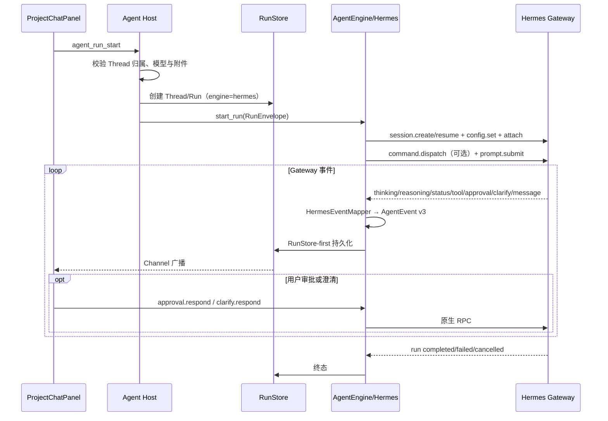

**断线缺口（不得猜完成）**：当前 WebSocket 在 `message.complete` 前断开会明确失败，不伪造 completed。下一阶段需要使用 Hermes Session 状态/消息游标重新连接并对账活跃 Turn；完成前不能宣称支持 Gateway 重启后的无缝续跑。

事件映射原则：Hermes Gateway event → `HermesEventMapper` → SophoNote AgentEvent **v3** → 先 RunStore 再 Channel。`agent_runs` 保存 `engine_transport=jsonrpc+websocket`、`external_session_id` 和协议版本。

| Hermes 侧 | SophoNote AgentEvent v3 |
|---|---|
| `prompt.submit` 已受理 | `run_started`（Surface 本地生命周期） |
| token/message delta | `message_delta` |
| thinking/reasoning delta | `reasoning_delta` / `reasoning_completed` |
| tool started/completed | `tool_started` / `tool_completed` |
| approval request | `approval_required` |
| clarify request | `clarify_required` |
| run completed | `message_completed` + `run_completed` |
| failed / cancelled | `run_failed` / `run_cancelled` |
| 不可恢复中断 | `engine_degraded` + `interrupted` |

#### 23.1.8 当前三引擎文件映射

| 文件/模块 | 当前职责 |
|---|---|
| `agent/commands.rs` | Tauri Run 入口与引擎分派；恢复时区分 Hermes 和 Pi/Claude |
| `agent/engine.rs` | Hermes 与历史测试使用的 AgentEngine 抽象；不要求 Pi/Claude 实现同一 trait |
| `agent/hermes/attached_engine.rs` | Hermes Gateway Session/Run 生命周期与事件适配 |
| `agent/pi/mod.rs` | Pi/Claude 共用的配置快照、Scope、Run claim、审批/文档工作副本准备 |
| `agent/pi/transport.rs`、`agent/pi/tools.rs` | Pi JSONL RPC 与 Host 文件/命令工具 |
| `agent/claude/mod.rs`、`agent/claude/transport.rs` | 模型协议兼容、官方 CLI stream-json、逐 Run MCP 工具桥 |
| `agent/runtime_updates.rs` | Pi/Claude/OpenCode 更新入口、独立进度与更新互斥、官方安装来源识别和 Claude 在途 Run 门禁 |
| `agent/store.rs`、`agent/events.rs`、`agent/types.rs` | 统一业务 DTO、AgentEvent v4、RunStore 持久化与重放 |
| `agent/run_controller.rs`、`agent/adapters.rs` | 历史 Rig 测试/迁移资产，不注册产品回退 |
| `model/*`、`documents/*` | 非 Agent 模型出口；文档唯一安全落盘入口 |

底层协议类型不进入业务 DTO/SQLite/前端 store。更新版本不改变 Thread 引擎或搬运原生历史。

#### 23.1.9 Hermes 历史迁移计划（NEXT-018～025；当前引擎范围见 DEC-053）

| 步骤 | 工作包 | 验收门槛 | 依赖 |
|---|---|---|---|
| H0 | 文档 DEC-011 + 原则修订（本轮） | PRD/架构/台账口径一致 | 无 |
| H1 | `AgentEngine` + `RigAgentEngine` 适配现网 | **已完成**：前端/RunStore 零感；`cargo test agent::` 全绿 | H0 |
| H2 | Hermes Supervisor：签名二进制、环回、Token、health | **已完成（协议 stub）**：`health/detailed` 绿；崩溃不伤 Markdown；真实 Hermes 打包不在此结论内 | H1 |
| H3 | API Server 只读 Run（list/read/search/evidence） | **已完成（协议 stub）**：无写文件；事件入 RunStore；Adapter 内只读工具（非 Bridge） | H2 |
| H4 | AgentEvent v2 + SSE 重连/对账 | **已完成（协议 stub）**：断网→重连或 interrupted；无假 completed；只验证“未来仅安装 SophoNote”的协议形态，未验证真实 Runtime 随包 | H3 |
| H5 | MCP Bridge + Lease + Skill 导出 | **已完成（协议/内存）**：越权/过期 Lease 拒绝；Skill 只读缓存；modelRoute 来自 SophoNote settings（DEC-012） | H4、NEXT-011 协同 |
| H6 | `propose_document_patch` 经 Bridge | **已完成（协议）**：`invoke_with_tools` + Lease；dry-run 不改 notes；审批/DocumentService 不变；`hermes_patch_bridge_h6` | H5 |
| H7 | 黄金任务双跑 Rig vs Hermes | **已完成（自动）**：终态类别一致、写工具不旁路、Lease 边界；`hermes_dual_run_h7`（非宿主录像） | H6 |
| H8 | Hermes 设为默认 | **历史已完成**：DEC-019 曾固定 Hermes；现由 DEC-053 扩展为按会话固定三引擎 | H7 |
| H9A | 移除 Rig 产品回退 | **已完成**：移除 `agent.engine` UI/读取、生产 Run Rig 分支和注册的 Rig Spike 命令；Hermes 不可用明确失败 | H8 |
| H9B | 物理删除 Rig 依赖与历史夹具 | **待清债**：不影响三引擎均不回退 Rig 的产品语义；完成全量 Rust 夹具迁移后删除 `rig-*`、Adapter 与旧循环 | H9A + 回归夹具迁移 |

**优先级纪律**：P0 书写宿主验收优先于 H3+；H 系列不得拖垮输入/切换性能。并发首版 `max_concurrent_runs: 1`。

### 23.2 笔记编辑、保存、预览与 AI 修改

内置功能范例是版本化 Markdown 产品资源，不属于用户笔记真相源。笔记本进入、日期切换与空态渲染不得读取范例后自动落盘；只有用户点击“导入功能范例”时，前端才通过既有 `appStore.saveArticle → Rust notes::insert_article → DocumentService` 链路逐篇创建缺失范例。同名用户笔记不覆盖，重复导入只补缺失项；导入后的文件与普通笔记、模板完全同权，可编辑、改名或删除。开发走查脚本可复用同一批资源，但其直接注入私有数据目录的能力不得成为产品运行路径。

#### 23.2.1 真相源与组件职责

| 层 | 职责 | 不变量 |
|---|---|---|
| `.md` 文件 | 正文长期真相源 | 一篇文档一个 UUID 文件；写入使用唯一临时文件和原子 rename |
| SQLite `articles` | 标题、类型、version、时间、关系元数据 | `version` 是 CAS 闸门，不是用户历史版本 |
| `MarkdownEditor` | Crepe/ProseMirror EditorState、history、selection、Decoration、completion | 正常编辑 transaction 才进入 history；ghost/diff 不写 Markdown |
| `DocWorkspace` / `NoteWorkbench` | 标题、模式、保存、滚动、大纲和编辑器句柄 | 笔记本和 AI 工作室操作同一 Article/Markdown，不复制正文 |
| app/project/change stores | 文档列表、项目关系、变更会话分别管理 | store 不合并；不同生命周期不互相覆盖 |
| DocumentService | AI Patch 预览、应用、拒绝、撤销、补偿和恢复 | baseVersion、TextAnchor、hunk、CAS、幂等和用户决定不可绕过 |

#### 23.2.2 普通编辑与文档切换

当前普通编辑主链为：ProseMirror transaction → 只标记编辑器 dirty → trailing/max-wait 到期后序列化 → `DocumentDraftQueue` 按文档保存 → Tauri 命令 → Rust 文档底层写路径 → 唯一临时文件/原子 rename → SQLite version/索引更新。前端已实现的 `DraftRecord` 等价字段为：

```text
DraftRecord = {
  documentId,
  markdown,
  title,
  dirty,
  generation,
  persistedGeneration,
  savedMarkdown,
  savedTitle,
  inFlight,
  error
}
```

必须遵守：

1. 文档 A 的保存完成回调不能修改文档 B 的 dirty/error/版本状态。
2. 切换文档先同步捕获该文档草稿后立即导航，不等待文件/SQLite；失败必须留在原文档队列并在再次打开时恢复 dirty/error 和重试入口。
3. 外部正文变化不能使用无语义的全量 replace 覆盖活跃 EditorState。同步 transaction 必须明确是否加入 history，并校验目标 documentId/version。
4. 编辑、预览、分屏切换需要保存 selection、scroll、focus 和 editor history；隐藏编辑器必须退出 Tab 顺序并暂停快捷键、补全和扫描。
5. 不允许为了性能绕过原子写、CAS 或保存失败反馈。

第一轮整改已完成 DraftRecord、空闲零轮询、分屏变更快照、关系 idle/输入复用、App/常驻组件 selector、文档非阻塞切换、页面 chunk 预取和编辑后保活。保活不是裸 `display:none`：预览态同时设置 readonly、`inert`、移出交互并暂停补全/选区工具。DEC-047 在页签层对笔记本/工作室最多两个工作区做同样约束，并停泊原生子 WebView。剩余热点为输入停顿时全文序列化、分屏全文渲染、列表插件扫描，以及保活后仍高于 PRD 的暖切换/A/B 数字（见台账 NEXT-004）。

#### 23.2.3 Undo、operation 与 checkpoint

三种机制语义必须分开：

| 机制 | 用户语义 | 生命周期 |
|---|---|---|
| ProseMirror history | `⌘Z/⇧⌘Z` 的连续写作撤销/重做 | 当前编辑会话；AI 应用应尽量合并成一次 transaction |
| `document_operations` | AI 修改提案、决定、冲突、提交和重启恢复的审计 | 按 operation 保留，不形成可浏览版本列表 |
| `document_revisions` | AI 应用前事故恢复 checkpoint | 有界、短期、后续人工写入后失效；不对外包装为版本历史 |

目标约束：每文档最多一个有效 checkpoint，建议 TTL 24 小时；新 checkpoint、后续人工写入、文档删除和 GC 都要清理旧记录。当前此上限和失效清理尚未实现，见台账 ISSUE-007。

#### 23.2.4 AI 局部修改链路

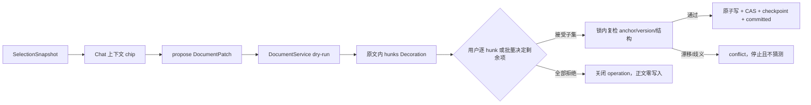

`SelectionSnapshot` 包含文档、版本、ProseMirror 范围、选中文本 hash 和前后文；Rust `TextAnchor` 只接受唯一匹配。零匹配或多匹配都进入冲突。整篇重写属于独立高风险语义，默认不向模型开放。纯拒绝正文零写入，不得依赖草稿保存成功。

多 hunk 审阅条只显示剩余未确认数，并提供逐处导航以及仅图标的“接受全部剩余项 / 拒绝全部剩余项”。批量动作只填充 `pending` 决策，不覆盖用户已经逐处作出的 `accepted/rejected`；仍由 `changeSessionStore` 一次性归约接受子集并走同一草稿 flush、CAS、原子写与冲突路径。已决定区域立即退出待审阅红/绿色样式，拒绝项恢复原文普通态，接受项用正文普通样式展示；在全部 hunk 决定前，这些视觉变化仍是 Decoration，不提前写入 Markdown。

笔记本“今日痕迹”是聚合导航，不属于 Markdown 正文或预览头部。`DocWorkspace` 负责聚合今日笔记、AI 解读与 Top5，并把入口作为 `NoteWorkbench` 顶栏 `⋯` 菜单项；打开后以中央区独立视图覆盖文档工作台，底层编辑器保持挂载但通过 `inert` 冻结，返回后保留原文编辑状态。点击痕迹项先关闭独立视图，再由既有文档/发现导航通道跳转，不复制内容、不写入正文。

笔记本左栏的日期导航采用常驻月视图。活动热度由全量 Article 的本地日期聚合：创建日计一次，若 `updatedAt` 与创建日不同则编辑日再计一次，同一文档同一天去重；这只是已有事实的前端派生，不新增第二份活动数据库。日期筛选只作用于笔记本 `docs`：journal 以合法的 `YYYY-MM-DD` 标题作为所属日，普通笔记以 `createdAt` 本地日作为所属日。切日或“回到今天”只选择该日已有的首篇笔记；没有笔记时保留空列表，不创建历史或今日 journal。文档创建只来自用户点击“新建笔记”或显式模板入口。

### 23.3 Inline Completion

Inline Completion 是写作低延迟旁路，不属于 Agent Run。

#### 23.3.1 组件与状态机

```text
ProseMirror update
  → inlineCompletionSetup（提取 caret/prefix/suffix/title/outline）
  → InlineCompletionController: idle → debouncing(300ms) → requesting → visible
  → Tauri completion_suggest
  → Rust CompletionService → ModelGateway
  → 绑定校验(articleId + documentVersion + anchorHash + prosePos)
  → Decoration ghost
  → Tab 接受为普通文本 transaction / Esc 拒绝
```

- ghost text 仅存在于 Decoration，不进入 Markdown、dirty 或 history；Tab 接受后才作为普通插入进入正文和 undo。
- 任意新输入、选区、光标、文档、version 或 anchor 变化都会取消/丢弃旧结果；服务端取消通过 `CancellationToken` 传播。
- 无 ghost 时 Tab/Esc 完全放行 Crepe 原行为；有 ghost 时捕获阶段拦截。
- frontmatter、代码围栏、表格行、行内代码、链接地址和非折叠选区默认抑制建议。

#### 23.3.2 请求预算、缓存与质量

请求只携带标题、大纲（最多 20 项）、光标前后窗口、语言、项目和绑定信息，不默认发送整篇。前端当前窗口上限为 prefix 400、suffix 200；Rust 使用专用低温、禁思考、`max_tokens=128` 的 Completion 请求。

服务默认超时 3,000ms，可配置并夹紧在 300～5,000ms；内存缓存 TTL 60 秒、最多 64 条，不落盘。建议必须是单一续写、无围栏/结构性列表、与 suffix 不重叠且不超过 120 字；无法自然续写、未配置、超时或错误时返回空建议并静默降级，不弹窗打断写作。

只记录 requests/cacheHits/completes/filtered/timeouts/errors/accepts/rejects/延迟等聚合指标，不记录正文上下文或建议全文。下一阶段以中文自然度、打扰率、接受率和首字延迟判断是否优化，不通过扩大上下文或接入 Agent 来掩盖质量问题。

### 23.4 信息采集、正文证据与沉淀

#### 23.4.1 采集链路

当前支持 GitHub、arXiv、Hacker News、HuggingFace models/papers 和 Product Hunt 等来源。手动刷新与 60 秒调度共用同一抓取入口：

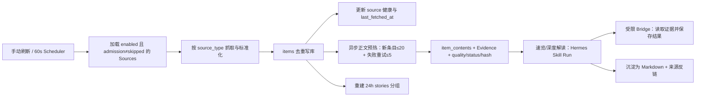

来源状态包含 tier、admission、抓取间隔、成功/失败计数、最后成功和最后错误。`admission=skipped` 的高风险源不进入抓取。每源顺序抓取；正文预热独立后台执行，条目之间节流，失败不阻塞列表入库或写作功能。

#### 23.4.2 数据与质量门禁

| 数据 | 职责 |
|---|---|
| `sources` | 来源配置、分层、准入、间隔和健康状态 |
| `items` | 统一元数据、来源、URL、热度和 AI 摘要标签 |
| `item_contents` | 正文/摘录、Evidence JSON、contentType、qualityLevel、hash、状态和错误 |
| `stories`/关联数据 | 24 小时内跨来源故事聚合与去重视图 |
| Markdown Article | 用户确认后的长期知识沉淀，保留来源链接与 `sophonote:item` 反链 |

AI 速览和深度解读必须使用已抓到的 evidence，并以 `[E1]` 等引用绑定关键判断。`unsupported` 或低质量内容不得伪装成完整证据；失败状态和错误应对用户可见。正文缓存优先复用，backfill 和 coverage 统计用于补齐与诊断，不等同于产品价值指标。

#### 23.4.3 各来源正文与证据策略

| 来源 | 当前证据获取 | 状态/质量要点 |
|---|---|---|
| GitHub Trending | E1 README（最多 18,000 字符）、E2 最新 Release、E3 License/语言/Stars/Forks/更新时间等仓库元数据；token 可选，匿名受限额 | 有 README 为 ready；至少一项证据可达 quality 2，多类证据可达 3 |
| Hacker News | E1 外链 HTML 清洗正文（最多 12,000 字符）或 Ask/Tell HN 自帖；E2 最多 4,000 字符高质量评论，Algolia 优先、Firebase 回退 | 正文少于 400 字符、登录墙或反爬标 partial；非 HTML/超限无其它证据时 unsupported；有评论时可降级为 partial/quality 2+ |
| arXiv / HF Papers | 完整 abstract；arXiv 历史截断摘要按论文 id 回源补齐并回写元数据 | 摘要存在即 ready/quality 2；当前不解析 PDF |
| HuggingFace Models | Model Card（最多 18,000 字符）加模型元数据，官方端点失败时允许受控镜像回退 | 有 Model Card 为 ready；仅元数据为 partial；覆盖率需按源监控 |
| Product Hunt | GraphQL post 详情：description、topics、makers、website、热度等 E1；精选 comments 为 E2 | 无 token、详情不存在时 unsupported；description/comments 均不足时 partial；取得有效详情并过门禁后允许 AI，不再永久排除该来源 |

Evidence 至少保存 `id/kind/title/url/text`，AI 输出中的关键事实必须引用相应 `[Ex]`。来源等级只影响信任权重，不替代内容质量门禁；营销来源拿到充分事实证据后可以使用，官方来源只剩标题时也必须拒绝生成。

#### 23.4.4 网络、缓存与降级

- `ready`、`partial`、`unsupported` 在 24 小时内复用；`failed` 至少间隔 1 小时才重试。内容 hash 未变时不得重复生成 AI 或重建索引。
- HN 外链只允许 HTTP/HTTPS，禁止 `localhost`、`::1`、`.local`、`.internal`、IPv4 10/8、127/8、192.168/16、172.16～31/12、169.254/16 和 0/8；重定向最多 3 次、请求 20 秒、响应体最多 5 MB，只解析 HTML，不执行 JavaScript。
- 安全校验当前基于 URL host/字面 IP；如未来允许更广泛的任意 URL 抓取，需要补 DNS 解析后私网校验和逐跳重定向复检，避免 DNS rebinding/重定向绕过。
- 所有第三方 HTTP 都由 Rust 发起，WKWebView 不直接跨域请求；批量抓取按条目节流并记录来源、HTTP 状态和错误，不得阻塞 Markdown 写作主链路。
- GitHub 匿名 API、HF 镜像、Product Hunt token 或模型不可用时，保留元数据和失败原因；编辑、搜索本地文档和导出继续可用。

#### 23.4.5 演进方向

- 外部来源、模型或镜像不可用时，已有 Markdown 编辑、搜索和导出必须正常；Discover 显示失败/部分内容而不是阻塞应用。
- GitHub 匿名 API、HuggingFace 镜像和 Product Hunt token 都可能受限；批量调用必须限速，错误保留 HTTP 状态和来源维度。
- 下一阶段不以“抓取条数”单独评价成功，需同时观察来源成功率、正文覆盖、重复率、打开率、AI 解读触发率和沉淀率；低价值或高失败来源应降级、暂停或移出默认集合。
- daily-picks 的联网增强保持确定性 workflow + 受控 Agent 步骤，不允许后台 Agent 自建调度器或绕过现有证据/写入链路。

### 23.5 新版产品壳、会话与知识组织

#### 23.5.1 目标页面组件树

```text
AppShell
├─ PrimarySidebar
│  ├─ 发现
│  ├─ 会话
│  ├─ 工作室
│  ├─ 笔记本
│  ├─ 计划任务
│  └─ 工具 / 任务
├─ PageHeader
│  └─ EmbeddedAgentToggle（仅工作室/笔记本）
├─ ActivePage
│  └─ AgentScopeProvider
└─ EmbeddedAgentPanel（仅工作室/笔记本，可折叠）
   ├─ ConversationCore(mode="compact")
   └─ BrowserSurface(threadId)

ConversationPage
├─ ConversationHistoryPane
├─ WorkArea
│  ├─ ConversationCore(mode="full")
│  └─ CodeWorkspace（绑定目录后）
│     ├─ FileTree / CodeEditor / CodeDiffReview
│     └─ TerminalSurface / PreviewSurface
└─ CollaborationPane
   ├─ Chat
   └─ BrowserSurface(threadId)

StudioProjectView
├─ ProjectNavigator
│  └─ Project → existing Sessions（为空则不展示子项）
├─ IDECanvas
│  └─ LocalWorkspace（Files / Changes / Terminal；代码与 Markdown 同源编辑）
├─ MoreMenu
│  └─ BrowserSurface(threadId)
└─ AgentPane
   └─ ConversationCore(mode="project"，权限控制唯一入口)

NotesView
├─ NoteTree / DocumentWorkbench
└─ EmbeddedAgentPanel
   ├─ ConversationCore(mode="note")
   └─ BrowserSurface(threadId)

Discover / Inbox / Tools
└─ ContextHandoffAction
   └─ 选择新建/已有 Thread → ConversationPage

ArtifactsPage（未来，只读投影）
└─ Project / Note / Memory Summary / Outcome → 打开来源对象
```

`ConversationCore` 目标只接收稳定参数：`threadId`、`mode`、`scopeDescriptor`、`selection` 和 UI 回调；消息、Run、过程轨、附件、模型、工具卡、审批状态均从现有 `agentStore` 以精确 selector 获取。`ProjectChatPanel` 的项目列表/文档选区适配层应留在工作室容器，不进入通用内核。

#### 23.5.2 页面入口、作用域与能力矩阵

| 页面 | UI 入口 | ScopeProvider 候选上下文 | 默认能力 | 高影响能力 |
|---|---|---|---|---|
| 发现 | 条目/故事“在会话中解读”，无嵌入面板 | 当前主题/筛选、选中 item/story、Evidence 引用 | 读取、比较、摘要、生成解读建议 | 收藏、沉淀知识、发起正式解读；需明确目标 |
| 会话 | 完整 Agent 任务窗口；会话级 WorkspaceBinding、权限模式与审批都在 Composer/会话头控制 | 显式附件、URL、用户选定知识引用、会话级 WorkspaceBinding | Hermes 通用模型、可见 Browser、授权目录读取、代码提案 | 文件写入、Terminal、Browser 副作用和 Git 操作按会话权限模式审批；无默认全库读取 |
| 工作室 | Cursor 式 IDECanvas + 右侧 AgentPane；左栏为项目及实际会话 | projectId、项目 WorkspaceBinding、当前本地文件/选区、项目 Skill | 本地代码/Markdown 读取编辑、Git Diff、Terminal、Browser、代码提案 | 文件写入经 Workspace/CodeChange 边界；权限只从 AgentPane 调整，Terminal/项目变更强确认 |
| 笔记本 | 右侧 Chat/Browser，首次默认收起 | 当前 article/version/选区、显式相关笔记、当前 Browser 引用 | 阅读、浏览、整理、改写建议、提取待办 | 创建/Patch/重命名/移动经 DocumentService；不提供通用代码写入 |
| 收件箱 | 原始条目处理与检索，无嵌入面板 | 当前筛选、选中条目、关键词/语义搜索结果 | 搜索、阅读、收藏、归档和索引 | 删除仍需确认；未来知识沉淀能力不在本页面提前实现 |
| 工具/任务 | 对象级“让 Agent 处理”，无嵌入面板 | 当前筛选、选中任务、来源会话/文档 | 规划、拆解、排序建议 | 创建/更新/完成/批量操作；预览、幂等、审计 |
| Artifacts（未来） | 只读积累投影，无嵌入 Chat | 选中项目/笔记/记忆摘要/成果的稳定引用 | 浏览、筛选、跳回来源 | 不直接编辑正文、记忆或知识索引；副作用回到来源对象执行 |

`ContextHandoff` 目标 DTO 只表达交接意图，不直接作为 Run 授权：

```text
ContextHandoff {
  sourceSurface,
  entityRefs: [{ type, id, version? }],
  selectionSnapshot?,
  intent: "interpret" | "compare" | "search" | "plan" | "operate",
  returnTarget
}
```

用户选择目标 Thread 后，`ContextHandoff` 转成可见的附件/上下文 chip；Rust 再将合法引用解析为 `ScopeSnapshot`。对象已删除、版本变化或无权限时必须逐项提示，不能静默扩大到当前集合或全库。

能力集合目标：

```text
allowedTools =
  surface capability profile
  ∩ thread/project scope
  ∩ active Skill declaration
  ∩ Hermes reported tool/MCP capabilities
  ∩ user policy
  ∩ SidecarLease.allowedTools
```

未知页面、缺少作用域、实体版本失效或归属不一致时默认降级为无页面上下文的只读会话，不猜测扩大范围。

#### 23.5.3 同一文档域

手工笔记、Journal、发现条目沉淀的深度解读、Agent 记忆引用的 Markdown 资产和工作室项目文档都是同一个 `Article + notes/<id>.md` 文档域；“发现/深度解读”“笔记本”“工作室”是入口和组织视图。Hermes Memory 不复制正文，未来 Artifacts 只引用这些对象。Journal 按日期定位，发现条目通过 `sophonote:item` 来源反链沉淀；note chunks、双链、任务和全文/语义搜索都消费同一 Markdown。

当前知识工作台已覆盖：编辑/预览/分屏、大纲、模板、资产、标题/正文搜索与命中高亮、全局 `⌘K`、双链/反链/未链接提及、别名、标题/块引用和嵌入、悬停预览、任务聚合与 checkbox 回写、Finder 式多选/右键操作、单篇/全库 Markdown 导出、存储统计和孤儿资产清理。性能优化不得拆成第二套正文模型或丢失这些能力。

#### 23.5.4 项目模型、会话归属与调用边界

```text
projects（扁平项目）
  └─ project_documents（article_id 单一项目成员关系 + parent_id 文档树）
       └─ articles → notes/<articleId>.md（与笔记本共用）

ProjectChatPanel
  → Run 只取得当前 projectId、成员文档工具、显式 SelectionSnapshot、激活 Skill
  → 读取工具复核 project_documents
  → 修改工具只生成 Patch
  → 用户在同源 Markdown 编辑器内逐 hunk 决定
```

新版目标补充：

```text
projects
  ├─ project_documents（历史兼容关系；DEC-036 后不再展示/新增，迁移时仅解除）
  ├─ agent_threads.project_id（一个项目多个会话；会话最多归属一个项目）
  ├─ workspace_bindings（目标：项目可持久关联授权目录/仓库）
  ├─ knowledge references（目标：引用关系，不复制资产）
  └─ tasks.project_id（目标：行动关系）
```

DEC-036 将两类入口按任务分工：一级会话使用 Codex/Claude Code/Cursor Agent 式自然任务流，中央只呈现对话、过程、审批和结果；工作室使用 Cursor 式 IDE 布局，本地 `WorkspaceBinding` 文件树与编辑器占据中央，AgentPane 固定在右侧协作。三种权限模式、目录范围和高影响审批只在会话窗口呈现和修改，IDE 工具栏不得产生第二套权限状态。

项目导航只展示真实项目会话；`ProjectChatPanel` 在工作室隐藏自身会话标签/历史，避免同一 Thread 出现两份导航。项目不再展示或新建 SophoNote Article 文档树，本地目录内 `.md` 即项目文档，可与代码文件一起编辑。历史 `project_documents` 在兼容期保留读取迁移能力但不进入当前 UI；删除项目只删除项目元数据/绑定并解除旧关系，不删除 Article/Markdown 正文。

DEC-037 进一步把 IDECanvas 固化为 VS Code Workbench 区域模型：项目/会话轨默认折叠；`LocalWorkspacePanel` 内部由 Activity Bar、Explorer/Search/Source Control 主侧栏、带 Breadcrumb 的多标签 Editor、编辑器下方 Problems/Output/Terminal Panel 与 Status Bar 构成；`ProjectChatPanel` 是右侧 Secondary Side Bar。文件打开、切换、关闭、脏状态、直接编辑、`Cmd/Ctrl+S` 保存、`Cmd/Ctrl+P` 文件筛选与 `Ctrl+\`` 终端切换属于 Host UI 行为，真实读写/命令仍必须经过 WorkspaceService 和权限模式。Browser 从省略号打开为 Editor 标签；会话、工作室和笔记本共用 `NativeBrowserSurface`，按可见标签懒创建、关闭标签即回收 Tauri 原生子 WebView。DEC-047 页签保活隐藏时不销毁仍打开的 Browser，而是把子 WebView 停泊到屏外 1×1，避免 `hidden` 后宿主矩形为 0 却仍覆盖当前页。支持普通网页、localhost、远程 PDF URL 和用户通过系统选择器明确授权的单个本地 PDF。不得使用会被站点 `X-Frame-Options`/CSP 普遍阻断的 HTML iframe 充当浏览器，也不得为浏览本地 PDF 放宽整个目录或任意文件协议访问。Host 内部 PreviewSession 仍可服务 Agent 验证，但不恢复独立 Preview 顶级标签。

DEC-038 将 `ProjectChatPanel` 的 Composer 固化为会话、工作室和笔记本共用的唯一任务控制面。底部 `leftSlot` 依次渲染添加按钮、`AgentEngineControl` 和 `ComposerPermissionControl`；权限值由拥有会话的 Surface 受控传入，未提供回调的笔记本使用面板内会话状态，任何情况下都不得把权限重新放入工作区 Header、IDE 工具栏或范围芯片。`AttachmentPickerPopup` 同时承载附件与 Skill：主层包含文件、文件夹、图片、粘贴图片、URL 和 Skill 入口，Skill 子层在同一浮层内选择 Hermes Skill 或普通对话；独立 Sparkles Skill 按钮和第二套 Skill Popup 已删除。工作范围芯片只表达路径/文档范围与移除动作，不混入权限选择。

现有项目 Chat 迁移为共享会话内核的 project filter。把快捷会话归属项目时，必须校验无非终态 Run、目标项目存在和用户确认；更新 `project_id/scope` 后继续复用 `external_session_id`。项目长期记忆只接收用户允许的摘要/成果引用，不把完整 RunStore 消息镜像成第二套记忆。

DEC-036 覆盖 DEC-010 的项目删除级联语义：项目不再拥有 Article/Markdown 正文，`project_delete` 事务只清理历史 `project_documents` 关系和项目元数据，返回空正文删除列表；笔记正文、版本、索引和 Markdown 文件全部保留。

DEC-036 覆盖旧 DEC-010：**删除项目只移除项目元数据与历史 `project_documents` 关系，不删除任何 Article/Markdown、本地工作树或会话历史**。若未来需要删除正文或会话，必须从对应真相源发起独立高风险操作，不能随项目删除默认勾选。

当前项目工具提供受限读取和 Patch 提议，不等于完整 RAG：跨文档召回、ContextAssembler、token 预算、引用归并和自动 chunk 更新需作为独立 P2 链路实现并验收。

### 23.6 历史故障沉淀的实现不变量

以下规则来自历史实施/回归中已经出现过的故障，现作为当前架构约束保留，不再要求开发者回查旧审计文档：

1. SQLite 可空字段判断使用 `IS NULL/IS NOT NULL` 或应用层 `!= null` 语义，不能把 `NULL` 当普通布尔比较值。
2. 来源 upsert 只能更新来源拥有的字段，必须保留 read/starred/saved、用户标签、笔记和已有 AI 结果；全量覆盖属于数据破坏。
3. 所有第三方 HTTP 经 Rust；批量外部 API 要节流并保存 HTTP/status/error，开发期 WebView 自动 reload 会中断长任务，验收长任务必须使用稳定宿主构建。
4. HuggingFace 官方端点不可达时使用受控镜像回退，但镜像结果必须保留来源并执行同一质量门禁。
5. sqlite-vec 查询显式传入合法 `k`；优先 vec 检索 id，再读取业务行，不能假设普通 SQL JOIN/隐式 limit 与虚表兼容。
6. Markdown 文件与 SQLite 没有共享事务；写入必须采用唯一 tmp、prepared/rename/CAS/补偿和启动恢复，不能把“数据库成功”当作文件必然成功。
7. 文档保存、任务回写、重命名和 Agent Patch 必须汇入受控 repository/service，不得各自发明旁路写文件。
8. 开发期未签名应用访问 Keychain 可能反复授权；现行代码不再把 Provider Key 回传 WebView 或写入 settings，旧 SQLite 明文仅作为一次性迁移源。发布必须在 Developer ID 签名产物中完成 Keychain 迁移、CSP、权限和日志检查。

### 23.7 冻结参考：旧自适应知识库、Git 版本与证据层

DEC-027～029 后，本节只保留为隐藏知识层的技术研究输入，不是 Library UI 实现目标。旧 Library 页面已经废弃，其信息条目能力归并原 Settings/Inbox，且 Inbox 不进入一级导航；知识层只服务项目、笔记、资料、会话与未来 Artifacts 投影的检索/版本/证据/关系。当前 Agent 长期记忆正文由火山 OpenViking 持有（§23.12），不是本节的本地 Context Adapter，也不是 Hermes 磁盘 MEMORY。不得仅依据本节恢复旧入口、创建独立知识列表或把知识对象复制成记忆。

### 23.8 收件箱 7 天 TTL 与长期记忆边界

- `items.first_fetched_at` 是首次成功写入本地收件箱的 UTC 时刻，一经创建不可修改；`last_seen_at` 记录最近一次被数据源再次观测的时刻；`expires_at = first_fetched_at + 168 hours`。
- 数据源重复返回同一稳定 `item.id` 时，只更新元数据、`fetched_at` 兼容字段和 `last_seen_at`；手动刷新、自动刷新、阅读、收藏、归档均不得修改 `first_fetched_at` 或 `expires_at`。
- 所有收件箱查询必须在 SQLite 层追加 `expires_at > datetime('now')`，不能依赖前端缓存隐藏。列表采用 `limit + offset` 分页，关键词筛选也在 SQLite 执行，取消固定 300 条窗口。
- 应用启动与每轮抓取完成后清理过期条目。清理范围包括 `items`、`item_contents`、`item_chunks`、收藏关系、发现临时引用及条目/分片向量，并在清理后重建故事聚合；已由条目沉淀形成的 Markdown `articles` 只解除 `item_id` 关联，不删除正文。
- 长期保留只允许通过项目文档、笔记、会话成果或用户授权的 OpenViking Agent 记忆写入完成。收件箱状态不是长期保留策略，收藏也不豁免 TTL；隐藏知识层不建设 Library 展现层，未来 Artifacts 只投影来源对象。

本节吸收《Sophonote 自适应知识库技术设计及需求文档》中“知识对象、版本证据、变更影响和可治理检索”的核心意图，但按 SophoNote 已有架构做如下收敛：

- V1 保持 macOS 本地单用户，不引入 PostgreSQL、OpenSearch、远程 Knowledge Service 或本地 OpenViking 进程作为启动依赖。火山云端记忆是可选外发能力，见 §23.12。
- `.md` 仍是正文真相源，Git 是语义版本真相源，SQLite 是可重建的元数据/检索/治理投影，各引擎原生 Session 是会话历史真相源，火山 OpenViking 是可选 Agent 长期记忆正文真相源。
- 知识库只建立 `memory_evidence_links`，不镜像 Hermes Memory 正文；因证据变化而失效时，标记外部引用待复核，不静默改写记忆。
- 默认执行面是 Rust + SQLite 的 Native Lite：Hot 目录层小而常驻，Warm 工作集按字节配额缓存，Cold 原文/版本从 SSD 按需读取。第三方 Context Database 只能是可停用 Adapter。
- memory-entry、PDF 页、chunk、Claim 和会话消息是不同计量对象；任何容量报告必须分开记录，禁止以“页数=记忆数”或“文档数=常驻内存”估算。
- “自适应”首期指可以根据资产类型、查询意图、证据新鲜度和变更风险动态选择检索/复核策略，不是无人监督的自动改知识。

#### 23.7.1 逻辑架构与真相源

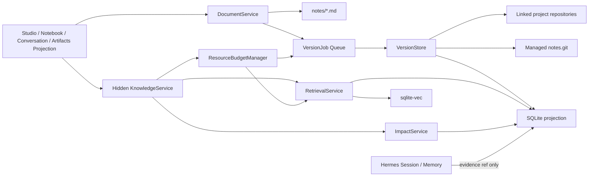

| 数据 | 真相源 | 投影/缓存 | 可否自动重建 |
|---|---|---|---|
| 当前笔记/沉淀文档正文 | `notes/<articleId>.md` | `articles`、`note_chunks` | 是，从 Markdown 重建元数据/索引 |
| 笔记语义版本 | `version/notes.git` 的 commit/tree/blob | `document_versions` | 是，从 commit manifest 重建 |
| 外部项目版本 | 授权本地仓库的 commit OID | `repositories`、`repository_projects`、`document_versions` | 是，只要对象未被清理 |
| Claim/Decision/关系 | SQLite 治理表 | UI/检索派生状态 | 否，必须备份 DB；但引用可对账 |
| EvidenceAnchor | SQLite 锚点 + Git OID/path/range/hash | chunk 命中和当前映射 | 部分；原始证据可读，人工确认的语义不可伪造 |
| Session/Memory 正文 | Hermes Runtime | `memory_evidence_links` 只存外部 ID/证据 | 由 Hermes 负责，SophoNote 不复制 |

#### 23.7.2 仓库模式与授权

**Managed Notes Repository**

- SophoNote 为受控 `notes/` 创建 bare 仓库，用 tree builder 写入稳定快照，不需要把 `notes/` 变成可 checkout working tree。
- tree 内使用稳定路径 `documents/<articleId>.md`，另写 `.sophonote/manifest.json`，记录 schemaVersion、articleId、contentHash、trigger、sourceOperationId、sourceRunId（可空）和当时标题。
- Git 仓库默认只保存 Markdown/小型文本和 manifest。新导入的 PDF/大附件只在 `knowledge/blobs/<sha256>` 保存一份内容寻址原文；已存在于 `notes/assets` 的附件继续原位引用。manifest 存 hash/size/mediaType/sourceRef，避免 assets、Git 和索引三份复制。
- 初次开启只建一个“当前基线”commit，明确标记 `historyBeforeBaseline=unknown`，不根据 `updatedAt` 倒造历史。

**Linked Project Repository**

- 用户可把 SophoNote Project 关联到现有本地 Git 仓库，选择授权的 root、ref 和 include/exclude glob；应用保存 bookmark/security-scoped access，不得扫描其他目录。
- 默认只读 commit 对象，不自动 `add/commit/push/pull/checkout`。当项目中由 SophoNote 管理的成果需写入现有仓库时，另作为显式高影响操作立项，不在 V1 默认开放。
- Working Tree 内容只能作为标记 `uncommitted` 的临时上下文，不能成为正式 Claim/Decision 证据；正式证据必须绑定不可变 commit OID。

仓库状态机：

```text
unlinked -> authorizing -> indexing -> ready
                       \-> denied | failed
ready -> stale(ref drift/path unavailable) -> reauthorizing -> indexing -> ready
ready -> paused -> indexing -> ready
ready -> unlinked       // 只删投影/授权，不删用户仓库或 Git 对象
```

#### 23.7.3 语义版本写入链路

版本触发点限于：

1. 用户显式“保存版本”；
2. Agent Document Patch 已审阅并成功提交；
3. 文档/项目成果发布或标记里程碑；
4. Claim/Decision 的证据需从临时引用升级为正式引用；
5. 系统在空闲期对距上一语义版本有实质变化的 autosave 进行合并快照，且用户可关闭。

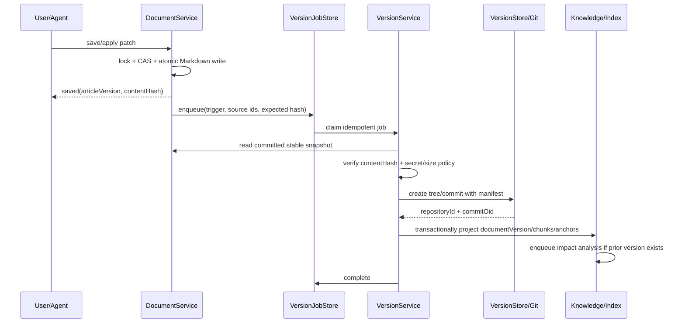

不变量：

- Markdown 保存成功与 Git 建版分属两个可观测状态；版本建立失败不伪装成保存失败。
- `idempotencyKey = repositoryId + entityId + contentHash + triggerGroup`；重试只能返回原 commit 或补齐投影，不能产生第二个等价 commit。
- commit author 是 SophoNote 本地应用身份，actorType/actorId 写入 manifest/SQLite；用户名和邮箱不得从全局 Git config 静默抵充。
- commit message 只是人类摘要，真正的变更依据由 trigger、sourceOperationId、sourceRunId、parentOid、diffStat 和 EvidenceAnchor 共同构成。
- 从旧版恢复不移动 HEAD 或覆盖 `notes/`；先展示版本 diff，再把选定内容转成 DocumentService Patch，用户确认后形成新版本。

#### 23.7.4 核心数据模型

以下是目标逻辑 schema；实际 SQLite DDL 必须通过幂等 migration 落地。时间使用 UTC epoch，JSON 字段需 schemaVersion。

```text
repositories(
  id PK, mode managed_notes|linked_project, display_name, root_locator?,
  default_ref?, head_oid?, include_globs_json, exclude_globs_json,
  authorization_state, index_state, last_indexed_at?, created_at, updated_at
)

repository_projects(
  repository_id, project_id, ref_name?, path_prefix?,
  PRIMARY KEY(repository_id, project_id)
)

document_versions(
  id PK, repository_id, entity_type, entity_id, commit_oid, parent_oid?, path,
  article_version?, content_hash, trigger, summary?, actor_type,
  source_operation_id?, source_run_id?, manifest_json,
  created_at, UNIQUE(repository_id, commit_oid, path)
)

evidence_anchors(
  id PK, repository_id, commit_oid, path, anchor_type,
  start_line?, end_line?, heading_path_json?, quote_hash?, context_hash?,
  chunk_id?, status active|stale|orphaned, created_at, last_verified_at?
)

knowledge_claims(
  id PK, claim_type fact|decision|hypothesis|constraint|artifact,
  title, statement, status draft|active|superseded|conflicted|retracted,
  confidence, valid_from?, valid_to?, owner_scope_type, owner_scope_id?,
  superseded_by?, created_at, updated_at
)

knowledge_evidence(
  claim_id, evidence_anchor_id, role supports|contradicts|context|derived_from,
  weight, note?, created_at, PRIMARY KEY(claim_id, evidence_anchor_id, role)
)

knowledge_relations(
  source_claim_id, relation depends_on|supersedes|conflicts_with|implements|derived_from,
  target_claim_id, created_at, PRIMARY KEY(source_claim_id, relation, target_claim_id)
)

change_impacts(
  id PK, from_version_id, to_version_id, affected_type, affected_id,
  reason_code, severity low|medium|high, status pending|accepted|dismissed|resolved,
  explanation, created_at, resolved_at?
)

memory_evidence_links(
  hermes_memory_id, evidence_anchor_id, relation grounded_by|derived_from,
  status active|stale|reviewed, last_checked_at,
  PRIMARY KEY(hermes_memory_id, evidence_anchor_id, relation)
)

version_jobs(
  id PK, kind commit|index|impact|rebuild, repository_id, entity_id?,
  idempotency_key UNIQUE, payload_json, state queued|running|succeeded|failed|cancelled,
  attempts, available_at, lease_until?, last_error?, created_at, updated_at
)
```

约束：

- `document_versions.commit_oid + path` 必须能读到与 `content_hash` 一致的 blob；不一致视为完整性错误，不进检索。
- active Claim 至少有一个 active EvidenceAnchor，否则只能是 draft/unverified；Decision 另需记录决策时间、备选和选择理由。
- `superseded_by` 不能形成环；`knowledge_relations` 传播有最大深度/节点预算，禁止无界图遍历。
- EvidenceAnchor 必须先按精确 commit/path/line 定位，再用 quote/context hash 校验；映射新版只是派生关系，不改写旧锚点。

#### 23.7.5 Chunk、索引与版本感知检索

Chunking 以 Markdown AST 语义边界优先：`document -> heading path -> paragraph/list/table/code block`；过长节再按 token 窗切分，保留 10%～15% overlap。chunk 稳定 ID 使用 `repositoryId + commitOid + path + headingPath + ordinal + textHash`，不用可变的行号作为唯一标识。

索引内容：

- 当前文档：全文/BM25 投影、标题/标签/项目/类型/时间元数据。embedding 只对当前、固定和近期活跃工作集增量生成，不以“已导入”为理由全量建向量。
- 历史版本：默认只保留最新、里程碑、被证据引用和时间窗内版本的向量；其余仍可由 Git 精确读取，需要时再延迟索引。
- diff 索引：对相邻语义版本保留 changed chunk IDs、文本摘要、触发依据和风险标签，用于回答“什么时候、为什么改了”。

查询规划：

```text
QueryIntent = lookup | explain_change | compare | decision_trace | current_truth | historical_truth
Filters = scope + repository + project + assetType + version/time + claimStatus
Candidates = lexical(title/tag/body) union optional_warm_vector(chunk) union graph(claim/relation)
Rerank = semanticScore + lexicalScore + scopeMatch + evidenceQuality
         + versionFreshness(current_truth only) + explicitPin
Assemble = dedupe by claim/content lineage -> token budget -> citation required
Answer = statements + [source title, repository, commit short OID, path/range]
```

- `current_truth` 只召回当前 active Claim 和目标 ref 可达最新版；`historical_truth/explain_change` 必须保留时间线，不用最新内容覆盖历史。
- `optional_warm_vector` 只在目标 scope 的 Warm 索引 fresh 且资源状态允许时执行；Lite/受限/critical 状态直接 lexical + graph，引用完整性不变。
- 没有证据的模型推断必须明确标“推断”，不能生成虚假 commit/path/行号。引用加载失败时降级为候选列表，不生成无根据结论。
- 导入外部仓库后先做增量 diff 索引；只有索引版本与目标 commit 一致时才对外标记 fresh。

#### 23.7.6 Claim、Decision、影响分析与长期记忆

Claim 是“可被证据支持或否定的知识陈述”，Decision 是 Claim 的专门类型，至少包含 `context / options / decision / rationale / consequences`。Artifact 代表可交付成果。三者都是对 Markdown/Git 证据的结构化索引，不取代原文。

当新语义版本产生时，ImpactService 仅对 changed chunks 与其入边执行有界分析：

1. 标记落在被删除/重写区域的 EvidenceAnchor 为 stale；
2. 找出依赖这些锚点的 active Claim/Decision/Artifact、Hermes Memory 引用和已发布成果；
3. 根据变更类型评估严重度：格式/措辞=low，数值/约束/结论=medium，删除依据/决策反转/冲突=high；
4. 生成待复核项，附 old/new 证据、diff 和受影响对象；
5. 只有用户或明确授权的 Agent 才能接受替代、撤回 Claim 或要求 Hermes 更新 Memory。

长期记忆写入规则：

- 会话中的普通助手文本、用户原话和工具输出不自动升格为知识或 Memory；用户确认“沉淀”后，先产生 Markdown/Artifact 和语义版本，再建立 Claim/Evidence，最后才可生成有界 Memory 候选。
- PDF 页、抽取 chunk、网页正文和 Git blob 永远是 Knowledge Resource，不因可检索就转成 Memory。一个资料可有大量 chunk，但通常只产生 0～少量已确认 Claim/Decision/Memory。
- OpenViking 记忆只存稳定用户偏好/约束、项目目标/当前状态、已确认 Decision、未完成事项和最新成果摘要。每次里程碑最多生成少量候选，必须有 scope/evidence/expiry 并由用户确认；自动同步的会话提取不能冒充已确认知识。
- Memory 引用变 stale 后，SophoNote 只标记外部引用待复核，经用户确认后再改云端记忆正文；不静默改写，不把 Claim 正文复制进 OpenViking。

#### 23.7.7 Tauri 命令与前端交互

目标命令按服务边界暴露，不向 React 暴露任意 Git 参数：

```text
repository_list()
repository_link_project(projectId, authorizedPath, refName, include, exclude)
repository_pause(repositoryId)
repository_unlink(repositoryId)
repository_reindex(repositoryId)

version_create(entityType, entityId, trigger, summary?, expectedArticleVersion?)
version_list(entityType, entityId, cursor?)
version_compare(baseVersionId, targetVersionId)
version_restore_preview(versionId, currentArticleVersion)
version_restore_apply(operationId, acceptedHunks[])

knowledge_search(query, scope, intent, filters, limit)
claim_create_draft(type, statement, evidenceAnchorIds[])
claim_review(claimId, action, replacementClaimId?)
impact_list(scope, status, severity?)
impact_resolve(impactId, resolution, operationId?)
```

- 所有列表都分页，有明确 loading/empty/partial/stale/error 状态；“已保存”与“已建版”使用两个不同状态，避免误导。
- 项目、笔记、会话引用详情显示当前版本、最后变更依据、证据、受影响项和相关 Claim；未来 Artifacts 只汇总这些状态并跳回来源对象。两版比较以语义 chunk 为单位，仍可切换原始 diff。
- 项目仓库连接向导先展示将索引的目录/排除规则/预估文件数，用户确认后才建索引；敏感文件命中时默认排除并可见。
- 高风险变更的影响中心按“依据变了什么 → 可能失效什么 → 建议处理”展示，不只给 AI 分数。

#### 23.7.8 安全、性能、保留与可观测性

- 建版前二进制/大文件/凭据扫描先于 Git object write；规则命中不把可疑内容发送到模型，就地中止并指定路径。
- 自动语义快照默认低频、可关闭；明确版本、被 Claim/Evidence 引用的 commit 和发布里程碑永不被自动 GC。未引用空闲快照可按数量/时间/字节三重配额压缩。
- 首次当前 FTS 索引和选定 Warm 向量作业都可暂停/取消/续传，作业租约超时后可重领；向量 API 不可用时保留全文检索、精确 Git 引用和版本比较。
- 记录 `jobLatency/indexLag/commitCount/objectBytes/anchorStaleRate/impactPending/searchCitationRate`，不记 chunk 原文或搜索原问。诊断导出只包含路径 hash、OID 短值、状态和错误分类。

#### 23.7.9 分期实施、迁移与验收

| 阶段 | 交付 | 准入/退出条件 |
|---|---|---|
| KB-0 契约与基线 | `VersionStore`/DTO/schema/feature flag，当前 notes baseline 预览 | 不改当前保存时延；备份与一键停用可用。2026-08-27 已落 schema、`knowledge.version.enabled` 默认关闭、只读预览与 unlinked 停用；尚未写 Git |
| KB-0L 轻量资源基线 | `ResourceBudgetManager`、Hot/Warm/Cold、1 GiB Memory Envelope、共享 lease、空间预检和压力降级 | 8GB 不启动额外知识/Embedding 进程仍可 FTS/引用/编辑；稳态/P95≤768 MiB、峰值<1 GiB；各进程、预算池与磁盘分区可观测 |
| KB-1 语义版本 | managed notes bare repo、幂等 job、版本列表/比较/恢复 Patch | 100% commit/blob/hash 对账；Git 故障不丢正文；P95 保存不因同步 commit 回归 |
| KB-2 项目溯源 | 链接授权仓库、过滤/敏感扫描、commit-aware chunk | 越界路径不可读；force-push/ref drift 可见；可暂停/重建 |
| KB-3 可信检索 | hybrid retrieval、查询意图、引用展示、黄金问题集 | Top-k/引用准确率达基线；无证据不伪造回答；旧/新版语义不串台 |
| KB-4 知识治理 | Claim/Decision/Artifact、EvidenceAnchor、supersede/conflict | 所有 active Claim 可回溯至不可变 commit；决策链可比较 |
| KB-5 影响与 Memory grounding | change impact queue、Hermes evidence link/review | 删除/改写依据可生成有界待复核；不复制/直写 Hermes Memory |

迁移只增加表、`version/` 和新导入使用的 `knowledge/`，不搬移 `notes/`，不突然复制存量 assets 或全库生成 embedding。任一阶段失败均可通过 feature flag 停用新 UI/后台作业；Markdown、旧索引、编辑、导出和 Hermes 会话继续工作。不得为回滚删除 Git 对象、Claim 或 Evidence，应保留到用户确认清理。

每阶段必须以下列固定黄金任务回归：

1. “这条项目决策的原始依据、当时版本和后续替代是什么？”
2. “某篇笔记从 A 到 B 改了什么，是谁/哪个 Run/哪次审批触发的？”
3. “如果这个接口约束已修改，哪些 Claim、文档、成果和长期记忆可能失效？”
4. “只使用 2026-06-01 时已知的资料回答，并附可打开的 commit/path 证据。”
5. Git 仓库不可读、embedding 不可用、App 中途退出后，验证正文不丢失、作业可恢复、证据不被伪造。

#### 23.7.10 本地轻量执行面与资源治理

**一、本地必须做什么**

SophoNote 原生知识层只承担离线产品闭环不可缺少的能力：

1. 保存用户原始资料、当前 Markdown、语义 Git 版本和可打开 EvidenceAnchor；
2. 保存 Resource/Claim/Decision/Artifact 的轻量元数据、权限、状态和关系；
3. 提供可降级的 FTS5 检索，只对 Warm 工作集增量提供 sqlite-vec；
4. 按需加载冷原文/历史版本，组装有引用的小上下文包给 Hermes；
5. 计量内存、磁盘、队列和索引新鲜度，在资源压力时有序降级。

本地知识层不负责：复制 Hermes Session/Memory 正文、常驻所有 PDF/L2、向量化每条历史消息/每个旧版本、托管本地大模型，或为毫秒级服务端并发将全库预加载内存。

**二、分层数据面**

```text
Hot Catalog（SQLite，小而常驻/分页）
  resource id/title/type/scope/status
  current claim/decision summary
  FTS rowid + evidence/version coordinates
           |
           v on demand
Warm Working Set（SQLite/cache，有界 LRU）
  current document + pinned resources + recent active projects
  extracted text + chunks + selected vectors + short summaries
           |
           v exact hit / user opens
Cold Evidence Store（SSD，不常驻）
  content-addressed PDFs/assets/raw pages
  Git commits/blobs/history
  Hermes session/message references
```

Hot/Warm/Cold 是 SophoNote 产品层级，可以映射到某个 Adapter 的 L0/L1/L2，但不绑定其内部存储实现。原始大文件只在 `knowledge/blobs` 保存一份；提取文本、OCR、thumbnail、embedding 和 rerank cache 全是可重建派生数据。

**三、ResourceBudgetManager**

```text
inputs:
  physicalMemory, memoryPressure, freeDiskBytes, freeDiskRatio,
  hostRss, hermesRss, adapterRss?, embeddingRss?,
  kbSqliteCacheBytes, l0CacheBytes, warmCacheBytes,
  queryWorkspaceBytes, ingestWorkspaceBytes, memoryWorkspaceBytes,
  queuedJobs, activeQueryCount

state:
  normal -> constrained -> critical -> guarded -> recovering -> normal

normal:
  envelope < 768 MiB，可执行前台查询或一个后台重阶段
constrained:
  envelope >= 768 MiB，禁止预取/rerank，并发=1，暂停导入、embedding、impact/compaction
critical:
  envelope >= 896 MiB，清 Warm LRU，停可选 Adapter/本地 embedding，检索切 FTS-only
guarded:
  envelope >= 960 MiB，拒绝新 heavy lease，只允许保存、精确读取、清理和恢复
recovering:
  连续稳定观察窗后逐项恢复，永不同时恢复多个重阶段
```

- `MemoryEnvelope` 是知识/记忆功能给整机增加的统一占用，不是单个 cache 配置：包含知识 SQLite/FTS 页缓存、L0 目录/摘要向量、Warm chunk/vector、查询/上下文组装、导入/OCR/Embedding 批缓冲、Memory 候选/压缩，以及 Adapter、本地 Embedding 和 Hermes 可单独观测的 Memory 专用缓存。WKWebView/UI 与 Hermes 基础 Agent Runtime 单独分账，因此该门禁不代表整 App 低于 1 GiB。
- Hermes 若暂时无法暴露 Memory 专用占用，ResourceBudgetManager 从安全余量中预留保守额度；不能用“不可观测”将其记为 0。所有进程采样使用同一时间窗，并记录稳态、P95 与进程树峰值。
- 预算由三部分组成：固定池≤320 MiB（SQLite/FTS≤128、L0≤96、Memory≤64、控制结构≤32）、共享瞬时池≤512 MiB、安全余量192 MiB。安全余量不得发放为常态 cache。
- 重任务取得 `MemoryBudgetLease(category, reservedBytes, expiresAt)` 后才能分配主要缓冲。前台查询可抢占后台 lease；导入/OCR/Embedding、影响分析与 Memory 压缩不能与一次大查询叠加各自峰值。lease 超时/进程退出必须自动回收。
- Host 内部采用“已配置固定容量 + 已发放 lease”做分配前的保守门禁，运行中再用知识标签分配/缓存统计校正；子进程按完整进程树 resident/physical footprint 计入，不与其内部 cache 统计重复相加。无法可靠拆分的 mmap/共享页按较大值归因，不能按较小值美化结果。
- `memory_budget_snapshot()` 至少返回 `fixedCommitted/sharedLeased/observedAttributed/adapterTreeRss/embeddingTreeRss/hermesMemoryReserved/safetyRemaining/state`；每次 lease 申请、阈值跳转和 worker 终止都落本地诊断事件，但不记录查询或正文。
- 资源归因必须分进程：SophoNote Host/WKWebView、Hermes、Context Adapter、本地 Embedding 模型分别记录 RSS/峰值；Embedding 模型与 Adapter 即使在不同进程，也必须计入同一个 Envelope。
- Context Adapter 与本地 Embedding 模型默认都不启动；只有单独和组合的完整进程树峰值均通过门禁时才能启用，二者默认互斥。
- 所有资源开关只影响检索质量/预取速度；DocumentService、Git 精确读取、SQLite 元数据、导出与用户删除始终可用。

**四、磁盘优先查询、导入与记忆召回**

查询链路必须让库规模主要增加磁盘和延迟，而不是常驻内存：

```text
query + scope/version filters
  -> SQLite FTS/metadata 粗召回（默认 <=200 candidates）
  -> 分片从 SSD 读取候选 L0 摘要/向量，在有界缓冲中评分
  -> 只为最终 <=10 hits 读取 L1 excerpt
  -> 仅回答确需引用时读取对应 L2 byte range / Git blob
  -> ContextAssembler 按 token + byte 双预算交给 Hermes
```

- 不构建全 chunk 常驻 HNSW；当前文档/固定资料/近期项目向量在磁盘按 scope/project/document 分片，查询只映射/读取候选页。SQLite `cache_size` 使用明确字节预算，`mmap_size` 必须受限并计入进程 RSS，不以 OS page cache 规避门禁。
- FTS 是永远可用的第一阶段；向量只重排粗召回候选。语义无关键词时可分页扫描 L0 文档摘要分片，不加载全库 chunk 向量。历史版本精确查询直接走 Git/SSD，允许更慢，不因此把历史索引永久升温。
- PDF/附件导入逐文件、逐页流式解析；OCR 单页串行，Embedding 小批处理且每批缓冲有上限。默认使用远端 Embedding 或纯 FTS，不把本地模型常驻作为基础能力。任务取消或 lease 被抢占后保存页级 checkpoint，可续传而不是保留整份中间结果。
- Agent 长期记忆正文在火山 OpenViking（§23.12）；SophoNote 常驻的只是 ID、scope、短摘要、evidence/status，不镜像云端全文。一次 Host 召回有界读取参考文本，再按 token 预算裁剪。每个里程碑最多生成少量候选，优先合并/supersede 旧记忆，禁止逐消息写入。本地 Hermes MEMORY 磁盘不再作为产品真相源。
- 查询、导入、影响分析、Memory 压缩共用 512 MiB 瞬时池；不通过“后台进程独立”获得额外预算。更大物理内存只允许系统更从容，不提高上述上限或并发。

**五、本地 Context Adapter 的位置（不是当前云端记忆）**

当前产品的 Agent 长期记忆是火山托管 OpenViking（§23.12），由 Rust HTTP 客户端访问，不在本机启动 OpenViking。本节只约束**未来可选的本地知识检索 Adapter**：它不是 Memory 真相源，也不是 V1 默认实现。若 Native Lite 在黄金问题上不达标，只能通过 `ContextStoreAdapter` 接入：

```text
ContextStoreAdapter:
  open(scope, budget)
  index(resourceRef, versionRef, policy)
  search(query, filters, budget) -> cited candidates
  fetch(candidateRef, byteRange)
  evict(scope|derivedOnly)
  stats() -> rss/disk/cache/index freshness
  pause() / resume() / health()
```

Adapter 不得保存 Claim/Decision 唯一真相、直写 Hermes Memory、越过 SophoNote 权限，或要求启动后才能编辑/打开文档。当前发布规则只允许 Hermes 一个随包 Python sidecar；因此 OpenViking 若仍依赖第二 Python 进程，必须另立打包/签名/生命周期/安全决策，未通过前不随客户端打包。

以当前输入的 OpenViking 客户端测算作为**容量预案，不作为已验证产品指标**：

| Adapter entry | 预估 OV 稳态 RSS | 查询峰值 | 预估磁盘 | 1 GiB 严格模式结论 |
|---:|---:|---:|---:|---|
| 100 | 150～300 MB | <800 MB | 2～4 GB | 仅可实验；还须加上 Native/Memory 开销并证明总峰值<960 MiB |
| 1,000 | 300～700 MB | 1.2～1.8 GB | 8～15 GB | 峰值已越过硬门禁，拒绝启用 |
| 5,000 | 800～1,200 MB | 2.5～3.5 GB | 40～60 GB | 稳态/峰值均不可接受，拒绝启用 |

这些 entry 是 Adapter 检索单元，不是 SophoNote Memory；1,000 entry 可以粗略对应 500～1,000 页资料，但受切分策略和内容密度影响。接入时必须钉住版本，用 SophoNote 真实中/英文 PDF、代码仓库和会话摘要重测以上表格。

客户端 Adapter 配置目标是“只缓存检索必需的 L0/目录元数据，L1/L2 从 SSD 按需读取”。不再把 `in_memory_cache_max_size = "512MB"` 当作产品默认值：该值只是先前客户端估算中的单项 cache 上限，不代表仍有 512 MB 可额外使用。接入器必须从 ResourceBudgetManager 获取当次 lease，再按钉住版本的 schema 生成更小的 cache 配置，并强制关闭 L1 全量预加载；若引擎不支持动态/更小上限，或调整后完整总峰值仍≥960 MiB，Host 不启动它。禁止复制服务端 2GB/4GB 缓存配置。

**六、磁盘与导入门禁**

- 导入预检分别估算 raw blob、extracted text/OCR、current FTS、Warm vectors、Git 文本版本和临时峰值；不用单一倍率遮蔽来源。
- 空间低于 `max(5GB, 10%)` 时停导入/向量化/空闲建版；用户仍可编辑、导出、删除派生缓存或移除原文。
- 存储页必须分区展示“原始资料/当前 Markdown/Git 版本/提取文本/向量/可清理缓存/Hermes 数据”；清理按钮不能把证据和派生数据混在一起。
- 已被 active Claim/Decision/Artifact/Memory evidence link 引用的原文和 Git commit 只能显式删除；删除前列出影响并使相关对象进入 `needs_review`。

### 23.9 Browser、代码工作区与应用 Preview

本节为 DEC-031 的目标闭环，包含尚未实现的服务：当前只有 Hermes 可见 Browser、目录绑定/权限、工作室本地文件/编辑/Git 变更/Terminal 基础；CodeChangeService、PreviewSupervisor 与接管整场按 NEXT-057/058/059 推进。目标不是内置一个完整 IDE，而是让同一 Thread 在会话、工作室与笔记本获得可见 Browser，并让会话/工作室完成与 Claude Code Desktop 同类的最小代码闭环：

```text
选择作用域 → Agent 浏览/读代码 → 提议改动 → 用户审 Diff
           → 运行命令 → 打开 Preview → Agent 复核 → 形成成果/依据
```

#### 23.9.1 组件关系与真相源

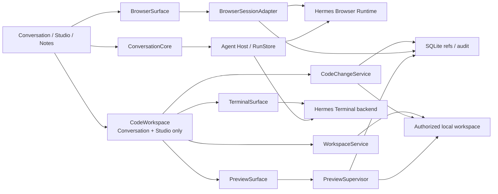

| 对象 | 真相源 | SophoNote 持久化 | 禁止复制 |
|---|---|---|---|
| Browser 页面/历史/DOM/控制权 | Hermes Browser Runtime | `external_browser_session_id`、Thread/Run 关联、权限决定、动作/引用审计 | Cookie、密码、完整 DOM、浏览历史正文 |
| 用户代码当前内容 | 用户授权工作树 | WorkspaceBinding、最近打开文件引用、CodeChangeSession/audit | 源码第二副本、整仓库进 SQLite |
| Git 状态/Commit | 授权仓库 `.git` | 短期状态投影、已引用 Commit/OID | 自建第二 Git 历史、未经确认的 commit/push |
| SophoNote 笔记正文 | `notes/<id>.md` | Article 元数据、Document operation | 通过 WorkspaceService 绕过 DocumentService |
| Terminal 进程 | Hermes Terminal backend / Host-owned child | process ref、cwd、状态、退出码、输出截断摘要 | Secret、无限输出、假完成状态 |
| Preview 服务 | PreviewSupervisor | launch spec hash、端口、所有权、健康/stale 状态 | 把 localhost Preview 冒充通用 Browser Session |

#### 23.9.2 WorkspaceBinding 与路径安全

目标最小模型：

```text
workspace_bindings {
  id,
  owner_type: "thread" | "project",
  owner_id,
  display_name,
  root_locator,
  authorization_ref,
  repo_kind: "none" | "git",
  access_mode: "read" | "read_write",
  created_at,
  last_verified_at,
  revoked_at?
}
```

- `thread` 绑定是会话级临时授权；`project` 绑定是可恢复的持久引用。项目可有多个绑定，但每轮 `ScopeSnapshot` 必须明确本轮允许的 binding 集合，不能因项目拥有多个仓库就全量授权。
- `root_locator` 只用于 Host 重定位，不回传给模型或遥测；macOS 正式实现使用 security-scoped bookmark 或等价可撤销授权。每次使用前重新解析、canonicalize 并确认仍位于授权根。
- 文件列举遵守 `.gitignore`、SophoNote 默认排除和用户排除；`.git/objects`、Keychain、SSH、云凭据、系统目录、设备文件默认不可读。symlink 解析后越界立即拒绝。
- 目录树和搜索分页；文本按范围读取。二进制、超大文件、vendor/build/cache 默认不进入模型上下文，用户显式打开也只展示安全摘要或外部打开。
- 应用私有 `workspace/` 继续作为 Hermes 可直接操作的沙箱，不能与用户授权仓库混称。用户目录只有在 WorkspaceBinding + ScopeSnapshot + Policy 交集内可读写。

#### 23.9.3 BrowserSession 与控制权

```text
browser_session_refs {
  id,
  thread_id,
  external_browser_session_id,
  state,
  control_owner: "agent" | "user" | "none",
  current_origin_hash?,
  created_at,
  last_seen_at,
  closed_at?
}
```

该表只保存引用/投影；Browser Runtime 仍是页面真相源。`BrowserSurface` 通过 Adapter 消费 Hermes 的页面、导航、动作、截图、DOM/可访问树和控制权事件，并把统一 `schemaVersion + seq` 事件先写 RunStore/审计再通知 UI。

控制权协议：

1. Agent 动作开始前校验当前页面版本/导航 generation 与控制权。
2. 用户点击页面或选择“接管”后，Host 发送 `browser.control.takeover`，未完成 Agent 动作取消或停在安全边界。
3. 用户选择“交还”或发送新指令后，Host 发送 `browser.control.release`；Agent 必须重新 snapshot DOM/URL，不复用旧 selector/坐标。
4. Browser 断线时只显示最后截图/URL的静态历史；重连由外部 Session ID 对账，无法恢复则新建并明确提示。

网页访问分两条路径：后台 `Web Search/WebFetch` 只返回结果/证据，不创建可见页面；`Interactive Browser` 创建或绑定 BrowserSession，所有导航和交互可见。两者事件名、工具卡和审计不能混用。

#### 23.9.4 CodeChangeSession 与写入

```text
code_change_sessions {
  id,
  workspace_binding_id,
  thread_id,
  run_id,
  base_tree_oid?,
  base_manifest_hash,
  status,
  reason,
  actor,
  created_at,
  applied_at?
}

code_file_changes {
  session_id,
  relative_path,
  base_blob_oid?,
  base_content_hash,
  proposed_content_hash,
  patch_ref,
  decision,
  applied_content_hash?
}
```

- `patch_ref` 指向受控临时文件/压缩 Diff，不把完整源码放普通业务表；会话结束后只保留审计必需的 hash、统计和仍被版本证据引用的 patch。
- 读取时记录 base blob/hash；应用前重新 stat/read/hash。任一文件改变即把相关 hunk 标为 conflicted，不执行“最接近位置”替换。
- 接受的文件先在同目录唯一 tmp 写入、fsync/权限继承，再原子 rename；多文件应用采用 prepared manifest + 补偿/恢复日志，不能声称跨文件原子事务。
- Git 仓库优先用 blob/tree OID 和 working tree diff；非 Git 目录用 manifest hash。应用只改变工作树，不自动 stage/commit/push。
- DocumentService 与 CodeChangeService 共享的仅是无状态 Diff 视图、Approval DTO 形状和审计规范。`articleId/baseVersion/TextAnchor` 与 `relativePath/baseHash/blobOid` 互不替代。

#### 23.9.5 Terminal 与 Preview

Terminal 命令由 Hermes Toolset 发现可用 backend，Host 再按 WorkspaceBinding、权限模式和风险校验 cwd/命令。前端只提交结构化意图或用户明确命令，不持有 shell 子进程句柄。输出以 Channel 流式传递并使用内存环形缓冲；完整诊断按大小上限落受控日志，Secret pattern 脱敏。

```text
preview_sessions {
  id,
  thread_id,
  workspace_binding_id,
  kind: "static" | "localhost" | "markdown" | "pdf" | "image",
  launch_spec_hash,
  host_owned,
  pid_ref?,
  url_or_file_ref,
  state,
  source_generation,
  verified_generation?,
  created_at,
  stopped_at?
}
```

- 静态文件 Preview 不启动命令；localhost Preview 只能通过获批 launch spec 启动，默认 bind loopback，不向局域网暴露。
- PreviewSupervisor 是 Host-owned 子进程唯一 owner：分配/验证端口、追踪进程组、健康检查、取消与退出回收。不得用随机杀进程解决端口冲突。
- `source_generation != verified_generation` 时显示 stale；Agent 必须在最新 generation 上检查 DOM/控制台/截图/关键交互，才能写入验证结论。
- PreviewSurface 可复用 WKWebView 呈现，但 Cookie/Profile、导航 allowlist、下载和外链打开策略与 BrowserSurface 分开。外部链接默认交给 Browser 或系统浏览器，不扩大 Preview 权限。

#### 23.9.6 权限模式与审批映射

当前实现缺口（NEXT-076 宿主补测）：下表仍是统一权限合同，不能当作四引擎全部已达标的事实。Hermes 的 `start_hermes` 目前仅验证权限模式枚举，`RunEnvelope` 与原生 Session RPC 未承载该模式；真实 Ask 请求出现 `write_file` 未经审批落盘。Pi/OpenCode 的 Host 工具审批证据不能覆盖 Hermes。必须补齐原生执行前权限/作用域约束，并以 Ask 未批准不落盘、Plan 写入拒绝及取消复验关闭；在此之前 S1 不满足权限验收门槛。

修复实现合同：随包 Hermes 增加版本化 Host 工具协议；每轮以非模型可见 RPC 字段传递短期环回工具地址与凭据，模型不接触授权信息。Host 在提交前确认协议版本；Hermes 顺序/并发工具执行入口均委托 Rust，缺少本轮授权或工具不在白名单时拒绝，不退回原生文件/终端或原生委托。Rust 复用 Scope/审批/受控命令执行，范围覆盖授权工作区、显式附件和单一文档工作副本，受管笔记仍只能经 DocumentService。工具服务与 Run 取消令牌同寿命，旧授权随服务销毁失效；恢复需新一轮授权。 真实 Gateway 的轮前 MCP 刷新会重建工具列表；有 Host 租约的 Agent 必须跳过原生重建，并在同一工具锁下发布 Host 快照及复核在途刷新，防止旧 tool_search/tool_call 重新覆盖受控列表。原生未适配工具明确不可用，不能按提示词“只读”放行。 当前实现已接通该协议及 Rust Host 通用工具；原生 slash/Skill 展开可能在工具循环前执行 quick command、插件或 inline shell，因此在受控普通任务入口准备阶段明确拒绝，不能只检查返回类型。原生 MCP/电脑/Cron 工具尚未映射到该受控工具面；能力目录的原生注册信息不等于本轮可执行权限，完整能力恢复仍属待办。602 项 Rust、5 项 Python 入口合同及真实随包 AIAgent 的本地模型→Host RPC→拒绝结果链路通过，真实云端已复现并修复轮前 MCP 工具刷新覆盖问题；新增真实 AIAgent 刷新回归先失败后通过，旧工具尝试被 Host 拒绝且未落盘。最终补丁包凭据已恢复，真实文本回复成功；原会话仍未提交 Host write，最终工具清单/静态提示缓存与界面审批链仍待定位验收。不能把旧工具拒绝当作审批卡链路通过。用户要求本轮收尾，当前保留此限制，未解除原生工具保护。


| 动作 | Plan | Ask before changes | Accept edits |
|---|---|---|---|
| 读取绑定内普通文本/Git 状态 | 允许 | 允许 | 允许 |
| Agent 写绑定内普通代码文件 | 拒绝 | 每个 ChangeSession 审批 | 可按当前会话授权自动应用；仍生成 Diff/审计 |
| 修改 SophoNote 笔记 | 仅提案 | DocumentService 审批 | 仍走 DocumentService，不自动放宽 |
| 执行 Terminal 命令/启动服务 | 拒绝 | 按命令/风险审批 | 仍审批；可对明确低风险 launch spec 建短期授权 |
| Browser 只读导航/截图 | 允许或按域策略 | 允许 | 允许 |
| Browser 表单提交/上传/下载/发布/删除 | 拒绝 | 逐次审批 | 逐次审批 |
| 跨绑定路径、Git commit/push/reset/rebase、权限提升 | 拒绝 | 高风险单独审批 | 高风险单独审批，不能持久自动允许 |

审批决定绑定 `threadId + runId + capability + workspace/browser scope + generation`；导航到新 origin、切换 WorkspaceBinding、base hash 改变或重启后旧批准失效。UI 所谓“始终允许”最多形成可撤销的窄规则，不能覆盖凭据、支付、发布、删除、remote push 或权限提升。

#### 23.9.7 前端装载、性能与恢复

- `BrowserSurface`、代码编辑器、Diff、Terminal、Preview 按 Tab 懒加载；不可见时停止截图/DOM 轮询、编辑器 layout、Terminal ANSI 重算和 Preview 帧更新。一个 Thread 默认一个活跃 Browser 页面和一个前台 Preview。
- 代码文件按需读取；最近文件缓存按字节而非条数有界，磁盘 watcher 只覆盖打开文件和 Git 状态必要目录。Terminal 输出使用有界 ring buffer；关闭历史仍可从受控日志分页读取。
- 页面切换/面板折叠不取消 Run。Browser 与 Preview 可后台继续，但进入低频模式；用户返回时通过外部 Session/process ref 对账，不依赖 React 组件内存恢复。
- 应用崩溃重启后：WorkspaceBinding 重新授权/验证；未应用 CodeChangeSession 从 prepared manifest 恢复为 reviewing/conflicted；Host-owned Preview/Terminal 子进程按 watchdog/进程组清理；外部用户进程绝不因 SophoNote 恢复而杀停。

#### 23.9.8 分期与验证门禁

| 阶段 | 交付 | 退出条件 |
|---|---|---|
| BC-0 Scope/Policy | WorkspaceBinding、授权、路径安全、三种权限模式、审计 DTO | symlink/越界/撤权/Secret 夹具全部 fail-closed；无通用写入旁路 |
| BC-1 Browser | 三处 BrowserSurface、控制权、DOM/console/screenshot、引用与审批 | 同一 Thread 跨视图不复制 Session；接管/重连/导航 generation 正确 |
| BC-2 Editor/Diff | 文件树/搜索、代码 Editor、Git 状态、CodeChangeSession、逐 hunk 审查 | 外部改动必冲突；代码与 DocumentService 契约测试证明无混写 |
| BC-3 Terminal/Preview | Terminal Toolset、PreviewSupervisor、静态/localhost/文档预览与验证 | 20 次启动/停止无僵尸/端口泄漏；stale/重新验证正确 |
| BC-4 Claude Code 核心对标 | 目录→读→改→审→跑→预览→验证整场宿主 E2E | 干净 macOS、真实 Hermes、固定 Git/Web 夹具通过；包体/内存/交互指标达标 |

自动测试至少覆盖 DTO/schema、路径 canonicalize/symlink、ignore/大文件、base hash 冲突、多文件 prepared 恢复、权限矩阵、Browser generation/控制权、Terminal 截断/取消、Preview 进程组回收。真实 Tauri 宿主测试必须覆盖 WKWebView 焦点/快捷键、200% 缩放、Chat/Browser/Editor/Diff/Terminal/Preview 切换、用户接管、登录站点不泄漏凭据和 App 完全退出后的子进程清理。

### 23.9.9 Computer Use 适配

电脑控制当前只接入 Hermes `computer_use`；Pi/Claude 不展示此能力。macOS 使用随包固定版本 cua-driver 的 embedded 模式：SophoNote Rust 主进程直接启动私有 daemon，保留 macOS TCC responsibility chain；由主 App 请求辅助功能和屏幕录制，权限归属必须为 `com.fei.sophonote`。禁止通过 LaunchServices 启动独立 CuaDriver.app，禁止由 Hermes Gateway 代为创建 daemon，禁止用改名或环境标签冒充已验证身份。非 macOS 暂保留原 Hermes 安装路径。

控制组件随 macOS App 资源打包，构建脚本固定上游版本与下载 SHA-256，嵌套可执行文件先签名、主 App 后签名/公证。Hermes 仅获得受限代理入口和本轮 App 专用 socket；入口只允许版本/manifest 探测及连接已有 daemon 的 MCP，拒绝独立 serve、安装、升级与授权命令，不能回退到机器全局驱动。组件更新随 App 版本，不受 Hermes 私有更新槽替换。

Host 负责启动互斥、子进程退出、私有 socket 目录清理、授权后的重新检测与重启；完整诊断在 Tauri `RunEvent::Ready` 后异步执行，不能阻塞 setup 首屏。上游固定版本需要 macOS 13+；子进程的配置 Home 独立放入 SophoNote runtime，避免覆盖全局驱动 PID/config。诊断只允许固定的只读身份/权限工具，白名单 DTO 不暴露 socket、原始窗口内容或任意命令。就绪须同时具备主 App 身份核实、驱动健康和权限，安装存在不代表授权成功。系统授权由用户操作，不能自动批准。当前 macOS 上 `CGRequestScreenCaptureAccess` 可能不自动生成录屏列表项；用户需在系统设置中通过 ＋ 添加实际 SophoNote.app。异常退出不重放未确认动作。

统一 AI 面板按需装载电脑操作卡，独立展示工具启用与组件就绪，macOS 明示“为 SophoNote 授权”。能力配置仍走 `tools.configure`；执行前核实当前 Session 的真实工具集。随包 Gateway 的 `tools.configure(session_id)` 会清空 history，禁止用它刷新会话；旧 Session 不具备能力时明确要求新建，原历史保留。截图与动作属于现有 Hermes 工具结果/RunStore，不新建连续屏幕流。停止并接管复用 Run cancellation，终态前禁止重启，不宣称原地暂停恢复。

首个笔记工作流由显式选择的随包 Skill 描述：先明确应用/窗口，读取后摘要，必要动作沿用 Hermes 审批；笔记编辑只修改本轮 Session 工作副本，终态经 baseVersion/TextAnchor/hunks、Diff 审阅与 DocumentService 落盘。Skill 是操作规约，不能代替驱动权限或 Host 写入校验。入口披露截图/可访问树可能进入当前模型请求。新 Skill 另随 App resource 分发，复用旧 Sidecar 或启用私有更新槽时仍获得新工作流。

### 23.10 模型配置与用量统计

#### 23.10.1 配置真相源与供应商预设

`settings.ai_config` 继续保存非敏感 provider 配置，Keychain 以 provider ID 保存密钥；Rust `provider_environment` 将产品 ID 映射为 Hermes 0.20 的规范环境变量（例如 `alibaba → DASHSCOPE_*`、`zai → GLM_*`、`kimi → KIMI_*`）。预设目录只存在前端静态元数据，不是第二份用户配置：用户点击添加时复制为普通 `ProviderConfig`，之后由用户配置独立演进，版本升级不覆盖。

首版内置 DeepSeek、Kimi、Alibaba/DashScope、Z.AI/GLM、MiniMax、StepFun 和 Xiaomi MiMo。选择范围以随包 Runtime 的 `providers.py/auth.py/models.py` 为工程门禁；仅在参考产品出现但 Runtime 无可验证路由的厂商，不标记为已支持。OpenAI 兼容配置继续由 `OpenAiCompatGateway` 服务 Inline Completion；Anthropic 原生 provider 可供 Hermes Agent 使用，但设置页必须明确 Inline Completion 仅支持 OpenAI 兼容协议。

前端配置面采用单页主从结构，而不是把所有 provider 表单纵向展开：顶部 `ActiveModelSummary` 只展示当前路由事实；中部 `ProviderList` 以紧凑行展示 provider、协议、默认模型和凭据检查状态；`ProviderCatalogDialog` 只负责从未添加预设中选择并创建普通配置；`ProviderConfigDrawer` 集中编辑一个 provider。Drawer 内凭据必须显式保存，非敏感字段仍通过既有 `updateSettings → ai_config` 持久化；打开 provider 时才惰性检查对应 Keychain 状态，列表不得把“尚未检查”误报为“未配置”。启用操作若凭据未确认，先打开配置面板，不直接改变 `activeProvider`。

向量嵌入与对话模型共用“AI 配置”入口但使用二级分段切换；它继续使用独立 embedding 配置和 Keychain key，不混入 LLM provider 列表。行内补全作为当前路由的能力开关，显示在对话模型总览附近；Anthropic provider 被激活时明确提示该开关不适用。

#### 23.10.2 模型目录同步

WebView 只传 provider ID。Rust 重新从 SQLite 解析 Base URL、从 Keychain 读取 Key，校验 URL 为 `http/https` 后请求 `<base>/models`，必要时回退 `<origin-or-base>/v1/models`；只接受 OpenAI 列表结构中的非空模型 ID，去重、排序并限制条数/响应体/超时。Host 只回传模型 ID 或脱敏错误，不回传 Authorization、响应头或任意凭据。同步成功后由前端写回 `ai_config`；失败不修改现有清单。

#### 23.10.3 用量数据流

设置页通过 `agent_usage` 并行读取 Hermes analytics 与本应用隔离目录的 Pi JSONL、Claude Code JSONL、OpenCode SQLite。Rust 在 blocking worker 中只读原生文件，按 Sidecar 输出窗口汇总、模型明细、每日用量和来源状态；不扫描个人 CLI 历史，不建立第二套 usage 表，不向 WebView 回传正文或凭据。原生格式不支持/文件损坏显式标记部分不可用，不把读取失败当作零用量。

Pi 按会话条目 ID、Claude Code 按原生 assistant message ID 去重（多个内容块保留完整累计 usage），OpenCode 按 step-finish 主键统计调用，通过所属 message 关联模型；会话数按原生会话去重。窗口为近 7/30/90 天，Pi/Claude/OpenCode 使用调用时间；Hermes 保留 API 以会话起始时间统计的原生口径。每日按 UTC 日期归组，图表保留窗口边界所在日期，避免滚动窗口首日被截掉。

Token 总量遵循原生字段：Pi 优先 totalTokens；Claude 输入 + 输出 + 缓存读取 + 缓存写入；OpenCode 使用原生总量（缺失时依其分桶相加）。Hermes 输出已含 reasoning，不能再次加 reasoning；其 API 未给出的缓存写入/模型细分保持未知。筛选单模型时 Hermes 没有逐日模型数据，隐藏不完整趋势，不按比例伪造。组合筛选、Sidecar 对比和模型明细必须使用同一结果，跨模型会话数使用来源总计而非相加模型会话数。

费用只展示调用时固化的正数估算，缺失或零价格显示“—”；部分有价格时标注“已知费用”，不得把它当完整费用。保留当前 USD → CNY 展示兼容换算，不根据模型名称套当前价格重算历史。来源失败独立呈现，不能阻断会话或吞掉其他 Sidecar 的有效结果。Hermes 仍通过 loopback + Session Token 读取，原有 `agent_hermes_usage` 保持兼容。

#### 23.10.4 价格目录与调价同步

当前 Hermes 已在每次模型调用完成后规范化输入、输出、缓存与推理 Token，并调用 `estimate_usage_cost`。OpenRouter 或兼容端点的 `/models` 明确返回 `pricing` 时会读取动态元数据；其他直连路由主要回退到 Runtime 包内的 `official_docs_snapshot`。以 DeepSeek 为例，随包版本使用 `deepseek-pricing-2026-07` 静态快照。该实现能生成稳定估算，但不能表达请求阶梯、时段规则或官方网页随后发生的价格变化；账本目前也只固化费用、状态和来源，尚未把 `pricing_version` 写入逐调用记录。

目标实现由 Hermes `PricingCatalog` 统一拥有，SophoNote Rust Host 只负责启动同步、网络策略和向 UI 转发健康摘要，React 不访问价格网站、不保存价格表：

```text
ProviderBillingAdapter
  ├─ actual charge / bill detail
  ├─ user contract override
  ├─ official structured pricing endpoint
  └─ verified official-page snapshot
            ↓
Versioned PricingCatalog
            ↓ select(provider, model, occurred_at, mode, token buckets, request tier)
AppliedPricingSnapshot → UsageLedger → Analytics DTO
```

`PricingRule` 至少包含 `provider_id/model_pattern/currency`、输入/输出/cache-read/cache-write/request 单价、计量单位、token/request 阶梯、`billing_mode`、`schedule + time_zone`、`effective_from/effective_to`、`source_type/source_url`、`fetched_at`、`version/hash`。同一供应商可同时存在多条规则，不能用单个 `model → input/output price` Map 覆盖阶梯、批处理、缓存与时段差异。

同步采用“启动后异步检查 + 6 小时后台检查 + 调用时只读本地目录”。有稳定官方接口时使用 ETag/Last-Modified/内容哈希增量更新；只有官方文档页时通过版本化 Adapter 生成候选快照，完成 schema 校验、异常幅度检查和最小模型集校验后原子发布。刷新失败或页面结构变化继续使用 last-known-good，并记录 `fresh/stale/failed`，绝不在推理请求前临时抓网页，也不因同步失败阻断调用。所谓实时是“价格更新确认后，下一次调用立即选用新规则”，不是每次请求同步抓取供应商页面。

费用优先级固定为：供应商返回的实际扣费 > 用户合同覆盖 > 官方结构化价格 > 经校验的官方快照；无规则时为 `unknown`，不得默认零价。每次调用把所用规则的版本、原币种、原始金额、发生时间和必要的汇率快照写入 Hermes 用量记录；新价格只影响其生效时间后的调用，历史分析直接汇总已固化金额，不按当前价格回算。供应商提供本币价格时直接以本币计算；跨币种展示由同一版本化汇率快照完成，禁止 React 使用当前汇率重算历史。

### 23.11 桌面化投影：WidgetKit 小组件与 Tahoe 控制中心控件

产品需求见 [PRD §7.12 DSK](./PRD.md)，决策见台账 DEC-042。本节为工程设计事实。

**拓扑**：单一 Widget Extension（bundle id `com.fei.sophonote.widget`）同时承载两类投影——`Widget`（systemSmall/systemMedium 桌面小组件）与 `ControlWidget`（`ControlWidgetToggle`/`ControlWidgetButton`）。Extension 以 `.appex` 嵌入 `.app/Contents/PlugIns`，挂进现有构建脚本链：xcodebuild 出扩展 → 嵌入 → 随主包统一签名/公证（门禁命令见 §17.6，需为扩展补独立签名步骤）。

**Availability**：小组件交互（`Button(intent:)`、`Text(timerInterval:)`）需 macOS 14+；`ControlWidget*` 首支持 macOS 26.0（Tahoe，Apple 文档实测：iOS 18 已有、macOS 自 26 起）。控件声明全部 `@available(macOS 26.0, *)`；非 Tahoe 降级为仅小组件。

**状态契约**：App Group `group.com.fei.sophonote` 存放快照 + 动作日志：`{status: idle|running|paused, endsAt, pausedRemaining, taskId, taskTitle, todayCount, todayMinutes, updatedAt, actions: [{action, at}]}`。应用（Rust）为唯一仲裁者：存活时写快照并监听动作日志应用迁移；启动时幂等对账（running 且 `endsAt` 过期 → 补记完成会话，统计从日志推导，不重复计数）。应用离线时扩展 Swift 侧仅对四个动作（开始/暂停/继续/放弃）做最小写入、追加动作日志，不复制完整状态机。

**交互与刷新**：

- 小组件：倒计时用 `Text(timerInterval:)` 无进程活秒，`pauseTime` 切静态数字；四动作走 AppIntents `Button(intent:)`；卡身 `widgetURL` 深链回工具整页（Tauri deep-link 事件接住）。
- 控件：无 timeline；刷新时机 = 用户动作、应用主动 reload、APNs push（首期不做 push）。Toggle 映射 running↔paused/ready；Button 为 fire-and-forget（放弃/打开整页）。
- reload 管线：状态迁移后应用侧同时调 `WidgetCenter.shared.reloadAllTimelines()` 与 `WidgetKit.ControlCenter` 的控件 reload；Rust 经 objc FFI 调 WidgetKit 的 Objective-C 兼容 API，备用 = 随包小型 Swift helper CLI。

**前端注册**：`ToolDefinition` 增可选 `desktopWidget` 描述符（widget kind、支持 families、控件清单、引导文案）；画廊/工具整页按其存在渲染「添加到桌面」与投影面板（面板每面「启用同步」+ 一次性引导）。首发实例 = PomodoroTool。

**放置约束**：小组件与控件均不能程序化放置（WidgetKit 平台硬约束），用户手动添加：右键桌面→添加小组件；控制中心→编辑添加控件；菜单栏自控制中心 pin。应用内入口只负责启用同步与引导，UI 文案不得承诺自动放置。

**构建与发布门禁**：扩展独立 bundle id + 双方 App Group capability；公证覆盖嵌入式 .appex（§17.6 命令补充）；Debug 包验收清单增三项：Tahoe 真机小组件活秒、控制中心控件 Toggle 往返、菜单栏 pin 与单击动作。

**实施前 spike 三项**：① Tauri 构建链 .appex 嵌入/签名/公证通路；② Rust 侧 WidgetCenter/ControlCenter reload FFI 可用性；③ Tahoe 控制中心编辑/pin/Toggle 往返真机验证。

**Trade-off**：不采用 Tauri 悬浮置顶卡方案（快但非原生，搁置备用）；首期不做 APNs push 刷新（reload + 启动对账覆盖单用户本机场景）；不为投影复制完整状态机（双份实现必然分叉，对账成本高于最小写入）。

### 23.12 长期记忆：火山托管 OpenViking

产品需求见 [PRD §7.6.1 AG-27](./PRD.md)，进展见台账 NEXT-074。本节是 Agent 长期记忆的现行体系，替换“Hermes 本地 MEMORY 即长期记忆”和“OpenViking = 本地知识 Adapter”两种过时口径。

#### 23.12.1 分层：记忆不是知识，也不是会话历史

| 层 | 真相源 | 当前职责 | 明确不是 |
|---|---|---|---|
| 知识层 | `notes/<id>.md`、SQLite 索引、目标 Git 语义版本 | 检索、版本、证据、关系 | 不是 Agent 记忆，不提供独立 Library |
| 会话历史 | 各引擎原生 Session + RunStore | UI 重放、续聊、故障恢复 | 不是跨引擎共享记忆 |
| Agent 长期记忆 | 火山 OpenViking memories | 偏好、目标、约束、决策、未完成状态、成果摘要 | 不是笔记正文库，不是 PDF/chunk |
| 收件箱 | `items` 168 小时 TTL | 短期外部信息池 | 收藏/阅读不续期，不能冒充记忆 |
| 目标治理投影 | `memory_evidence_links` | 记忆与 Claim/证据的引用绑定 | 不复制记忆正文 |

DEC-013 的 Thread↔原生 Session 1:1 仍然成立：短期会话状态由所选引擎维护。DEC-030 的知识/记忆分层仍然成立：记忆层属于 Agent，不属于隐藏知识层。变化的是记忆**正文**改由火山 OpenViking 持有，Hermes 原生 `memory_enabled` / `user_profile_enabled` 固定关闭。

#### 23.12.2 当前产品路径

- 可选外发能力，**不是启动依赖**，未配置时四引擎照常工作。
- 服务固定 `https://api.vikingdb.cn-beijing.volces.com/openviking`，Host provider `openviking-memory`；只配 API Key，不提供本地 endpoint / 账户覆盖，不启动本地 OpenViking 进程。
- 入口：`设置 → AI 配置 → 记忆`。命令：`agent_openviking_*` → `agent/openviking.rs`。
- 四引擎共用一把 Key，peer 范围分开；`memory.sophonote_engines` 保存明确授权的 Host 引擎列表，旧配置缺省为空，不自动扩大到 Pi/Claude/OpenCode。
- 不把配置保存、连接检查或本地会话续接宣称为跨引擎云端召回。

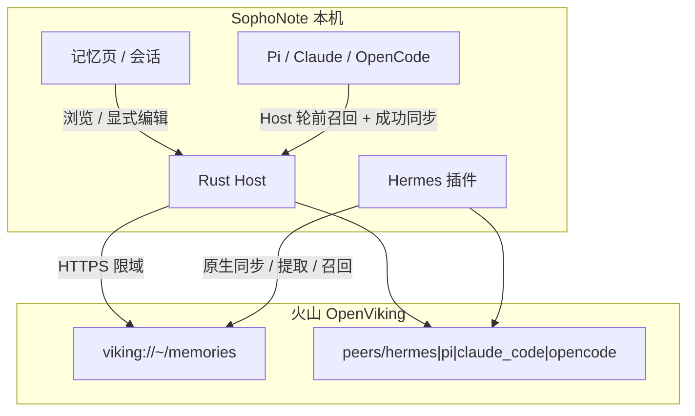

#### 23.12.3 命名空间与授权

允许写入的根：

| URI | 身份 | 读取 |
|---|---|---|
| `viking://~/memories` | 公共用户 | 已授权引擎跨读 |
| `viking://~/peers/hermes/memories` | Hermes peer | 本引擎 + 管理页 |
| `viking://~/peers/pi/memories` | Pi peer | 本引擎 + 管理页 |
| `viking://~/peers/claude_code/memories` | Claude Code peer | 本引擎 + 管理页 |
| `viking://~/peers/opencode/memories` | OpenCode peer | 本引擎 + 管理页 |

拒绝 `privacy`、`sessions`、`skills`、其它 peer、路径穿越与编码歧义。管理页按所选目录设置 `x-openviking-actor-peer`。启用前必须勾选会话外发与同身份共享范围；新增 Host 引擎须再次保存四引擎确认。

当前**不承诺项目隔离**。项目归属只改 Thread 关系，不自动改 OpenViking scope；跨项目污染只能靠用户选择写哪些摘要，不能靠默认全局 key 假装隔离（延续 DEC-013/017）。

#### 23.12.4 四引擎接入

| 引擎 | 召回 | 成功后同步 | 提取 |
|---|---|---|---|
| Hermes | 原生 Memory Provider | 原生插件写会话 | 云端异步提取 |
| Pi / Claude Code / OpenCode | Host `/search/find` 查公共 + 本引擎 peer，URI 归一化后有界读取，包裹为不可信资料 | 用唯一 Run ID 建云端 session，只写原始 user 与 final assistant 两条并 commit | 云端异步；commit 成功 ≠ 召回成功 |

Host 路径由 `pi::start_engine` 前后置调用 `openviking::RunMemory`。取消/失败不提交；不发送工具输出、系统提示或附件正文。配置代次在换 Key / 停用时递增，在途 Run 复核代次后停止向新库同步。

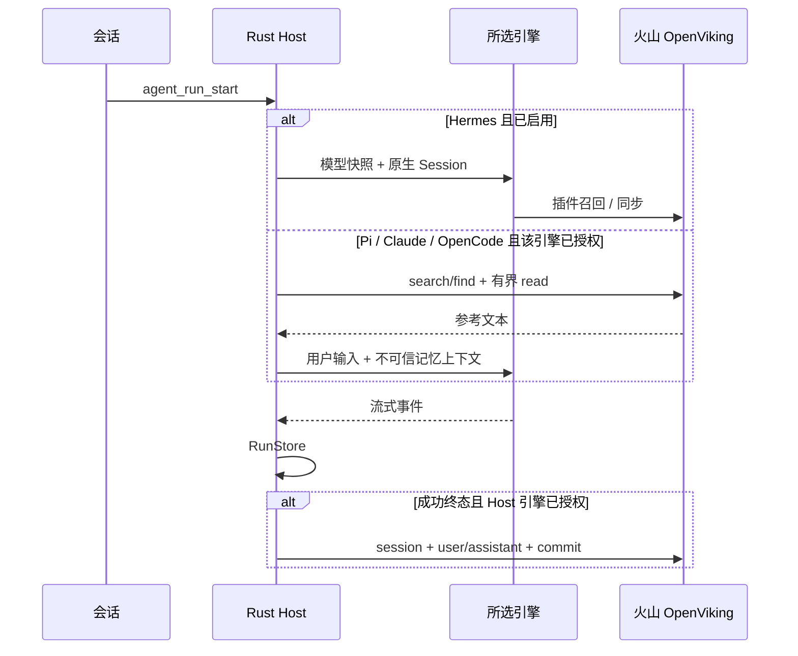

#### 23.12.5 页面编辑与冲突

记忆页可浏览、分页、读取、显式编辑公共用户与四个 peer 的 memories。正文只在页面草稿暂存，不落本地记忆库。写入前重读并核对读取时 revision；已变化则停止并保留草稿。revision 对原始全文（含服务端 MEMORY_FIELDS）计算摘要；写出只给正文，避免云端重复附加元数据。Host 串行编辑与配置变更，但上游 write 尚无原子 CAS，存在外部客户端检查后修改的窗口，不能把本机互斥说成服务端锁。编辑器不处理受管笔记。

停用只清 provider、保持 MEMORY/USER 关闭，不 delete、不 reset。保存不自动重启 Hermes；已有 Run 由用户空闲时重启生效。钥匙串暂不可读不阻塞引擎启动，只停止提供云端凭据。

#### 23.12.6 安全、预算与失败

- 云端 HTTP 只在 Rust：固定 HTTPS、校验证书、禁止重定向、超时与响应有界，错误保留状态码，不回显正文或 Key。
- 连接检查用已鉴权只读目录，不依赖匿名 `/health`（托管服务对匿名返回 401）。
- 召回结果是外部数据，不能授予工具权限；笔记写回仍经 DocumentService。
- 记忆不可用显示独立诊断，不阻断主任务、不回退 Hermes 本地 MEMORY。
- 本机增量是 Host HTTP 客户端与有界缓冲，服务端 RSS 与 1 GiB 本地知识/记忆 Envelope **分账**。1 GiB 门禁继续约束本地 FTS/向量/导入/可选本地 Adapter，不把云端库规模算进本机 Envelope。

#### 23.12.7 与本地 Adapter 的边界

| | 火山 OpenViking（现行） | 本地 ContextStoreAdapter（§23.7 预案） |
|---|---|---|
| 用途 | Agent 长期记忆 | 知识检索加速 |
| 进程 | 无本机 sidecar | 第二 Python 进程，未过门禁不打包 |
| 真相 | 记忆正文在云端 | 不得保存 Claim/笔记/记忆正文 |
| V1 | 可选，已接入配置与 Host 链路 | 不是依赖 |

二者不得混用配置、不得互相回退。

#### 23.12.8 未完成

- 真实模型对话端到端召回（钥匙串凭据授权，见 NEXT-074/075）。
- 项目级记忆 scope、显式跨项目授权与清除（DEC-013 仍禁止静默复用全局 key）。
- KNOW-15：记忆与 Claim/Evidence 的引用绑定、失效复核。
- 云端 write 的条件 CAS；跨客户端竞争窗口需产品提示，不能宣称已消除。
- Hermes 保存后需用户重启才注入 Key，不能把“已保存”当成当前 Run 已用新凭据。

<a id="agent-routing-architecture"></a>

### 23.13 自动路由、SDK 适配与受控协作（DEC-054，目标架构，分期实施）

本节落实 [PRD AR-01～30 与 §15.8](./PRD.md#agent-routing-prd)，交付跟踪为 [NEXT-076](./project-ledger.md#agent-routing-delivery)。当前自动提交入口已编码并自动验证；以下 S0 与影子评估说明是沿用的基础实现，S2 已有受控 Pi 父子进程与 Debug 预览包的本轮授权、原子创建和过程投影；发行构建尚未开放；S3 有界编排仍为目标合同。Hermes 是具体引擎，Harness 是执行框架类别，不混为新增产品 ID。

**2026-10-14 AR-S1 首版基线（当前排序已由下述 automatic-v2 取代）**：`agent/automatic.rs` 用 `automatic-v1` 规则对未被硬排除且探测通过的候选选一个准备。通用任务优先 Hermes/Pi/Claude/OpenCode；文档范围优先 Pi/Hermes/Claude/OpenCode；显式目录 Plan 分析优先 Claude/OpenCode/Pi/Hermes。优先级不表示质量最优，原生 Skill/命令与 Session 绑定始终优先。候选并发探测和 Hermes 目录验证各有 1500ms 截止，模型不参与排序。失败不改选、不换模型/供应商。选择证据沿用逐 Run 审计，决策 schemaVersion=4；准备失败只保存固定中文指引，原生错误与凭据不进入提交快照。

**automatic-v2 执行需求基线（画像提取现由下述 v3 修正）**：新增 `agent/task_profile.rs` 纯函数 `infer(&AgentRunStartArgs) -> TaskProfile`，仅查看上限 4096 字符的本轮用户请求和显式上下文存在性，不读取附件正文/目录、原生历史或凭据。输出封闭的 TaskProfile 枚举；不接收执行器路径，不授予工具权限。优先级：原生能力硬要求 → 明确内联代码解释 → 工程操作或仓库探索（要求目录）→ 研究/跟踪工作流 → 限定资料处理（要求资料范围）或文本响应 → 通用。内联代码解释归文本响应，不因附带目录被视为仓库探索。否定性片段不作为正向执行需求；只读与写入仍由 Host 原权限模式核验。研究/跟踪线索不会自动创建 Cron。

`automatic.rs` 以画像和已选供应商原生协议计算稳定偏好，与原有候选、运行时证据和 Hermes 精确映射取交集；仅权限模式改变不得改变画像或静态偏好。`RouteDecision` 升为 schemaVersion=5/policyVersion=automatic-v2，新增可选 taskProfile/preferredEngine，结合 selectedEngine 推导是否采用兼容替补，carry_preflight 必须保留这些值；旧 schema 继续可读。逐 Run 审计仍不保存用户文字、文件路径、URL 或密钥。`RunSnapshot.routing` 仅投影封闭枚举生成的中文说明、策略版本与实际引擎；缺失/无法解析的历史说明返回空，不让历史回放失败。前端独立运行详情组件在展开时按 Run ID 读取，切换会话隔离迟到响应，不在每个 token 触发查询。

**automatic-v3 画像边界**：TaskProfile 推断先截取 4096 字符，再屏蔽引号、反引号代码段和 Markdown 引用行；保留原用户输入供 Adapter 执行，不改写消息。正向片段逐段判定，避免跨片段拼接无关动作和对象。与 workspaceRoot 相同的 folder 附件是导航范围，不能单独构成资料画像。明确仓库操作优先于内联解释；排序序列、候选硬过滤与权限保持 v2 合同。审计仅升级 policyVersion=automatic-v3，数据字段仍为 schemaVersion=5，v1/v2 历史解释继续可读。本地性能样本仅覆盖有界画像、候选元数据筛选与确定性选择，不计为包含运行时探测、数据库、凭据或模型的整场路由延迟。

本次不引入新的外部分类请求、模型切换、动态质量分数或直接响应生命周期；文本响应的独立 ModelGateway 快路径已在后续切片接线，详见下文独立响应合同与 NEXT-076 验收状态。 Debug 构建对 sha2 单独启用优化，避免未优化的大文件完整性校验挤占 1500ms 运行时探测预算；不跳过文件哈希、不放宽截止，也不将迟到结果写入观察缓存。真实随包 Pi/OpenCode 完整性校验另用显式原生资源测试验证预算。

自动提交先以 requested_engine=auto 登记不可变意图，再以 generation CAS 一次写 selected_engine；请求重放不重新排名。旧四引擎 CHECK 通过事务迁移，保留索引、触发器和请求身份。原有 native prepare 在同一 Host 内继续拥有 Runtime/凭据/作用域，claim 前复核模型配置 epoch、凭据变更 epoch 与取消代次；ai_config 插入/修改/删除推进持久 epoch，能识别改回原值的 ABA。凭据保存/删除期间不接受准备，其变化结束后才重启运行时。作用域仍由现有准备和逐工具验证、Thread 项目校验及 DocumentService CAS 执行；统一持久 ScopeSnapshot/后代撤权是 S2 前置，未冒充完成。

Hermes 自动候选需匹配本 Host 成功启动的 Gateway 地址、配置/凭据代次、唯一 provider 环境前缀及明确端点（含 Host 免密钥本地代理），并通过原生 model.options 的精确 slug/model/鉴权状态验证；别名不唯一、外部附着、配置未重启同步均不猜测放行。Pi/Claude/OpenCode 复用共享模型准备。requires_key=false 的 Hermes 启动环境也不再读取历史密钥。

会话提交名额在 SQLite IMMEDIATE 登记事务中统一保留，手动与自动合计 2 个，兼容统计未绑定提交的旧活跃 Run；等待准备和 recovering 都占名额，终态释放。此处覆盖 Host 会话入口，不把 Hermes 独立 Cron 作业纳入此计数，完整编排预算仍属 S2/S3。无独立排队、跨引擎回退或子任务。内部 agent.routing.enabled=false 拒绝新自动准备；产品不因此恢复手选入口。现有任务查询/停止和旧兼容 API 保留。

自动提交恢复快照（AR-22）：agent_submissions 增加可空 recovery_json，仅自动提交从 Host 类型化请求保存，总大小上限 4 MiB，与身份登记同事务。通过身份、时钟、会话存在性及大小校验后，ThreadBusy/ResourcesBusy 以 state=failed、固定 failure_reason 和 recovery_json 原子登记，不占活跃名额、不给准备租约、不创建 Run/用户消息；手动兼容入口仍返回原拒绝。失败身份重放只查询原结果，即使名额释放也不重新派发；显式重发使用新 UUIDv7。无效/过期/冲突身份、缺失会话、超限输入与存储故障不生成恢复记录。查询/丢弃专用 IPC 按 clientRequestId 定位；仅无 Run 的 failed/cancelled/interrupted 可取回正文，活跃或派发未知不能作为可重发草稿。Run 绑定、Thread 墓碑与用户丢弃清除 recovery_json，去重盐/摘要仍遵守原保留规则。浏览器持久化终态恢复身份，不保存正文；执行接纳前的会话忙/名额满也返回持久终态快照，复用同一恢复入口；其余未登记拒绝仍依赖页面内存，旧记录无快照时明确提示不可恢复；页面恢复显式展示原文字、附件及文档范围，新发送生成新 ID 并重新走准备。终态草稿正文超过 7 天后，在后续接纳时清理；本地恢复身份不携带正文。草稿恢复不自动变更权限模式或工作目录；目录或权限模式不一致时停止恢复，原选区/文档版本不刷新为新版本。

Composer 统一投影 AI 配置并通过 agentStore 持有提交；浏览器只持久化恢复 ID 与状态，不复制输入正文/附件。准备过程锁住同一草稿，原输入保留到 claim 确认；停止先记录意图，回包丢失只用 find/get 查询，窗口重挂载不调用 start。claim 后采用 Host selectedEngine 并接回 Run snapshot/replay；已确认极快终态不重新挂运行标记。无独立 Submission 事件流，使用有界状态查询；超时保持未知锁并提供“查询任务状态”。运行详情展示真实执行者，审批继续使用真实引擎。自动规则、持久状态和客户端契约已验证；真实 Tauri 已确认自动准备、凭据失败恢复、准备取消与运行详情。DeepSeek 凭据恢复后，Hermes/Claude 的自动首轮与原生第二轮、Claude 运行中取消、离开项目后的历史恢复已验收；持久审计确认首轮 automatic、续接 session_affinity 且引擎不改绑。云端记忆独立凭据仍报错，主任务按现有合同降级继续；automatic-v2 已验证 Pi/OpenCode 的真实 DeepSeek 自动首轮、原生续接、按需路由说明，OpenCode 运行中取消及重启后的两条会话历史/说明恢复通过；持久审计为 schemaVersion=5，首轮 automatic、后续 session_affinity。上述 v2 工程请求只确认意图；后续 v3 已在真实 Tauri 中通过合成仓库 ls/read、计算错误识别、重启后上下文续接、Plan write 拒绝和运行中取消/恢复。Pi 的引用材料翻译、续接和历史/策略恢复也已通过；事件审计与 fixture 哈希核对无额外写入。完整产品黄金任务和性能/发布门禁仍待完成。

以下三段保留 S0 与影子评估的实施基础及各切片边界；当前自动执行范围以上文 AR-S1 说明为准。影子开关不控制产品自动提交入口。

**AR-S0 已实现边界**：先以 Rust 封闭枚举注册表统一启动入口，保留四种原生 Transport；当前不需要动态 trait 对象或未使用的统一 prepare/reconcile 方法。手动路由结果与本次准备阶段观察到的能力写入 `agent_runs.route_decision_json`，与 Run claim 同事务、旧记录为 NULL；只记录枚举、版本、工具名和来源，不存输入正文、路径或凭据。S1 需要多候选/多决策时再迁移为独立决策表。当前快照是逐 Run 的准备证据，不是 TTL 健康缓存：Pi/Claude/OpenCode 记录已校验 Runtime 版本与当前权限模式的 Host 工具，Hermes 现有探针仅证明配置，版本/原生工具保持未知。全部委托能力保持 false。下文完整候选过滤、主动健康探测、自动选择与协作接口仍为后续合同。逐 Run 准备证据与下段的短期运行时观察缓存分开维护。

**AR-S0 候选预筛选与运行时观察缓存**：每次手动派发前按会话绑定、显式选择、Hermes 原生功能、模型协议/白名单及权限模式重新计算四引擎候选，明确排除的手选请求在启动原生校验前返回原因、不创建 Run；通过预筛选并成功 claim 的结果随路由审计保存（决策 schemaVersion=2，旧记录的候选字段按缺失兼容读取）。候选只有 `excluded` 与 `needs_preparation` 两种状态；预筛选不签发执行许可，未验证凭据、具体作用域、资源及原生功能仍由所选 Adapter 校验。未知模型配置不猜测兼容，Hermes 保留原生模型目录复核。运行时观察缓存仅保存最近一次本地版本/完整性校验的证据，进程内最多四条、单调时钟 TTL 30 秒；观察文件、更新指针或 Claude 定位环境变化即失效，过期/缺失统一 unknown。缓存不读取密钥、不缓存模型/授权配置、不发起候选模型请求，不跳过每次启动的原生校验；Hermes 配置探针不进入 verified 缓存。本切片不并发启动其它引擎作探测，不启用自动选择；短截止探测与规则影子评估见下段；凭据/作用域/资源门禁及 S1 自动执行另行接入。

**AR-S1 主动探测与规则影子评估已实现边界**：Debug 宿主可用 `SOPHONOTE_ROUTE_SHADOW=1` 显式开启；默认关闭，Release 不读取该开关。仍遵守手选与会话约束，仅对预筛选未排除的候选并发检查，单候选原生探测 future 截止时间 1500ms（缓存元数据检查与记录另计入总耗时），每引擎全进程最多一个探测。Pi/OpenCode 复用版本槽与完整性校验，Claude 执行现有版本检查，Hermes 仅连接已存在的 Gateway 并校验 ready 首帧；不启动 Gateway、不读模型凭据、不创建 Session、不发送用户输入、不调用模型。超时/失败/忙分别记录固定原因码；同步文件校验超时后可能仍在收尾，工作线程持有探测名额直至真实结束，迟到结果不写缓存或审计。规则按 general-v1 固定引擎顺序，仅从模型预筛选通过且本地运行时已校验的候选中建议“优先准备”；Hermes 连接成功仍缺原生模型目录合同，不进入该建议。缓存仍为运行时观察，不能证明凭据、作用域或资源可用。影子结果随原 Run 审计持久化（决策 schemaVersion=3，旧记录缺省 shadow 为 None），不改变 selectedEngine，不重放任务；尚不构成 AR-S1 自动执行交付，80 项黄金任务、真实四引擎及宿主门禁仍待完成。

#### 23.13.1 分层与所有权

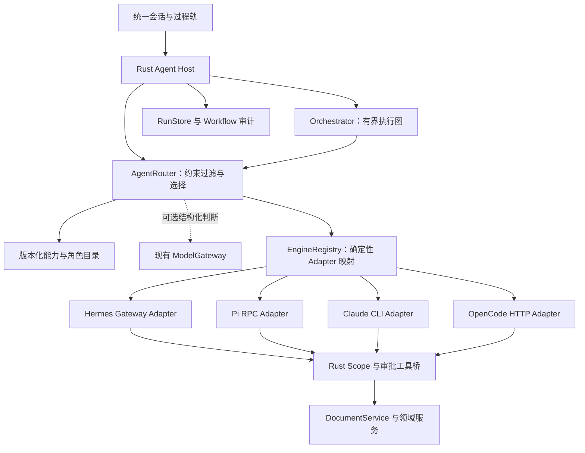

AgentRouter 决定“交给哪个合法执行器”；Adapter 决定“如何调用该执行器”；Orchestrator 决定“哪些工作先做、并行、等待或取消”。Agent 的 token/tool 循环仍由原生引擎持有，Host 不重建通用模型循环。ModelGateway 只承接无工具的路由判断等非 Agent 请求，不接管四引擎全部推理 HTTP，不新增 Node/Python 控制服务、消息中间件或 LangGraph 调度层。现有本地免鉴权兼容代理不因本设计扩大用途。

首期接点是 `agent_run_start` 在原生请求提交之前的引擎解析与准备阶段。当前 `agent/engine.rs` 并非四引擎共同实现的完整接口；目标新增薄 `EngineAdapter` 门面包住既有 Hermes Surface 和 Pi/Claude/OpenCode 分支，逐步抽离 `agent/pi/mod.rs` 的公共 prepare/claim，不要求一次改写所有 Transport。

轻量响应使用独立 `response_conversations` / `response_turns` 表，不写 `agent_threads`、`agent_runs` 或原生记忆。首次路由只接受没有显式工具上下文、已提供文本载荷的文本处理请求；项目默认目录只参与画像判断，不进入模型请求，续轮保持 ResponseConversation 身份。Host 以客户端 UUID、完整请求意图、项目归属去重，准备前获得数据库宿主锁；配置版本与选定模型冻结后只读取一次凭据，派发前复核。最多两个响应在途、单会话一轮，单次 HTTP 不重试、不重定向、响应体有界；ModelGateway 对解析后的 localhost 或 loopback IP 使用直连连接池，避免系统代理把本机模型请求转发出去，其他地址继续遵循原代理配置，不以字符串前缀判断；取消持久终态优先于迟到回复，宿主重启将 preparing/running 标 interrupted，不重放。用量缺失保留 unknown，错误只显示允许的分类。前端合并两类会话的导航投影，历史与执行分别读取，升级为 Agent 仅经显式的可编辑摘录，不伪造 engine 或 Run。

#### 23.13.2 角色、能力快照与注册表

以下为逻辑 DTO 草案，字段以双端契约实施为准：

```text
AgentProfile {
  id, version, purpose, requiredCapabilities[], allowedEffects[],
  outputSchemaId, preferredEngines[], maxTurns, maxDurationMs
}
EngineCapabilitySnapshot {
  engineId, engineVersion, adapterVersion, runtimeGeneration,
  checkedAt, expiresAt, health: ready | unavailable | unknown,
  protocols[], modelCompatibility, effectiveTools[],
  supportsHostDelegation, supportsChildIsolation, supportsMemorySuppression,
  supportsCancellation, supportsTurnLimit, recoveryMode,
  nativeSubagentMode: disabled | audited
}
RouteRequest {
  requestId, threadId, workflowId?, executionId?, profileId,
  mode: auto | explicit, requestedEngine?, boundEngine?,
  providerId, modelId, scopeSnapshotId, requiredCapabilities[],
  taskSummary, contextRefIds[], budgetReservationId, policyVersion
}
RouteDecision {
  routeId, requestId, selectedEngine, profileVersion,
  candidateSnapshotHash, reasonCode, excludedCandidates[],
  source: explicit | session_affinity | rule | llm | rule_fallback,
  policyVersion, runtimeGeneration, elapsedMs, routingUsageRef?
}
```

`AgentProfile` 定义能力与成果合同，不是任意系统提示词市场；角色偏好不能扩大工具权限。Hermes 仍遵守 DEC-020：原始用户消息不被路由器重写，角色不自动注入 system prompt、Skill 正文或历史；子任务的有界任务描述属于显式委托输入，引用通过既有附件/工具桥提供。需原生角色配置时由 Adapter 声明是否支持，并单独验证。

能力目录复用 `agent/capabilities.rs` 的真实数据源，但管理界面的长探测（当前可达 25 秒）不进入路由热路径。健康快照建议 TTL 30 秒，版本槽/配置/权限变化立即失效；陈旧或 unknown 状态只作为待探测，不能等价 ready。候选探测并发且有独立短截止时间，超时排除并保留原因；进入所选 Adapter 的 prepare 时再次检查实际二进制、模型协议、凭据可访问性与权限代次。Keychain 交互计为独立准备阶段，不被伪装成路由计算慢或静默切模型。

注册表是 Rust 编译期白名单 `EngineId → Arc<dyn EngineAdapter>`，目前只允许 `hermes / pi / claude_code / opencode`。LLM、前端、资料内容都不能构造 executable path、导入 npm 包、填写任意 URL 或修改注册表。新增引擎要求实现 Adapter、有效能力合同和原生二进制验证；普通新角色只改版本化 Profile。

#### 23.13.3 如何路由到指定 SDK / 原生协议

| EngineId | 本仓库首选调用路径 | 上游 SDK 的位置 | 协作开启前的缺口 |
|---|---|---|---|
| `hermes` | 既有 Gateway JSON-RPC / WebSocket：原生 Session、输入、事件、取消 | 不引入新的 SDK wrapper；沿用现有 Surface Adapter | 验证逐子任务身份、只读边界、迭代上限、取消及按 Session 关闭原生记忆；不能证明则仅单 Agent |
| `pi` | 既有独立二进制 JSONL RPC 与权限扩展 | 上游提供 `createAgentSession` 等 JS SDK；Rust 产品继续用 RPC | 新增受鉴权的委托工具与内部 Session 隔离；关闭扩展的递归委托 |
| `claude_code` | 既有官方 CLI stream-json + 私有 MCP + 原生 Session | Claude Agent SDK 可配置 `agents`；当前产品不依赖其 JS/Python 宿主 | 当前 mapper 会忽略带 `parent_tool_use_id` 的子事件；原生子代理须先补归属映射和完整门禁，不能直接开 Agent 工具 |
| `opencode` | 既有认证 HTTP / SSE + 私有 HOME / Session / Host MCP | 官方 SDK 是 server/client 接口，可创建 Session 和发送 prompt；Rust 直接调用受支持服务 API | 当前受控配置限制原生工具；须验证子 Session、task 权限、取消和成本映射后才开放原生委托 |

官方接口依据：[Pi SDK](https://github.com/earendil-works/pi/blob/main/packages/coding-agent/docs/sdk.md)、[Claude SDK Subagents](https://code.claude.com/docs/en/agent-sdk/subagents)、[OpenCode SDK](https://opencode.ai/docs/sdk/)、[OpenCode Agents](https://opencode.ai/docs/agents/)。核对日期为 2026-10-13；文档里的最新字段不自动适用于仓库钉扎的 Pi 0.85.1、Claude 最低 2.1.233 或 OpenCode 1.18.31。是否支持以实际解析到的版本与兼容测试为准。

```text
EngineAdapter（目标语义接口）
  capabilities() -> EngineCapabilitySnapshot
  prepare(ExecutionSpec) -> PreparedExecution
  start(PreparedExecution, eventSink, cancellation) -> ExecutionHandle
  respondApproval(handle, decision)
  respondClarification(handle, answer)
  cancel(handle) -> StopReceipt
  reconcile(binding, lastNativeCursor) -> RecoveryObservation
```

`ExecutionSpec` 包含 Host 生成的身份、模型快照引用、作用域、工具租约、原生历史绑定、预算与原始输入/任务包引用；密钥只在受监督启动时短期注入，不出现在可序列化路由结果。`prepare` 可核验配置和创建空 Session，但不得提交任务、触发模型/工具副作用；任何例外必须声明并阻止首发自动改选。`start` 是唯一派发边界。没有同等原生能力的方法返回结构化 unsupported，不模拟成功。

具体分派只相当于 `registry.get(decision.selectedEngine).start(prepared)`。模型不能直接调用 SDK；SDK/CLI 方法名、进程参数和协议适配全部在受审代码中。`resume` 不是普遍的活跃轮次续接：Hermes 按 §7.4 对账，Pi/Claude/OpenCode 按各自实际恢复策略处理；私有历史可用于下一轮不等于崩溃前工具可安全重放。

#### 23.13.4 路由算法与提交边界

1. Host 校验用户输入、Thread 与当前授权，冻结最小 ScopeSnapshot / 模型快照。已有原生 Session 绑定优先；手选或原生 Skill 约束有冲突即失败，不能“挑一个可用的”覆盖冲突。
2. 从注册表快照筛选版本、协议、实际工具、权限、资源及协作能力。`requiredCapabilities` 是需求，不是授权；LLM 推断遗漏不会放宽执行期工具门禁。
3. 零候选返回 `NO_ELIGIBLE_ENGINE`；单候选规则直达；多个候选先用版本化角色偏好形成稳定排序。AR-S0 只审计，AR-S1 才允许 LLM 在候选中选择。
4. 路由 LLM 输入限用户任务摘要（最多 2000 字符）、上下文类型、Profile 和候选能力摘要；不载入附件正文、全量历史、密钥、工具输出或云端记忆。输出仅 `{candidateId, reasonCode}`，严格 schema、未知字段拒绝，最大 256 输出 token，硬超时 1500ms，不自动重试。无兼容 ModelGateway 路由模型时直接规则选择。
5. Host 再验证结果属于同一候选快照；使用任意 confidence 分数均不能越过硬约束。超时/非法值只选既有合法规则候选；准备阶段的新事实使全部候选失效则失败。
6. 按 §23.13.13～15 先锁定提交意图，事务外完成所选 Adapter prepare，再原子 claim Run 并固化路由、版本/槽、权限代次与派发意图。提交前重核授权、取消状态和预算；更新槽不能替换已准备的路径。
7. 持久化 dispatch intent 后才调用 `start`；从“开始尝试提交”起禁止自动跨引擎回退。返回原生 Session/运行身份立即保存映射，再持久化事件并向 UI 发布。

根会话一旦提交或已有原生运行即固定引擎；即使“没有看到 token”也不构成安全重试证据。S1 首版不自动改选。后续独立验收后，首次尚未提交、prepare 明确无任务副作用的自动会话才可改选剩余候选，最多 1 次，路由审计保留两次决定；显式手选不自动改选。空 Session 创建失败或清理不明时登记残留引用，不能误把 Session 创建成功当成任务执行完成。

派发状态目标为 `prepared → dispatching → acknowledged → running → terminal`，另有 `dispatch_unknown`。SQLite 与外部进程/HTTP 不具备分布式事务；Host 在 dispatching 后崩溃，即使收不到 ack，也可能已经执行。恢复先按原生身份/关联号核实；无法核实则停在 unknown、阻止新派发，不宣传外部 exactly-once。幂等键只保证 Host 不重复建节点或审批；工具副作用是否可重试由具体领域服务合同决定。

#### 23.13.5 Host SubAgent 工具合同

资料版本核验采用 Host 保存的不可变证据清单：引用 ID 绑定 canonical 文件路径与 SHA-256，受管文档另绑定文档 ID、项目身份与正文 version。子任务读取返回的同一份字节须与清单一致；接收成果时再次核对全部输入引用的版本、可见性和可读性，资料变化返回冲突，不能把旧分析记作当前成功。清单最多 20 项、每项最多 1 MiB；目录范围不自动生成文件证据，网页引用须由联网工具另外登记获取时的版本，不接受模型自报路径或摘要作为版本。该核验是协作派发的前置能力，不单独启用委托入口。

当前基础合同由 `agent/orchestration/contracts.rs`、`scope.rs`、`evidence.rs` 与 `store.rs` 实现：严格委托/结果字段、冻结引用与版本复核、去重、四子上限/单子在途、租约撤销、截止时间、代次及未知恢复。2026-10-15 已将 Workflow/Execution、Scope/证据和内部 Thread 注册表接入生产数据库初始化；普通发送、历史、原生 Session 操作、移动、归档和删除入口显式检查内部所有权，根 Workflow 活跃时保持根会话锁。普通提交与子 Run claim 共用全应用两个名额；子 Run、内部 Thread 和 Execution 绑定在同一 IMMEDIATE 事务内完成；收到原生首个 turn_start 事件后才登记启动确认，写入派发意图或发送 prompt 均不能冒充原生回执，派发未知继续占名额。

首条原生桥为 `native_child.rs` → 既有 Pi Transport：仅对 Host 已建立的只读 Workflow 注册 delegate/await/cancel，以原生 tool-call ID 去重；子任务使用独立原生 Session，不复制父历史，不挂 RunMemory，不继承父工作副本或写权限。当前仅 Pi 0.85.1 + Plan 父任务 + 冻结文件读取；子任务工具面仅 read，拒绝受管文档、网页和嵌套委托。本地合成模型驱动真实父子 Pi 进程，已验证委托、读取、等待、汇总及整树取消；不是云端模型或真实 Tauri 协作验收。

`supervisor.rs` 以实际 Run 终态对账；停止先撤销租约再发信号，原生进程未确认退出保留 recovering 和名额。Pi 在每次 Provider 请求前执行次数/截止门禁，缺失预算拒绝请求；子任务最多 8 次，工具循环不能先发第 9 次再报超限。适配器错误路径也执行进程清理并等待退出；无法核实退出时不标记 cancelled。内部运行不召回/同步长期记忆；Pi 根任务仅在 Workflow 整体成功后以 workflowId 同步最终输入/答案，此同步边界仍待真实云端验收。

正式协作能力开关仍关闭；Debug 构建通过 `agent_workflow_preview_available` 暴露仅本轮授权入口，非 Debug 的 Host admission 直接拒绝该请求，前端隐藏授权控件。已接 Workflow 原子创建与有界过程/终态投影，本机合成模型已通过真实 Tauri 完成/取消路径；不能据此声称 S2 全阶段可交付。旧二进制最低数据版本门禁、未知原生进程恢复对账、内部原生 Session 文件 TTL 清理、其它引擎/文档/网页子任务、整体用量聚合及有界 DAG 仍未完成；需要这些门禁和真实宿主验收后才开放。

2026-10-15 Host 工具桥验收补证：真实 Gateway handler/turn runner 本地模型两轮合同与实际 Tauri + DeepSeek 新会话均通过，后者包含拒绝无落盘、允许一次、后续新审批、审批中停止和 Plan 拒绝写入。真实包为此前已授权版本；新 approvalId 请求身份隔离仍只有源码/自动测试证据，尚不能宣称最新源码全部已宿主验收。

工作流的有效截止时间取整轮预算与持久范围租约截止时间的较小值。到期巡检须在同一事务撤销范围、取消排队节点并将已派发节点置于停止待确认；到期本身不证明原生进程已退出。正常收尾必须读取根 Run 的权威终态，且所有子节点均已终止；子节点失败或部分完成时不能聚合为全部成功。终态结果引用只由 Host 提供，旧回执不可覆盖终态，收尾同时撤销范围。上述存储接口仍需生产调度器接入后才产生用户可用协作。

AR-S2 新增受控工具 `delegate_task`，仅注册到通过安全验证的父执行器。示例为目标协议，不代表当前 MCP 已提供：

```json
{
  "profileId": "researcher",
  "objective": "核对已附加资料中三个关键结论的来源",
  "contextRefIds": ["ref-a", "ref-b"],
  "requiredCapabilities": ["web.read", "document.read"],
  "outputSchemaId": "evidence-review.v1"
}
```

Host 从工具通道的真实 `runId + toolCallId` 解析父身份；不接受模型提交 parent/root ID、任意 threadId、密钥、裸文件路径或权限提升参数。以 `(parentRunId, toolCallId)` 唯一去重，校验 Profile/schema 白名单、作用域子集、引用可见性、深度与剩余预算，原子创建子执行节点/内部 Thread 后返回 `{executionId, status}`。`await_task` 和 `cancel_task` 只接受同一父执行节点拥有的子 ID；等待返回有界结构化结果或明确 pending/failed，不直接把自然语言结论当成功状态。

```text
ChildResult {
  executionId, status: succeeded | partial | failed | cancelled,
  summary, findings[], evidenceRefs[], artifactRefs[],
  unresolved[], effects[], usageRefs[]
}
```

所有结果长度有界；首版摘要 ≤2000 字符、证据引用 ≤20 个、序列化结果 ≤32 KiB，超限返回截断标记及 Host 成果引用。`effects` 由 Host 工具审计补齐，不能信任模型自报“未修改”；`usageRefs` 来自真实用量来源。结果通过原父工具调用返回主 Session，不拼接子 transcript。无法安全注册这些工具的引擎不作为委托父节点；无法隔离权限/原生记忆的引擎也不作为子节点。

S2 产品接入切片：`readOnlyCollaboration` 是发送意图中的显式布尔授权，默认 false；Host 候选硬过滤仅允许通过版本门禁的 Pi 父节点，保持原 Session 亲和。Prepare 冻结显式文件证据，claim 在同一事务内持久化 Scope、证据、根 Run/消息及 Workflow，任何失败全部回滚。只读工作流快照从根 Run 查询，返回独立控制序号、总体状态与最多四个子节点的有界摘要，不返回内部 Thread、原生 Session 或私有路径；前端在 agentStore 保存按根 Run 隔离的投影，仅可见且活跃的流程查询更新。终态立即停止刷新，重挂载从快照恢复；原生事件仍归各自 Run，不复制子正文流到根消息。投影为首版状态查询，不宣称已实现完整跨节点事件 replay。

结果优先的前端投影：LightResponsePanel 复用 `sn-chat-*` 阅读列、消息与输入区视觉，仍使用独立 ResponseTurn 生命周期；WorkflowProgress 保持锁与轮询逻辑常驻，只有子任务内容按需展开。ProjectChatPanel 不挂载 RunRoutingDetails，WorkflowProgress 不接受路由详情插槽，展示与引擎类型无关；Host 路由快照/审计契约保留供工程诊断。子任务标签使用 executionId 作为内部稳定 key，显示 objective、状态、摘要和未解决项；前端仅按真实快照计算已完成数量，失败/取消不能计入成功；不改调度器或新增模型调用。WorkflowProgress 的收起条件同时要求整体 succeeded、未锁定、全部子项 succeeded 且 unresolved 为空；展开状态按 Run 隔离，已选择子结果阻止完成时自动收起。详情关闭恢复触发按钮焦点，不创建新事件或改变快照锁。ProcessRail 接收结果动作插槽，保持过程明细与异常提示为整行，不增加计时器。运行态依据实际 ToolCard 展示最近三项归并进展，按最近事件排序并优先保留进行中项；用户可展开全部，终态自动收起。状态明确区分已完成、进行中、失败和终态下未确认的工具，不推断百分比或未来步骤。当前动作的无障碍播报与秒级计时分离，避免重复播报。过程区置于滚动区内，不挤占 Composer；异常/恢复提示放在折叠内容外，隐藏详情不解锁或停止监听。 轻量对话使用现有 near-bottom 判断，按本地阅读状态决定是否跟随最新正文；ResizeObserver 仅观察内容尺寸，不新增定时轮询，卸载即清理。提交接纳后恢复跟随；切换会话由组件 key 隔离。终态正文复用 AnswerCopyButton 与既有 Markdown 剪贴板服务，保留源码格式并区分成功/失败；更多操作只改变呈现，不改变 handoff 的范围与执行门禁。

任务目录的单条/列表读取按最新 Run 对应 Workflow 投影状态：整体成功才显示完成，取消显示已取消，partial/failed 显示失败，未核实仍显示进行中；不改写原生 Run 历史。前端已知快照同步当前轮目录状态，旧轮快照不能覆盖新轮。协作停止/失败在进度区明确提示成果缺口。

#### 23.13.6 Workflow、Thread 与 SQLite 模型

AR-S1 保留单 Run 执行链，在其前引入 §23.13.13 的 Submission 控制准备与去重；旧入口适配同一提交服务，不提前实现调度图。AR-S2 起引入 Workflow 表示一次用户发送，Execution 表示逻辑工作，既有 Run 表示一次原生尝试；重试不复用旧 Run ID。UI `tasks` 表仍是工具域任务，不能拿来保存 Agent 调度状态。

| 目标增量 | 必需字段/约束 | 所有权 |
|---|---|---|
| `agent_submissions`（S1） | 全局唯一 client_request_id、intent_hash、可空 thread_id/run_id、state/generation、配置/授权代次；详见 §23.13.13 | Run 前的提交、取消、去重与恢复；准备成功前不建 Run |
| `agent_route_decisions` | route_id、request_id、thread_id、execution_id 可空、候选摘要/hash、选择原因、模型/策略/Adapter 版本、耗时与用量引用 | 路由审计，不另存完整 Prompt 或密钥 |
| `agent_workflows` | id、root_thread_id、user_message_id、client_request_id、state、generation、budget_json、policy_version、final_result_ref | 每根 Thread 最多一个非终态 Workflow；`(root_thread_id, client_request_id)` 唯一 |
| `agent_executions` | id、workflow_id、parent_execution_id、thread_id、role/profile_version、scope_snapshot_id、state、required、output_ref、delegation_key | 父子必须同 Workflow；depth ≤1；逻辑节点结果与归属，不复制 Run 事件 |
| `agent_execution_edges`（S3） | workflow_id、from_execution_id、to_execution_id、dependency_kind | 两端同 Workflow，无自环/循环；节点创建与边插入同事务 |
| `agent_threads` 增量 | visibility=`user`/`internal`、root_thread_id、owner_execution_id 可空 | 旧行为默认 user；内部 Thread 不进普通列表，不能由普通发送/移动接口直接操作 |
| `agent_runs` 增量 | client_request_id、workflow_id、execution_id、attempt、route_id、dispatch_state、runtime_generation、scope_snapshot_id、budget_reservation_id | 旧 Run 新列可空；S1 根请求以 `(thread_id, client_request_id)` 唯一去重；S2 内部尝试用各自 Host ID。同 Thread 仍最多一个非终态 Run，同节点最多一个在途 attempt |
| `agent_workflow_events` | workflow_id、seq、event_id、execution_id、kind、source_run_event_id 可空、control_payload | 只存编排事件与原生事件引用，不复制正文 delta；唯一 source 引用去重 |

ScopeSnapshot 沿用 §7.5 / NEXT-031/035 的设计，实施时补不可变持久引用及 authorization generation；路由快照不能代替授权。一个内部 Thread 首次绑定一个引擎与原生 Session，不共享根 `external_session_id`。内部 Thread 只服务所属执行节点的尝试；父计划与最终汇总可按顺序使用根 Thread 的同一原生 Session，但对应不同 Execution/Run。

首次用户发送只写一条用户消息。规划、委托与合成提示标为内部来源；UI 不将每个原生 Run 的回答都渲染成用户可见最终答案，最终用户回答仅由 Workflow 的指定输出节点发布。原生审计完整保留。规划 Run 的终态不解除根会话发送锁；门禁同时检查非终态 Submission、Run 和 Workflow；同一 Submission 的内部状态推进不视为新发送。同根重复发送按 client_request_id 幂等返回，不同请求在锁内拒绝；不要通过扩大每 Thread 并发绕开约束。

实施补充：内部 Thread 的归属以 `agent_internal_threads(thread_id, root_thread_id, execution_id)` 不可变注册表持久化，避免在普通 Thread DTO 中暴露编排身份。内部记录同时保持 archived 标记，兼容旧版普通列表过滤；新版普通历史、原生 Session 操作与发送入口仍须显式拒绝内部身份，不能仅靠界面隐藏。数据库触发器保护所有权、活跃 Workflow 的根移动/归档/删除及内部 Run 绑定；根删除在同一事务清理自有内部记录。旧二进制没有协作隔离合同，启用协作前仍必须关闭旧实例，不能把兼容隐藏声称为旧客户端完整授权保护。

内部会话必须随根归档/删除策略管理：先确认所有后代已停止与租约撤销，再归档、按 TTL 清理自有原生引用；不能删用户在外部客户端创建的 Session。根会话移动项目、删除归属或缩小范围时，有在途 Workflow 必须先停止并核实；不能只检查根 latest Run 是否结束。

#### 23.13.7 有界 MultiAgent 调度

AR-S2 仅父 → 子 → 父单层委托。AR-S3 支持固定拓扑 `plan → [research_a, research_b] → synthesize → proposal`；proposal 可为不调用模型的 Host 验证节点。计划来自版本化模板或模型结构化提案，但必须由 Host 校验节点数、边、能力、预算、必需/可选依赖及输出 schema 后才执行。首版不开放可视化 DAG 编辑器、不动态递归扩图。

Host 以拓扑就绪队列执行：必需依赖成功才入队；必需依赖失败使下游 blocked，整轮返回失败及已完成成果；可选依赖失败可继续，但聚合明确缺口。工作流状态为 `queued / running / waiting_input / cancelling / recovering / succeeded / partial / failed / cancelled / interrupted`，终态通过 CAS 唯一落库。`dispatch_unknown` 节点使整轮 recovering，直到核实或明确人工处置，不当作已完成节点。

原生全应用并发初值 2，根与子均占令牌；S2 活跃父 + 单子可运行，若只剩 1 个总容量则不接受同步子委托并让父继续单 Agent。S3 的规划 Run 先完成、释放令牌，才运行最多 2 个只读节点，收齐后续用根 Session 汇总。等待工具结果但仍活跃的原生循环不释放令牌；只有 Adapter 能证明已暂停并禁止后续模型/工具执行时才可另议。调度器公平排队，不能预占全部名额再等待自己的后代。

首期子节点仅 `document.read / file.read / web.read` 等已验证只读工具，不使用 shell 伪装只读。只读工具范围以父 Scope 中可读路径的子集冻结；执行时再次 canonicalize，链接逃逸或资料路径变化不能扩大到父工作区。即使原生 SDK 仍提出 write/edit/bash 请求，Rust 也拒绝且不弹出可批准卡片；子节点联网须单独包含 web.read。读阶段不派发同目标的 Agent 写；最终单写者持有全应用 target lease（文档 ID 或 canonical workspace root），不同根任务也参与互斥。原生进程或工具无法遵守写 lease 的执行模式排除出协作候选。用户手工编辑和外部程序不受此锁控制，仍依靠 content hash/baseVersion、TextAnchor 和 CAS 检测冲突。代码写与命令能力按既有门禁开放，不因 DAG 自动获准。

#### 23.13.8 上下文、审批与记忆

`TaskContextPackage` 只保存/传递目标、用户约束、Host 校验的 context refs、证据版本、已完成发现、未解决项与真实副作用引用；正文按授权按需读取。子节点返回的 URL、文档 ID、路径与引用均重新验证，不能把子结果或网页中的指令升级为 Host 策略。根 Session 保存自己看到的简要子结果，不导入子 Session 全历史。

单 Run 的 Host 工具桥先落实逐请求审批：前端必须回传卡片的 `approvalId`，控制通道按 Run 隔离，工具桥只消费与当前不可变请求匹配的 ID 和 once/deny；迟到、重复和其它请求的决定不能授权后续操作。等待期限使用固定截止时间，错误 ID 不延长等待；取消仍在执行前复核。卡片状态随请求身份重建，前一卡片的迟到回包不能把下一张卡片标成已提交。这不等于已实现 Workflow 的 Scope generation 合同。

审批主键逻辑绑定 `(workflowId, executionId, runId, toolCallId, actionHash, scopeGeneration)`。父任务批准过某次操作，不等于批准子节点或重试；更换参数、目标、代次即旧审批失效。既有会话级授权只有在策略明确包含该子执行模式、目标和动作时才可复用，首期一律子任务只读。Plan/Ask/Accept edits 由 Rust 策略执行，Profile 和模型提示均不能取消它。取消时原子撤销派发与工具租约，审批回包晚到也不能重新启动节点。

长期记忆遵循 §23.12，并增加 Workflow 级边界：路由判断不读写记忆；多节点首期所有内部运行关闭自动 recall/sync，根任务只在开始时按原有授权召回一次并作为不可信参考，按需要给子任务最小引用。只有整体成功后同步“原始用户输入 + 唯一最终答案”，以 workflowId 去重。当前 Pi 协作路径已由 Workflow 整体成功门禁接管同步；Claude/OpenCode 的协作钩子仍须适配，Hermes 原生插件若不能按 Session 抑制中间同步，不加入多节点候选。不能全局关闭插件而影响并行的普通会话。

OpenViking 不做 DAG 黑板、跨 Agent 消息总线或本地恢复状态存储。记忆连接异常不阻塞主任务，但外发授权撤回须阻止后续同步。云端身份共享不等于项目级可见性；Host 引用授权仍是最后边界。

#### 23.13.9 事件投影、取消与恢复

原生事件继续 RunStore-first。AR-S2 才升级双端事件合同：保留现有 runId/seq，新增可空 workflowId/executionId/parentExecutionId 与 actor；旧事件仍可读取，新子事件不得按根 Run 的 seq 直接归并。`workflow_seq` 是编排投影独立游标，不冒充原生顺序；跨子节点只保证 Host 持久化顺序，不推断真实并发因果。

原生 Run 事件落库与其 Workflow 引用在同一 SQLite 事务完成，再发 Channel；控制事件如 execution_queued、dependency_blocked、workflow_completed 自身入编排表。replay/snapshot 通过 source_run_event_id 取正文，避免第二份消息真相源。前端只在 `agentStore` 增加 Workflow/Execution 索引，四个既有 store 仍分离；`changeSessionStore` 继续拥有文档审批状态。

整体停止先写 cancelling、增加 generation、封住新派发并撤销租约，再取消各原生句柄与队列。对子进程按所有权优雅终止、超时强杀并验证退出；共享 Hermes 服务只能中断所属 Session，不能杀整个 Gateway 影响其他会话。默认停止宽限 5 秒，未核实停止则保留 recovering/等待核实，不释放可能仍在写的目标锁。子任务停止只影响该节点及必需依赖，整体状态由依赖策略计算。迟到 delta 保留审计但不改写已发布最终答案；不得让旧终态解锁新 Workflow。

重启先恢复锁与未知派发，再调用各 Adapter.reconcile；按原生 Session/工具审计确认运行、停止或已提交结果。没有原生活跃轮次恢复能力时只允许标 interrupted，不自动重放。仍有任何未核实外部副作用时维持恢复门禁；确认只读且已停止的失败节点可由用户显式重试，生成新 attempt，并重新校验范围、预算和输入版本。已完成写入不因重试再做一次。

#### 23.13.10 预算、质量与可观测性

BudgetCoordinator 管整轮时限、节点数、深度、原生迭代和并发，数值以 PRD 为真相源；先预留子预算再启动，终态归还未用份额。整轮 deadline 为父子共同上界；单子 deadline 取父剩余与角色上限较小值，等待审批也受整轮时限约束，到期撤销待处理操作并返回可恢复状态。预算耗尽停止新增任务并尝试有界汇总，不伪造全部完成。

路由调用是 Host ModelGateway 新产生的真实用量，使用独立 source=`host_router` 和 request ID；引擎消耗仍来自四个原生账本。Host 只保存预算预留、用量引用和聚合投影，不复制整份引擎 Token 明细，不把 parent inclusive usage 再加一次 child usage。适配器须注明用量是 leaf 还是包含子任务的总量；无法拆分时按权威总量展示并标无法细分。价格未知、延迟到账、原生重试未上报都标 unknown；无请求前可执行的成本上界时不承诺硬费用封顶。

RouteTrace 记录输入指纹、策略/Profile/Adapter/引擎版本、候选排除原因、最终选择、是否规则降级、耗时；执行 Trace 关联 Workflow/Execution/Run/工具审批/成果版本。普通日志不存 Prompt 正文、附件正文或凭据，不外发诊断遥测。指标分清 routing latency、prepare/冷启动、首 token、总完成时间、取消确认时间、任务成功率、审批拒绝率和真实成本；模型自评/路由 confidence 不能作为成功真相。

初始优化采用离线黄金集与仅路由影子判断；对同等合法候选比较任务质量/成本/延迟，先记录可解释规则，再调整权重。每次策略升级固化 policyVersion，保留回退；不在有写入副作用的真实任务上双跑评测，也不首期引入在线探索或自动训练路由器。

#### 23.13.11 实施映射、迁移与验收

| 阶段 | 代码落点（目标） | 必须保持/新增的契约 |
|---|---|---|
| AR-S0 | `agent/routing.rs`、`agent/registry.rs`、Adapter 门面；复用 `capabilities.rs`、`commands.rs` 与现有四引擎 transport | 明确硬过滤与会话亲和；手选输出、历史、审批、取消不回归 |
| AR-S1 | `agent_run_start` 路由接点、现有 `model/*` 结构化调用、`tauri.ts`、Composer 与能力详情 | 自动/显式请求的双端合同；LLM 结果验证、派发边界、版本快照与取消竞态 |
| AR-S2 | `agent/orchestration/*`、RunStore/schema、工具桥、`agentStore` 与过程轨；复用现有 Scope/权限模块 | Workflow/内部 Thread、委托身份、深度/预算、子事件、根锁、停止恢复和记忆抑制 |
| AR-S3 | 同一 orchestration 模块增加 DAG 与 target lease | 有限拓扑、规划/执行/汇总分阶段、两只读并发、单写者、全局资源降级 |

新增表/列沿用 `create_schema/ensure_columns` 幂等迁移，旧数据不重写原生 Session，不回填虚构 Workflow。受支持的新版本以可空字段读旧数据；内部 Thread 的查询/搜索/归档过滤、所有命令的 owner 校验与根锁必须同批上线，再开启 S2。功能开关建议为 `agent.routing.enabled`、`agent.delegation.enabled`、`agent.multi_agent.enabled`，初始关闭，依赖顺序为 routing → delegation → multi_agent。关闭开关停止接受新协作任务，保留既有恢复/审批/取消路径直到任务终止。

运行于旧二进制不能靠“加列兼容”推断安全：旧版可能把 internal Thread 当普通会话。启用 S2 前须具备数据格式最低读写版本门禁；降级只能使用受支持版本或预先备份的完整数据根，不允许旧版直接打开新增内部会话的库。单引擎回退开关与二进制/数据回滚是两种不同操作。

实施验证映射：① Rust 路由纯函数/注册表/恶意候选与 schema；② SQLite claim、幂等、DAG、根锁与派发未知窗口故障注入；③ 四种真实二进制的原生 Session/流式/工具/取消契约（HTTP 夹具不能代替真实供应商验收）；④ 双端事件与内部 Thread 不泄露、父子审批归属；⑤ 文档冲突与取消副作用；⑥ 真实 Tauri 黄金任务及 50 KB 编辑并行性能。PRD §15.8 是交付标准；现有 `sophonote-current-architecture.*` 继续表示已实现架构，不能在代码落地前把本节目标节点画成当前能力。

#### 23.13.12 设计缺口收敛与实现顺序（目标合同）

当前实现已具有注册表、预筛选、观察缓存、影子推荐及共享模型/凭据准备，缺少自动执行需要的提交控制与完整派发准备。按以下顺序实施；影子模块只提供实验数据，不逐步叠加成另一套派发器。

| 缺口 | 确定设计 | 首个落点 / 退出条件 |
|---|---|---|
| auto 与 EngineId 混用 | `RoutingIntent = explicit(engine) / auto`；EngineId 永远只有四个；缺省旧请求保持原语义 | 新 DTO 与旧参数适配同一入口，禁用 auto 必须结构化拒绝 |
| Run 前无取消/去重身份 | S1 新增 Submission，S2 才新增 Workflow；先持久化提交身份再异步准备 | start/status/cancel/replay 双端契约、重挂载与重复发送测试 |
| 建议尚非可派发结果 | 分离 MetadataScreen、Probe、Prepare、Commit；用不可序列化的单次 PreparedExecution 消费派发许可 | 模型/凭据先统一，再抽公共作用域与资源租约 |
| 默认模型及 Hermes 别名漂移 | 冻结 Host provider 实例/model/配置代次，Adapter 只做明确的协议映射 | 模糊映射拒绝，配置变化后不混用旧 key 与新 URL |
| claim 与 prepare 顺序不一致 | 提交锁先于准备；Run claim 在准备完成后、原生输入提交前 | 原子 claim + dispatch intent + 单次消费；未知状态锁住重试 |
| 跨根资源与父等待 | NativeRunLease 全 App 共用；探测 Semaphore 另算，不占执行名额 | 手动和自动、父与子都纳入同一账本，不靠每 Thread 限流代替 |
| 协作输出未形成闭合合同 | 版本化角色/结果、去重委托、权限交集、引用重验、显式重试 | 首期只有单层只读，父资格与子资格分别验证 |
| 发布与故障判定笼统 | 80 例黄金集 + 故障窗口矩阵 + 独立开关回滚 | 代码覆盖、真实 Runtime、供应商、Tauri 分别记证据 |

2026-10-14 入口收敛：Composer 不再暴露执行引擎选择；新提交以自动意图进入 Host，已有 Session 保持亲和。手动协议仅作旧客户端/内部契约兼容。S1 使用可审计确定性选择，不为“智能路由”额外发送用户正文给分类模型；选中后只准备及派发一次。前端按提交快照等待 Run claim，再沿用持久 Run 事件恢复；未知提交不能创建新 ID 重发。

#### 23.13.13 提交身份、前置取消与双端协议

目标新入口为 `agent_submission_start({clientRequestId, threadId?, routing, modelSelection, contextRefs, message, permissionMode}, channel)`，立即返回 `{submissionId, state}`。`agent_submission_get` 返回已持久化的阶段、可空 threadId/runId、实际引擎、错误码及恢复动作；`agent_submission_cancel(submissionId)` 可在无 Run 时停止准备；replay 使用独立 submission seq。旧 `agent_run_start` 保留原返回值，在迁移阶段通过相同提交服务等待 Run claim；所有入口共用 Thread 排他约束，不能绕过新锁直接派发。该完整自动路由 DTO 仍为目标；当前已注册下文的手动提交 start/get/cancel 变体，复用旧请求 DTO。 首个持久化切片已提供 `agent/submission.rs` 的 SubmissionStore 与幂等建表，覆盖登记/重放、状态 CAS、准备取消、Run 同事务绑定及离线恢复/墓碑操作；旧发送入口已登记内部提交，首次接管数据库前持有 OS 文件锁并恢复旧准备状态。 早期手动切片只接受四引擎显式选择，当前 auto 与配置 epoch 已扩展，持久 scopeGeneration 尚未接通；实际状态表以 generation 防迟到回包，prepared 状态到绑定有效期 30 秒（当前手动链路另限制从登记到 claim 不超过 120 秒）。绑定函数要求调用者事务中已存在同会话、同引擎且 queued 的 Run，拒绝并发活跃 Run；它只持久化 dispatch intent，不构成原生启动许可。手动与自动入口共用提交锁与宿主独占锁，自动路径还复核配置代次。 已接入的 `submission/live.rs` 让旧 agent_run_start 为每次调用生成内部 UUIDv7 并在探测/准备前登记提交；旧返回值不变，不宣称跨调用幂等。RouteDecision 携带仅 Host 内存可见的准备凭据，Run claim 同事务核验 generation 并绑定提交；原生后台启动前持久化 queued，用户消息纳入 claim。按数据库路径持有 OS 文件独占锁至 Host 退出，获得锁后才恢复准备中断；Run 终态驱动已绑定提交收口，未知/Interrupted 保持 recovering。RunStore 及原生 claim 都校验提交所有权；准备失败标 failed，未 claim 的异步任务释放标 interrupted。数据库触发器使 Run 完成/失败/取消与提交终态同步，Run interrupted 只转 recovering；此切片的 dispatching 仅代表持久派发意图，尚无统一原生 ack。触发器同时阻止活跃提交所属 Thread 的删除/移动/归档；删除整个会话及其子记录改为同一事务，避免删除被拒绝时先丢失消息。此前端准备取消与自动入口现已编码，当前实现范围以本节开头 AR-S1 说明为准；完整协作租约与派发对账仍待后续阶段。

新增 `agent_submissions`：`id/client_request_id UNIQUE, intent_hash, routing_mode, requested_engine?, thread_id?, state, generation, config_revision, scope_generation, selected_engine?, run_id?, error_code?, created_at, updated_at`；已有 Thread 的非终态提交部分唯一索引防并发；新会话用全局唯一 clientRequestId 去重，不能只靠 `(NULL threadId, requestId)`。输入正文仍由草稿/既有消息真相源持有，审计只保存引用与加盐意图摘要，不再复制正文。准备期间上下文附件由 Host 暂存引用并绑定提交；重启不凭一份不完整摘要重建用户任务。

clientRequestId 使用 UUIDv7；首次未知 ID 只接受 24 小时内、未来偏差不超过 5 分钟的时间戳。已知 ID + 同 intent 返回原状态，已知 ID + 不同 intent 返回 REQUEST_ID_CONFLICT；终态重送不会再执行。失败准备详情默认保留 7 天，其后可清理明细；完成提交明细跟随所属 Run/Thread 生命周期；即使删除根会话，最小请求墓碑仍至少保留 7 天，重送返回 REQUEST_GONE，不重建已删除会话。旧 ID 即使已清理也因时间窗拒绝，不被重新当作新任务。修正输入或显式重试必须创建新 ID；时钟异常保留草稿并提示校准。此幂等规则只约束 Host，不声称原生副作用 exactly-once。

Submission 状态：`accepted → preparing → waiting_credentials? → prepared → dispatching → running → terminal`，终态为 `succeeded/failed/cancelled/interrupted`，可从未派发阶段转 `cancelled/failed/interrupted`；`dispatching` 中断转 `recovering`。Run 尚未创建时，取消先以事务推进 generation 与终态，再释放准备资源；尚在 Keychain/阻塞校验内的结果带旧 generation，回到 Host 时丢弃。等待系统授权的默认准备 deadline 为 120 秒，且不延长从 accepted 开始计算的整轮 10 分钟预算。凭据读取在受限阻塞任务中执行，同一 provider 的在途读取合并等待，分别核对各提交取消代次；绝不在持有 SQLite 写事务时等待系统或网络；不可中断调用的收尾时间不伪装成已取消进程。

前端在 agentStore 内维护 Submission 映射与乐观消息，不新建第五个业务 store；`accepted/preparing` 阶段锁住同一草稿发送，显示停止。claim 事件把同一乐观消息绑定到正式 user_message_id；失败保留原草稿，重连通过 submissionId 查询，不能仅因 Channel 丢失再调 start。关闭窗口不等于取消，显式停止才取消；应用退出先收口控制状态，重启依数据库恢复门禁。

当前已实现**手动提交**协议：`agent_submission_start({clientRequestId, request: AgentRunStartArgs}, onEvent)` 要求明确四引擎之一，返回状态快照并在后台准备；重复 ID 返回原快照，不重新订阅或派发。`agent_submission_get(submissionId)` 查询阶段、generation、threadId/runId 和取消意图；事件沿用已有 Run seq/replay，尚无独立 Submission 事件流。`agent_submission_cancel(submissionId)` 在 claim 前原子取消并推进 generation；claim 后只持久化 cancel_requested 并通知原生令牌，结果未知不标 cancelled。两个原生启动入口必须先注册令牌再读取持久取消位，消除 claim 与令牌登记之间的漏取消窗口；读取取消位失败则取消启动。手动接口仅作兼容，不授予协作或新模型/权限能力；自动产品入口使用本节开头列出的 S1 约束。`src/services/agentSubmission.ts` 提供 UUIDv7 生成、深复制冻结的请求封套和 start/get/cancel 类型化客户端及契约测试，Composer 已改用 `agent_submission_auto_start`；`agent_submission_find(clientRequestId)` 专门恢复丢失的首次回包。自动入口不接受 engine 字段；宿主交互验收仍待完成。

#### 23.13.14 统一准备合同与模型身份

准备分为两层：①只读候选预检可以并发、无凭据/Session/模型调用；②按稳定规则选择一个候选后串行 prepare，读取一次所选凭据、解析实际作用域、保留资源和原生运行时槽。S1 prepare 失败不自动尝试其它引擎，避免多次系统授权和未确认 Session 残留；§23.13.4 的一次安全改选留作独立后续门禁。

`ModelSelectionSnapshot` 固定 `{hostProviderId, modelId, configuredProtocol, endpointIdentity, configRevision}`，供本轮所有候选比较；Adapter 生成 `NativeModelBinding`，必须保留同一供应商实例与模型 ID。Claude 只允许现有 Anthropic 映射及已验证的官方 DeepSeek 同源协议转换，不改写代理域名；Pi/OpenCode 只接受当前已接入协议。Hermes 的 `model.options` 只读目录需要与该确切 Host 实例、endpoint、模型白名单、原生 authenticated 状态一致；仅凭 kimi/moonshot 等 slug 别名或“同名模型”不能证明同一外发目的地。无法证明一对一映射时，Hermes 从自动候选排除，手动旧路径保持既有兼容行为；不能从 Runtime 默认模型反推用户意图。

模型预筛选和所选 Adapter prepare 必须调用同一个协议/模型校验函数。`requires_key=false` 跳过凭据读取，Host 准备结果保持空 key；原生协议若要求字段，沿用固定的 local-no-key 占位符而不发送历史真实密钥；不因为 Host 留有历史 key 就发送它。`requires_key=true` 才调用既有凭据服务，空值为 CREDENTIAL_MISSING，读取失败为 CREDENTIAL_UNAVAILABLE，不能降级为免密钥、切供应商或把缓存值当作授权永不过期。候选探测、影子评估和失败诊断不读取密钥。已实现的 `agent/model_preparation.rs` 由 Pi/Claude/OpenCode 的公共准备入口使用，候选预筛选复用同一 `select`；6 项单元测试覆盖免密钥不读取、实例/模型保留、缺失/不可用区分、白名单及协议映射。该模块仅为模型准备部分，不等同于完整 PreparedExecution；Hermes 身份映射和完整代次冻结仍需后续接入。

配置与凭据修改分别推进 configRevision/credentialGeneration；撤权推进 scopeGeneration。三者由 Host 管理，前端传值仅作期望值，不能自授权。PreparedExecution 为 Rust 内部不可 Clone、不可 Serialize 的单次值，包含实际 Runtime 句柄/槽引用、原生模型绑定、短期凭据、ScopeSnapshot 引用、NativeRunLease、取消 generation 与提交 ID。审计只保存代次、枚举和原因，不保存 endpoint、key、正文或工作路径。准备结果默认有效 30 秒；commit 前核对各代次、期限和取消状态，任何变化丢弃准备并返回 PREPARATION_STALE，不把新 URL 与旧 key 混在一起。

ScopeSnapshot 固定项目身份、可见文档 ID+version、canonical 根目录、显式附件引用、允许工具/网络目的范围和授权代次。路径 canonicalize 不是永久授权，文件工具每次再次校验实际路径、链接逃逸及当前授权。Profile 的 requiredCapabilities 必须是有效权限的子集；准备完成也不跳过逐工具审批、DocumentService Patch 与 CAS。受管笔记只能通过工作副本/提案写回。

NativeRunLease 初始全 App 容量 2，S1 无空闲则 RESOURCE_BUSY、保留输入，不建立隐形长队；S3 有界队列默认最多 8 个待执行节点并服从整轮 deadline。租约与 Runtime 槽在准备期间保留，commit 失败/准备取消释放；派发未知继续占位直到 reconcile。不得持有数据库事务等待租约。跨重启依据未终态 Run 重建容量，核实前 fail closed；启用自动执行前必须确认或补齐数据根独占 Host 锁，不能仅依赖开发启动脚本防止双实例；不另建分布式调度服务。

#### 23.13.15 准备、claim 与派发事务顺序

统一顺序为：先锁定 Submission/Thread 意图，事务外完成 prepare；随后单事务校验提交 generation、Thread 绑定/并发、各版本代次和预算，创建唯一 Run/用户消息、关联路由决定、绑定所选引擎并记 dispatch intent。事务失败释放 PreparedExecution，不执行任何原生输入提交。各 Adapter 的 prepare 必须声明是否创建了空原生 Session；已创建则记录所有权及清理结果，不把它当作模型已派发。

提交外部请求前先持久化 `dispatching`，然后消费 PreparedExecution 调用一次 start。收到原生身份/确认后记 `acknowledged/running`；从开始尝试提交起，异常或取消若无法证明未接受，一律 `dispatch_unknown/recovering`。不使用 token 到达与否做判据。Run claim 后 UI 只依据实际 selectedEngine 更新会话，不依赖原草稿选择。现有 RunStore 的原子审计是基础，不等于这些派发状态已全部实现。

| 故障窗口 | 持久状态与恢复动作 | 禁止行为 |
|---|---|---|
| prepare 前或中途取消/Host 退出 | Submission cancelled 或 interrupted，无 Run；丢弃迟到准备，清理自有暂存 | 不补发模型，不留永久 Thread 发送锁 |
| prepared 后、claim 前崩溃 | 准备句柄失效，启动后释放/核实本地暂存并标 interrupted | 不反序列化密钥或复用旧权限代次 |
| claim 后、原生调用前后无法区分 | dispatch intent → recovering，按关联身份核实；无证明则等待核实 | 不自动新建另一个引擎 Session 重放 |
| 原生 ack 到达、Host 落库前崩溃 | 查询属于本提交的原生身份；不能查询到则保持 unknown | 不因数据库无 ack 推断未执行 |
| Run 终态已存、Channel/窗口断开 | replay 返回同一结果与用户消息 ID | 不追加第二条用户消息/最终答案 |

统一内部错误码至少包括 ROUTING_DISABLED、NO_ELIGIBLE_ENGINE、MODEL_PROTOCOL_UNSUPPORTED、MODEL_NOT_CONFIGURED、MODEL_MAPPING_AMBIGUOUS、CREDENTIAL_MISSING、CREDENTIAL_UNAVAILABLE、SCOPE_CHANGED、RESOURCE_BUSY、PREPARATION_STALE、PREPARATION_TIMEOUT、REQUEST_ID_CONFLICT、REQUEST_EXPIRED、REQUEST_GONE、DISPATCH_UNKNOWN。错误投影给出中文 message + action（settings/runtime/reselect/retry/reconcile）；原生异常正文只作本地脱敏诊断，不拼进模型上下文或向 WebView 返回密钥。

#### 23.13.16 协作的剩余闭合合同

S2 的父资格、子资格分开注册：父须具备可鉴权的 delegate/await/cancel 工具桥及等待取消；子须具备只读工具交集、独立原生 Session、记忆抑制、轮次上限、可核实取消和可归属用量。任何一项 unknown 均为不支持协作。四引擎初始全部 false，只有带具体版本的真实合同测试通过才逐项开启；上游原生 SubAgent 仍单独关闭。

researcher/reviewer 的 requiredCapabilities 从 Host 版本化角色目录取得；模型只能增加需求不能删除角色最低需求。委托 objective ≤2000 字符、contextRefIds ≤20、请求 JSON ≤16 KiB；重复 `(parentRunId, toolCallId)` + 相同参数返回原节点，不同参数报冲突。await 默认长轮询最多 20 秒、可取消，到期返回 pending，不消耗新的子节点预算；父剩余时间不足时立即返回未完成。父仍运行时占用执行名额，容量只有 1 时不创建一个永远等待自己的子任务。

ChildResult 使用 §23.13.5 的大小限制与版本化 schema；外部事实须含来源引用、文档版本/获取时间及不确定项，Host 重新校验引用可见性和可读取性。结构错误返回 invalid_result，不把自然语言“成功”当成功。结果到达后以 Execution attempt + generation CAS 接收，重复/旧结果不覆盖新尝试。只读失败的显式重试保留逻辑节点并增加 attempt；变更目标、角色、输入版本或授权范围则创建关联的新节点并使依赖重新验证，不偷偷更新已成功节点的含义。

root cancel 优先于子成功与审批回包；所有后代工具租约撤销后，迟到成果可保留审计但不能再触发汇总或记忆同步。必需依赖失败使下游 blocked；可选依赖失败时汇总须读取 failure 标记并列缺口。Workflow 的单一 final_result_ref 用终态 CAS 发布，任何子 Run completed 都不能单独解锁根 Thread。根归档/移动项目先核实全树停止，清理仅限 Host-owned Session 与暂存，不能删除外部个人 CLI 历史。

#### 23.13.17 发布控制与交付检查点

发布策略由 Host 版本化 capability flags 决定：manual 兼容 API 保留，产品不恢复手选入口；shadow 只观测；rules 必须具备完整准备/提交合同；llm_rank 依赖 rules；host_delegation 依赖 Submission、Workflow 与持久权限；workflow_dag 依赖 delegation。任一依赖关闭时拒绝新的高阶段请求，已运行任务继续原版本策略完成或显式取消核实，不热切换执行器。SOPHONOTE_ROUTE_SHADOW 只是当前 Debug 实验开关，不能当作正式产品配置或真实执行许可。

按四个检查点推进：A 统一模型/凭据及作用域准备；B Submission 幂等、前置取消、PreparedExecution、资源与 dispatch intent；C 双端自动入口、规则派发、80 例黄金集及真实四引擎/Tauri 验收；D 单层只读委托后再 DAG。每个检查点更新 NEXT-076 原记录，不另建阶段台账。S1 首版无需 LLM 排序，先证明规则派发正确，再比较有界 LLM 排序的质量/费用收益。

80 例分组以 PRD §7.6.3 为准，机器可读输入/预期/副作用边界在 `src-tauri/tests/fixtures/agent-routing-acceptance.json`，逐例合同运行器为 `scripts/verify-agent-routing.py`。运行器核对编译后的精确测试名，零测试、忽略、超时或失败均不记通过；超时回收本次测试进程组，结果仅写 target 临时构建产物，进展只更新 NEXT-076。Host 合同和原生本地模型夹具分别计数，不外推为真实供应商或 Tauri 验收。另在五个派发故障窗口注入取消、重复事件、配置变更、授权撤回和 Host 崩溃。缓存命中规则 P95≤50ms、LLM 排序≤1500ms、热路由 P95≤2000ms 的计量排除系统授权等待但分别公开准备/冷启动耗时；没有样本与同机夹具结果不声明达标。候选越权、重复派发及内部会话泄露必须为零；默认开启属于发布决定，不能由测试开关自动升级。

## 24. 架构维护规则

- 产品范围、优先级和验收变化先更新 [PRD](./PRD.md)；组件、协议、存储、专题实现和部署变化更新本文；进展、问题和后续事项只更新[项目台账](./project-ledger.md)。
- 不再创建第二份 TODO、项目状态、逐轮进展或专项长期设计。需要新增细节时扩展本文专题章节，不另立当前真相源。
- 旧方案、审计和图表不写回本仓库：历史草稿不在树内，不要重建 `docs/history/`。
- 现行文档平铺在 `docs/`，不要重建 `docs/current/` 或 `docs/guides/`。
- 社区入口文档成对维护：英文无后缀（`README.md`），中文为 `.zh-CN.md`。本文与 PRD、台账正文以中文为真相源，不另写英文全译本。
- 当前架构图统一维护 `sophonote-current-architecture.archify.json` 与校验后的 HTML；本文 Mermaid 保持同一边界的简图，不再维护独立 Hermes 目标图。Agent 长期记忆体系只维护 §23.12，不另写专项记忆 PRD。
- 代码探查先走 graphify 图谱（`query` / `path` / `explain`），改代码后只做 AST-only `graphify update .`，用局部子图代替全库检索以减少 token；`graphify-out` 不是产品运行时，也不进入 WKWebView / Host / 引擎路径。
- 代码注释只引用 `docs/` 下的长期文档或直接描述不变量，不以历史文件和开发轮次作为实施基线。
